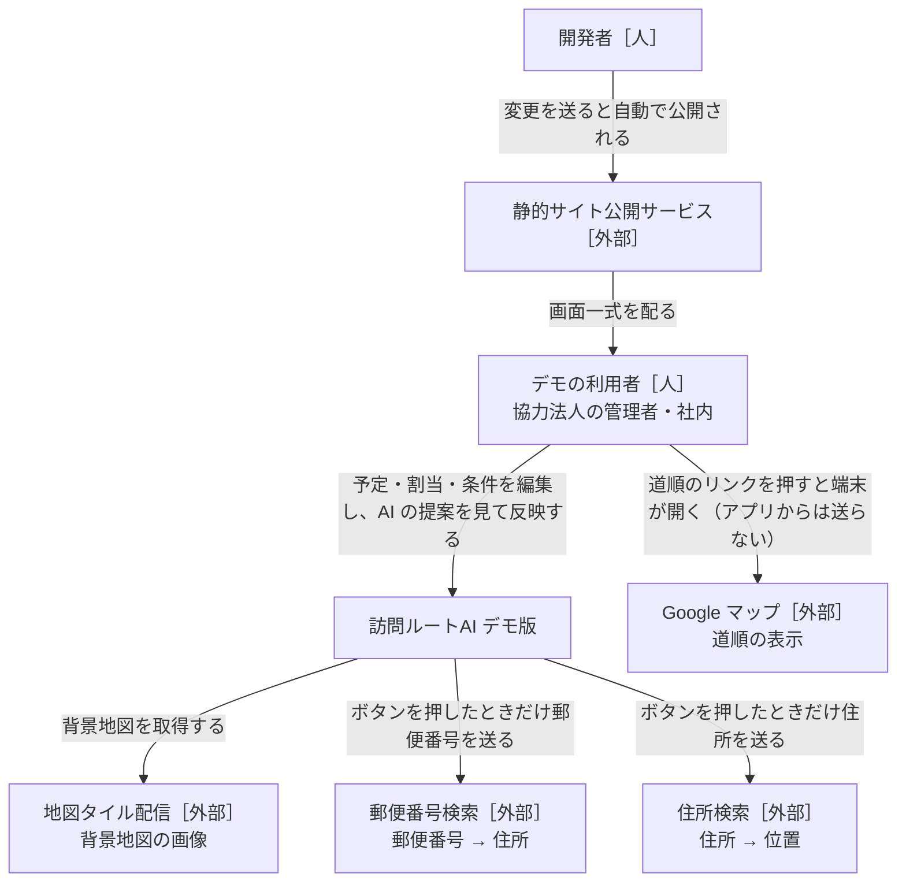
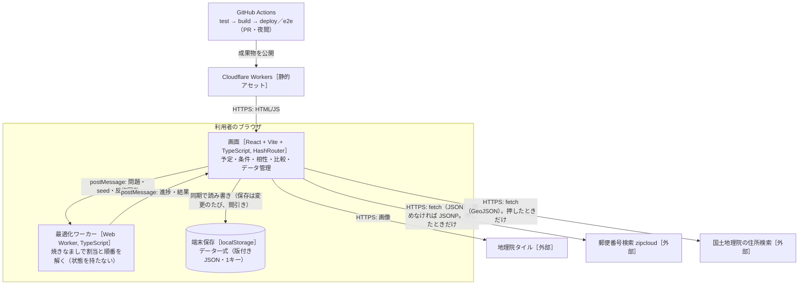
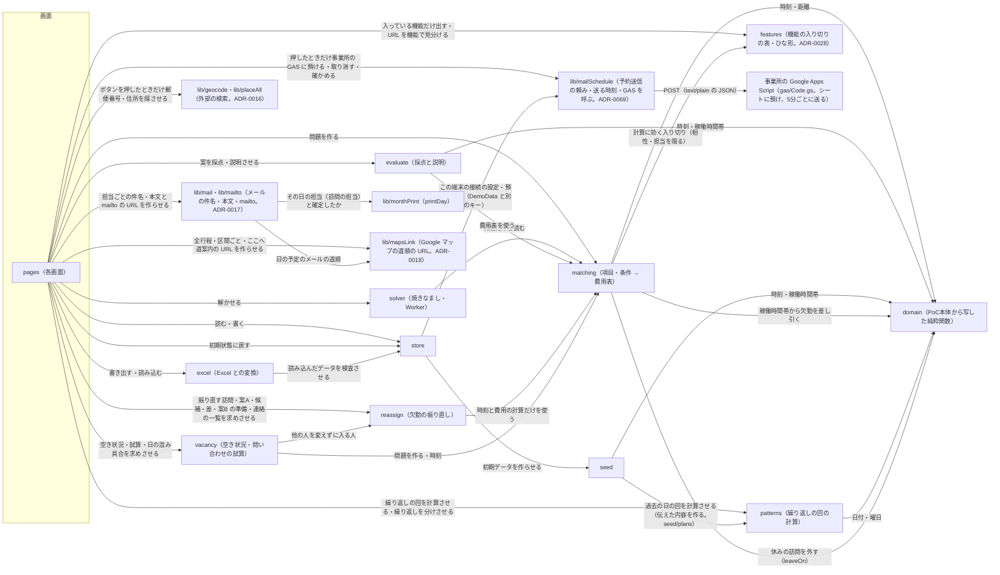

# 設計書：訪問ルートAI デモ版（ブラウザ完結）

- PRD：[docs/prd.md](prd.md)
- 作成者：松浦（草案：Claude）
- 更新日：2026-10-27
- 状態：合意済み（2026-10-11）
- 読み方：今の仕様だけを書く。判断の理由は `docs/adr/`、経緯は git の履歴、型の正は `src/contracts/`

## 1. 背景と目的

PoC本体（`katahimo-dev/visit-route-poc`）の管理者画面（予定・担当の割当・AI の提案）を、サーバーなしでブラウザだけで動く静的サイトに移し、Cloudflare Workers（静的アセット）で公開する。
データは localStorage に残し、JSON で書き出し・読み込みする。
最適化は Python（OR-Tools）の代わりに Web Worker 上の焼きなましで解き、ClassClassify のように**項目・条件・重み（0〜5）・必須**で、相性・スタッフの特性・顧客の希望を柔軟に足せるようにする。
目的は、協力法人に触ってもらって割当の考え方を集めるサイクルを速く回すこと（PRD §1）。

## 2. やらないこと

- ログイン・サーバー保存・事業所の分離・同時編集
- 外部送信は地図タイルと、ボタンを押したときの郵便番号・住所の検索（ADR-0016）と、日の予定のメールの予約送信（押したときに事業所自身の Google Apps Script へ。ADR-0069）だけ。メールはほかは `mailto:` で端末のアプリを開くだけ（送信サービス・送った記録・HTML メールなし。ADR-0017）。道順は Maps URLs のリンクだけ（経路・時間を取らず、キーの要る API は使わない。ADR-0018）
- Firebase・Cloud Functions・Python 最適化・Google Maps Platform。移動時間は直線距離からの概算（`estimateLeg`）だけ
- スタッフの記録・位置・ジオフェンス・勤怠・CSV・通知・PWA のオフライン対応、相性の学習
- 勤務シフトの自動作成、日をまたいだ最適化（範囲の AI で組むは1日ずつ。ADR-0012）、定期パターンの日付指定・祝日（ADR-0013）
- 休みでの自動の振り替え、伝えた日の自動の組み直し、決まりごとを割当の条件に使うこと、案内文の送信（ADR-0013）
- 希望休の申請・承認・日数の確認と、それを考えたシフト作成・自動の振り直し、担当を限る期間・「なるべく」、印刷の書式設定・PDF（ADR-0014）
- 実績・打刻・請求・LINE・集金。勤務の見込みは予定からの見込み。拘束の上限を AI の条件にすること、退職者の訪問の自動の作り直し、段階ごとの期日管理、紹介元とのやりとりの記録、当日キャンセルの請求（ADR-0015）
- 欠勤の受付・通知の自動送信・複数日の一括入力・有給の管理、欠勤を入れただけで振り直すこと、中止・日時変更の自動提案（ADR-0011）
- 名簿で人を消すこと（総入れ替えも終了・休止まで）、ほかのシートだけの入出力、読み込みの取り消し（ADR-0020）
- PoC本体へのコードの書き戻し。共通の純粋関数は**写して**使い、同期しない（ADR-0001）

## 3. 全体図

### L1 システムコンテキスト

### L2 コンテナ

### L3 コンポーネント

- 矢印は「読む・呼ぶ」。データを書き換えるのは store だけ
- 外部の検索（`lib/geocode`）と予約送信（`lib/mailSchedule` の `postMailSchedule`）を呼ぶのは画面だけ（ADR-0016・ADR-0069）。`lib/mail`・`lib/mailto`・`lib/mapsLink` は URL の文字を作る純粋関数で通信しない
- solver と evaluate は同じ費用表を使い、AI の提案と今の担当を**同じ物差し**で採点する

## 4. コンポーネントと責務

型・関数の形は §5。「決定的」＝乱数・`Date.now` を使わず、今日・今の時刻は引数で受ける純粋関数。

データは版2（ADR-0053）：担当は訪問に持ち（`Visit` の `staffId`・`start`・`pinned`）、AI は提案を出して「反映する」で訪問に書き、確定は〈スタッフ〉に伝えた内容（`snapshots`）。その日の担当の並びは `lib/dayPlan` の `dayRoutes`（訪問の担当と組んだ開始から作る）。

確定（伝えた）はエキスパート機能（expert）の入り切りで扱いが分かれる（ADR-0073。PRD D382）。入：今までどおり、日の画面・月・週の「確定（伝えた）」で `snapshots` に残し、あとの変更は「未連絡の変更」。切（既定）：確定の段階を出さず、今日から1か月先（今日の1か月後の同じ日。無ければ月末）までの日は、組んだ・手で直した（保存した訪問が変わった）ときに store の `update` が自動で伝えた記録を付け（`lib/settled` の `autoTell`。同じ書き方の `tellDay`）、そのあとの変更は訪問に「変更あり」の印（押すと連絡の一覧）、連絡の一覧の「連絡した」で今の担当・時刻を伝えた記録にする。メールで送る・予約したときの伝えた記録は入切によらず今どおり（`confirmByMail`）。見せ方の入切は `lib/settledView` の1か所。
- 自動の組みと決まった日：expert 切のときは伝えた（決まった）日も担当なしの訪問を自動の組みで埋める（`lib/autoArrange` の `skipsToldDays`。担当のある訪問は固定のまま動かさず、伝えた記録も書き換えない。足した訪問は伝えた内容と違うので「変更あり」）。expert 入は今のまま伝えた日を飛ばす
- 記録のタイミング（`lib/settled`）：今回増えた・日時が変わった担当なし・ピンなしの訪問（`autoTargets` と同じ条件＝自動の組みの依頼が出るもの）がある日は、組んだあとまで待つ。自動の組みの仕事が終わったら、反映した・何も書かなかったに関わらず対象の日を `settleDates` で記録する（同じ1手。繰り返しの保存からの組みで visits が変わらない日も拾う）。依頼を出さない保存（担当なしをはっきり選んだ・まとめて直す）は `UpdateOptions.settleNow` で待たない
- 拾う update：`visits` を変える予定の直しすべて（組み・手直し・ドラッグ・まとめて直す・欠勤の振り直し・最終勤務日の振り直し（offboard）・空き時間に入れる・訪問の追加・取り消し・〈利用者さん〉の終了・仮押さえの取り消し・繰り返しの保存で変わる訪問）。止める update（`tell: false`）：名簿の読み込み・予約の読み込み（担当なしで入れるだけ。ADR-0075）・古い記録を消す・訪問の種類を消す（設定。訪問の種類の外れだけで予定は変わらない）。ほかの設定（項目・条件・プリセット・呼び名・機能の入り切り・〈スタッフ〉の勤務）は visits を書き換えないので記録されない
- 「変更あり」の印はマウスで押す（日・週・月のマスと札）。キーボードの道は日の画面の上の「変更あり N件」のチップ（Tab で届き Enter で連絡の一覧）。札の読み上げの名前には「変更あり：…」を含める

### store（データ一式の保存）
- 責務：`DemoData` の読み込み・保存・検査（zod）・版の確かめ（版1は移さず初期データで始める。ADR-0053）・修復（repair）、JSON の書き出し・読み込み、初期状態に戻す、置き換える前の1世代の控え（ADR-0032）。画面へは `useDemoData()`（`data`・`update(fn, label?)`・`undo()`・`redo()`・`replace(d)`・`reset(features?)`・`saveError`・`keepPrevious(reason)`・`restorePrevious()`・`previous`・`broken`・`outdated`・`brokenKept`・`dismissBroken()`・`needsFirstRun`・`redoingFirstRun`・`cancelFirstRun()`・`startFirstRun(answer)`・`askFirstRun()`・`externalReloads`・`replacedCount`・`previousDrops`）。書き換えは update・replace・reset・restorePrevious・startFirstRun だけ
- 持つデータ（持ち主）：`DemoData`（キー `vrdemo:data:v1` の1つの JSON）、読めなかった元の文字（`vrdemo:data:broken`）、1世代の控え（`vrdemo:data:prev`＝置き換える前の `DemoData` の JSON、`vrdemo:data:prev:info`＝`{ at, reason }`（時刻 ms・操作の名前））、初めて開いたときに最初の2問を出さない印（キー `vrdemo:features:start`。`all` だけ意味を持つ。PRD D276・D379）、最後の問2の答えの印（キー `vrdemo:booking:last`＝`oneOff`／`regular`。初期状態に戻すが使う。個人の情報は持たない。PRD D216）、最後に書き出した日（`vrdemo:backup:last`＝`{ date: 'YYYY-MM-DD', kind: 'json' | 'excel' }`）と控えの知らせを出した日（`vrdemo:backup:reminded`＝'YYYY-MM-DD'）。`vrdemo:data:v1` 以外はブラウザごとの記録で、DemoData の外（版・書き出し・読み込み・初期状態に戻すの対象外。`src/contracts/` に足さない）
- 提供するAPI：`load()`・`loadWithStatus()`（保存データが無いとき：印 `all` があれば seed の `createInitialData(今日, {})`（今の初期データ・すべて入）を書いて始める。無ければ最初の2問（`firstRun: true`。PRD D379）：答えるまでデータを書かず、読み直してもまた2問。それまでの仮のデータは空のデータ）。読めなければ元の文字を `vrdemo:data:broken` に退避して初期データで `broken: true`（退避が容量超過なら1世代の控えを捨ててもう1回。退避できたら初期データを書き、読み直すたびに作り直さない。それでも退避できなければ元の文字を残して `brokenKept: false`））、`brokenText()`（退避した元の文字。退避できていなければ開いたときに覚えた元の文字、それも無ければ本体のキーの読めない文字）、`save(data, onResult)`（300ms 間引き。`flushSave()`。結果は `(message, droppedPrevious)`：容量のために控えを捨てたか）、`startWithAnswer(answer)`（問2の答えを印 `vrdemo:booking:last` に残し、最初の2問の答えで `lib/firstRun` の `createFirstRunData(answer, 今日)` を作って書く。呼び名・ひな形・データが答えで決まる。初めて開いたとき・設定の「最初の設定をやり直す」。やり直しは react の `startFirstRun` が先に1世代の控えを残す）、`reset(features)`（features の既定は今のデータの入り切り＝入り切りは残す。最後の問2の答えの印があれば `createFirstRunData({ start: 'demo', booking: 印 }, 今日, features)`（今のデータが無い・読み込みの例外から戻すときの入り切りは答えのひな形）、印が無い・印 `all` なら `createInitialData(今日, features)`（今のデータが無ければすべて入の `{}`）。PRD D216）、`exportJson`、`backup()`（例外の画面の控え：待っている保存を先に書き、画面の最新のデータ（`rememberCurrent` で Provider が覚える。`load`・`save`・`reset` でも覚える）を、無ければ保存してある文字をそのまま、壊れて退避した文字があればそれも別のファイルとして返し、保存の失敗の文言を添える）、`importJson`（版1の控えは `OUTDATED_MESSAGE` で断る）、`migrate(raw)`（既定値で読み必ず `repair`。§5「版と移行」）、`isOutdated(raw)`（版1か。`loadWithStatus` は版1なら初期データで始め `outdated: true`、画面が「データの形が変わったので初期データで始めます」と知らせる）、`repair`
- 〈スタッフ〉のアイコン `icon`（PRD D299。ADR-0050）も `DemoData` の中で store が持つ。検査は zod では形だけ（前後の空白なし・32コード単位まで。無い古いデータは ''。形の合わない値は読み込みを止める＝メールアドレスと同じ）。見た目で2文字までは入れる所（画面・Excel）で見る（`Intl.Segmenter` の無い環境で保存データ全体が読めなくならないように）。ほかを指さないので repair は触らない。画像は持たない（localStorage を圧迫するため）
- repair（いない物を指す参照を除き、ID の重複は最初の1件）：
  - 相性・上書き・振り直しの情報（`reassigns`）の `base*`（`absenceIds` は残す）・伝えた内容（`snapshots`。日付とキーがそろわない・いない訪問は外す）
  - 条件の重み・必須（`data.rules`）はいつも点数の基準のプリセットにそろえる（重みは1組。ADR-0053）
  - プリセット：6つまで・0件なら初期の3種・重みは 0〜5・0.5刻み（`clampWeight`）・必須にできない型の必須は外す。`scorePresetId` が無効なら先頭
  - 欠勤は同じ人・同じ日の最後の1件。種類は20まで
  - パターン：いない〈利用者さん〉のものを除く、無効な `typeId`・`usualStaffId` は null、`weekdays`・`monthWeeks` は重なりなしの昇順（毎週系の `monthWeeks` は `[]`）、`dayTimes` はパターンの曜日だけ・曜日ごと最初の1件・曜日の順
  - 訪問：無効な `typeId`・`pattern` は null（訪問は残す）。取り消していない訪問の `cancelKind` は null。いない・休止中の担当は null（ピンも外す）。担当の無い訪問のピンは外す
  - `allowedStaffIds`：いない・休止中の人と重なりを除く（空になれば限らない）。active・tentative を段階に合わせる（`stageFlags`）
- 案内ツアーは初回に自動で出さないので、見たかは覚えない（旧 `store/tour.ts` と `vrdemo:tour:seen` は無い。PRD D379）
- 最初の2問を出さない印（PRD D276・D379。ADR-0045・ADR-0073）：`store/start.ts` の `startsWithAll(getStorage)`：`vrdemo:features:start` が `all` なら真（保存データが無いとき、2問を出さず今の初期データ＋すべて入の `{}` で始める）、ほか（無い・読めない）は偽。読むのは保存データが無いときだけ。画面からは書かない（e2e の `scripts/lib/startFeatures.cjs` と、全機能を見せるデモの前準備）
- 最初の2問（PRD D379〜D381。ADR-0073）：内部の state `firstRun`（`'first'`＝初めて開いたとき・`'redo'`＝設定からのやり直し・`null`＝出さない）のうち `null` 以外のあいだ、公開の `useDemoData().needsFirstRun: boolean` が真になり、画面は本体の代わりに2問の画面を出す（`components/FirstRunPage` の `FirstRunGate`）。`startFirstRun(answer)` は、やり直し（`redo`）なら先に `keepPrevious('最初の設定をやり直す')` で1世代の控えを残し、`startWithAnswer` で作って書き、`replace` と同じに履歴を捨てて `replacedCount` を増やす（元に戻す Ctrl+Z の対象外）。`askFirstRun()` は2問をもう一度出すだけ（答えるまで今のデータのまま）。`redoingFirstRun`（`firstRun === 'redo'`）のときだけ画面は従のボタン「やめる」を出し、`cancelFirstRun()` で今のデータのまま戻る。`first` のあいだは仮の空データを保存しない（保存の effect が `firstRun === 'first'` で書かない。StrictMode の2回実行でも）
- 1世代の控え（PRD D227。ADR-0032）：`keepPrevious(data, reason, at)` は置き換える前のデータを `vrdemo:data:prev` に書く（次に残すと上書き）。書けなければ前の世代を消して1回だけ試し直し、それでもだめなら残さず `{ kept: false, why: '控えを残せません：容量不足' }`（操作は止めない）。`cancel()` で前の世代に戻す（確認を取り消したとき）。画面は確認で OK になってから残す（確認の本文は見込みの `canKeepPrevious()`：保存が使えない・最後の保存が容量超過なら「容量不足」）。`previousInfo()`・`readPrevious()`（`importJson` を通す）・`samePreviousInfo(a, b)`（同じなら react の state を替えない）。`swapPrevious(now)` は控えを読み、いまのデータを「直前の状態に戻す」として控えてから控えのデータを返す（もう一度戻せる）。いまのデータを控えに残せなければ戻さず（控えは元のまま）「いまのデータを控えに残せないため戻せません：容量不足」。react の `restorePrevious()` はこれを使う。本体の保存（`writeNow`）が容量超過なら控えを捨ててもう1回書き（いまのデータが先）、捨てたら `previousDrops` を1つ増やす（画面がトースト「容量が足りないため、直前の状態の控えを消しました」）
- 最後に書き出した日・控えの知らせ：`store/backup.ts` の `backupMemory`（`lastExport()`・`markExported(kind, date)`・`lastReminded()`・`markReminded(date)`。`createBackupMemory(getStorage)`）。ツアーと同じく DemoData の外。知らせるかは `lib/backupReminder` の `shouldRemindBackup`（純粋関数）
- 決まった予定の自動の伝えた記録（ADR-0073）：`update(fn, label?, opts?)` が fn の結果に `lib/settled` の `autoTell(before, after, today)` を通す（expert 切のとき、保存した訪問が変わった今日〜1か月先の日に伝えた記録を付ける。同じ1手に入り、元に戻すで一緒に戻る）。止めるのは `opts.tell: false`（名簿の読み込み・予約の読み込み・古い記録を消す）。`undo`・`redo`・`replace`・`reset`・`restorePrevious`・別のタブの読み直しは `update` を通らないので付けない
- 全体の「元に戻す・やり直す」（PRD D329。ADR-0054）：`update(fn, label?)` の1回を1手として `lib/history` の `appHistory` に積む（更新の関数の中で前後のデータの参照を積む。StrictMode の2回目は同じ update の印で置き換える）。最大50手・画面の状態だけ（保存しない）。`undo()`・`redo()` は履歴から差し替える（積まない）。`replace`・`reset`・`restorePrevious`・別のタブの読み直しで履歴を捨てる
- 別のタブの変更：`storage` イベントで `vrdemo:data:v1` が変われば読み直し（書き戻さない）、`externalReloads` を1つ増やす（画面が知らせを出す）。データを丸ごと差し替えたら（`replace`・`reset`・`restorePrevious`・別のタブの読み直し）`replacedCount` を1つ増やす（組んでいる月の AI で組むを止めるきっかけ。ADR-0042）。控えのキーが変われば `previous` を読み直す
- 依存するもの：seed（`seed/plans` の `createInitialData` も）、presets（重みをそろえる）、zod
- 配置：`src/store/`（保存・読み込み・控え・検査は React に依存しない `persist.ts`、Provider と `useDemoData` は `react.tsx`、入口は `index.ts`）
- 完了の条件：
  - [ ] 壊れた JSON は元のデータを残して日本語のエラーを返す（画面が真っ白にならない）。版1のデータは移さず初期データで始め、知らせる（テスト）
  - [ ] 書き出し → 読み込みで同じデータに戻る（欠勤・振り直し・種類・パターン・休み・伝えた内容を含む。テスト）
  - [ ] 容量超過で書き出しと「古い訪問を片づける」を促す（`QUOTA_MESSAGE`）
  - [ ] 置き換える前の1世代の控え・取り消しで前の世代・容量超過なら残さず理由（テスト）
  - [ ] 古いデータが §5 の既定値で読め、repair が効き、直す所の無い〈利用者さん〉は同じ物（テスト）

### seed（デモの初期データ）
- 責務：PoC本体 `scripts/seedDemo.ts` の生成（仙台・〈スタッフ〉8人・訪問先20か所・稼働時間帯の上書き）を写し、項目・条件・相性・種類・繰り返し・プリセットの初期値を足す。起動したときの初期データは、過去の日（前の月の1日〜昨日）を伝えた状態にし、今日からは繰り返しの担当のまま（AI で組まない。PRD D322。ADR-0064）。日付だけで結果が決まる
- 持つデータ（持ち主）：なし
- 提供するAPI：`createDemoData(today)`（繰り返しと繰り返しの担当。保存した回は入れない）、`seed/oneOff` の `createOneOffDemoData(today, features)`（単発のデモ。PRD D380）、`seed/blank` の `createBlankData(today, org, visitTypes)`（空のデータ。PRD D381）・`ONE_OFF_VISIT_TYPES`・`REGULAR_VISIT_TYPES`、`seed/plans` の `createInitialData(today, features = {})`（`createDemoData` に機能の入り切りを入れ、過去の日を伝えた状態にする。store が起動・初期化で使う）、`seedPatternStart(today)`、`seedPatterns`、`INITIAL_PRESETS`・`initialPresets()`・`applyPreset(rules, preset)`・`matchesPreset`・`presetOf(rules, presets)`・`scorePresetOf(presets, id)`（無ければ先頭）・`scoreRulesOf(data)`（条件に点数の基準のプリセットを当てたもの。0件なら条件そのもの）。AI で組んだ日のあるデータ（テスト用）は `seed/plans.testkit.ts` の `withSeedPlans(data, today, days = 7)`
- 単発のデモ（`seed/oneOff.ts`。PRD D380）：ベビーシッター型の架空の事業所。お客様6・シッター4（仙台の公共施設の近く。実在の人・住所ではない）と、今日から14日（`ONE_OFF_DEMO_DAYS`）の単発の予約（日の番号を7で割った余りで1〜3件、同じ日に同じお客様は重ならない。繰り返し・伝えた記録は無い）。担当は `generateDay`（手作業らしい割当）で決め、乱数・現在時刻を使わず、今日は引数。種類は「見守り・保育」（必要条件なし）
- 空のデータ（`seed/blank.ts`。PRD D381）：人・訪問・繰り返しは無く、訪問の種類（定期＝介護・リハビリ、単発＝見守り・保育）と呼び名・機能の入り切りだけ。項目・条件・プリセットは今の初期データと同じ。事業所名は「自分の事業所」（`OWN_ORG_NAME`）。単発のデモと共通の土台
- 初期データ：
  - 繰り返しは前の月の1日（`seedPatternStart`）から。前の月の1日〜昨日は伝えた内容を入れる（`withPastTold`：その日の取り消していない訪問の繰り返しの担当を写す。開始は null＝時刻の違いを数えない。確定の時刻はその日の18:00（日本時間））。今日からは伝えていない
  - 繰り返しの担当（`withUsualStaff`）：内部で作った割当でその〈利用者さん〉を多く担当した順に、繰り返しの曜日すべてに勤務があり、同じ人のほかの回と30分（`USUAL_GAP_MINUTES`）より近く重ならない人。いなければ null（担当なし）
  - 呼び方は「スタッフ」（`domain/terms.ts` の care の既定「ヘルパー」は写したまま）
  - 訪問は希望の時刻ちょうど（PoC本体の幅は始まりの時刻。c4 だけ終わりの 10:30＝日曜に担当が足りなくなるため）
  - 項目：スタッフ側は性別・資格（介護福祉士/看護師/保育士/初任者研修/理学療法士/作業療法士/言語聴覚士）・経験年数（開始年。値は 2026 年の年数から逆算した年）・得意（高齢/子ども/障害/家事/話し相手/料理）・喫煙者・ペット可。訪問先側はペットあり・喫煙環境・対象（高齢/子ども/障害）
  - 性別希望（c6・c18 女性、c11 男性）は性別＋必要条件、NG（c2→s2、c12→s7）は相性 ×
  - 種類：介護（色0。資格に介護福祉士・初任者研修・看護師のどれか）、リハビリ（色3。理学療法士・作業療法士・言語聴覚士のどれか）。理学療法士は s4・s7
  - 繰り返し：〈利用者さん〉ごとに1つ（ID＝〈利用者さん〉の ID。平日の1曜日だけ休み・`weekend` の印で土日も。毎週。時刻・所要は `slot`。子どもは種類なし、ほかは介護）。リハビリ40分を c7（水 14:00・s4）・c14（金 15:00・s7）。回は保存せず見るときに計算する（ID `${日付}_${繰り返しID}`）
  - 決まりごとの例は c2・c4・c9・c13（`VISIT_RULE_SEEDS`）。欠勤・休みなし。`scorePresetId` は `balance`
- 依存するもの：domain、patterns（`seed/plans` が過去の日の回を計算する）。`seed/plans.testkit.ts` だけ solver・`lib/dayPlan`
- 配置：`src/seed/`
- 完了の条件：
  - [ ] 同じ日付で同じデータ。繰り返しの担当は重ならない人（テスト）
  - [ ] `createInitialData`：過去（前の月の1日〜昨日）は確定済み・今日からは伝えた内容が無く、保存した回が無い（繰り返しの担当のまま）（テスト）
  - [ ] 性別希望・NG・種類・繰り返し・訪問の ID が上のとおり、プリセットは §5 の3種（テスト）

### domain（PoC本体から写した純粋関数）
- 責務：時刻（`hhmmToMinutes` など）、距離と移動の概算（`distanceMeters`・`estimateLeg`）、稼働時間帯（`availabilityOf`・`withinSlots`）、担当の列の時刻の補助（`domain/scheduleModel.ts`。PoC本体 `web/src/features/admin/schedule/model.ts` の `timeOrder`・`timesOf`・`windowText`）
- 持つデータ（持ち主）：なし
- 提供するAPI：PoC本体と同じ名前・引数（写したコミットをファイル先頭に書く）。デモ独自（コメントに明記）：`withoutAbsences(slots, absences)`（`domain/availability.ts`。「その日に働ける時間帯」を決めるのはこのファイルだけ）、`afterLastDay(base, date)`（`availabilityOf` は最終勤務日の後なら上書きがあっても空）、`leaveOn(leaves, clientId, date)`・`isOnLeave(leaves, visit)`（`domain/leaves.ts`。休みの判定はこれだけ）
- 依存するもの：なし（zod のみ）
- 配置：`src/domain/`
- 完了の条件：
  - [ ] PoC本体の該当テストを写して通る
  - [ ] `withoutAbsences`：終日で空、9〜18時から 9〜12時を引くと 12〜18時、15:00〜で 9〜15時、〜11:00 で 11〜18時、12〜13時で 9〜12・13〜18時、時間帯の外は変わらない、複数でも開始の順・重なりなし（テスト）
  - [ ] `leaveOn`：開始日・終了日の当日は休み、前日・翌日・別の人は休みでない（テスト）

### matching（項目・条件 → 費用表）
- 責務：項目・特性・必要条件・希望・相性・条件を、solver が読む**問題（`Problem`）**に変換する。①可否 ②割当費用（§5「費用の物差し」）③負担の均等の目安 ④移動・待ちの行列と係数。訪問×スタッフごとの**理由**も返す
- 持つデータ（持ち主）：なし
- 提供するAPI：`compile(data: CompileInput, date, pins?)`（問題に入る〈スタッフ〉は利用中の人。`pins` の訪問はその担当だけ可＝理由 `pin`「ピン（手直し）」）、`matches(cond, item, value, date)`（開始年の項目は date の年までの年数で比べる。ADR-0070）・`yearsSince(startYear, date)`・`conditionText`・`scheduleRoute`（時刻の唯一の実装）・`routeCost`・`balancePoints`・`balanceOff`・`totalPoints`・`dropPointsOf`・`fitStart`・`naiveSeqs`、`bestInsertion(problem, routes, visitId, staffId)`（strict で最も安い位置、無ければ開始の順に lenient で入れて違反として見せる）
- 可否で外す原因（`points` は Infinity）：
  - 必須の条件、相性 ×（重み・必須によらない）
  - 稼働時間帯（`slot`）：欠勤は差し引き、文は `ABSENT_ALL_DAY`「欠勤（終日）」・`ABSENT_NO_HOURS`「欠勤で稼働時間がない」・`ABSENCE_OVERLAP`「欠勤の時間と重なる」。最終勤務日の後は `AFTER_LAST_DAY`「最終勤務日の後」
  - 種類（`visitType`。ADR-0012）：種類の `requirements` を満たさない条件ごとに「種類（〈名前〉）：〈条件の文〉 ✗」。満たせば ✓・0点。いない種類は無視
  - 担当を限る（`allowedStaff`。ADR-0014）：`allowedStaffIds` のうち問題にいる人が1人以上いればその人たちだけ可。理由「担当を限る：山田、佐藤 ✗／✓」（問題にいる限った人を並べた順）
  - 種類と担当を限るは常に必須で、条件の重み・プリセット・達成の件数に関係しない
- 問題に入れない訪問：取り消し、休み（`leaveOn`）の〈利用者さん〉の訪問。AI で組む（担当を組む・組み方の標準・比較）・空き状況・振り直しはどれも compile を通る
- いつもの担当（`continuity`）：訪問の `pattern` の繰り返しの `usualStaffId`（単発の訪問は無し）
- 機能の入り切り（ADR-0028）：`compat` が切なら相性（値・条件・×）を、`allowedStaff` が切なら `allowedStaffIds` を読まない。切ったときの問題はデータが空のときと同じ。休み・欠勤・希望休・最終勤務日・繰り返しは常に読む
- 案B（ADR-0011）：`problem.stay` があれば `routeCost` に、担当が `stay.staff[v]` と違う1件に `movePoints`、`stay.start[v]` からのずれ1分に `minutePoints`。`scheduleRoute`・採点には足さない。`dropPointsOf` は `stay.keep[v]` なら `KEEP_DROP_POINTS`（採点の `totalPoints` は常に `DROP_POINTS`）
- 依存するもの：domain、contracts の `org.features`（相性・担当を限るの入り切り）
- 配置：`src/matching/`
- 完了の条件：
  - [ ] 重み0の条件は費用にも理由にも出ない。必須を満たさない組は可否で外れる（テスト）
  - [ ] 項目を消すと参照する条件は「無効（項目がない）」になり、計算は止まらない
  - [ ] 担当の候補がいない訪問は `infeasible` に訪問と原因が入る
  - [ ] 欠勤・種類・担当を限る・休み・最終勤務日の可否と理由が上のとおり。それが無い問題は変わらない。限った人が休みの日は infeasible に原因（テスト）
  - [ ] `compat`・`allowedStaff` を切った問題、stay の減点が上のとおり（テスト）

### solver（最適化・Web Worker）
- 責務：`Problem` を受け、時間の約束・稼働時間帯・可否を破らずに `移動分 + 待ち分×係数 + 割当費用 + 均等の費用 + 落とした訪問の点` を最小にする割当と順番を返す。焼きなまし（ADR-0003）。決定的な乱数（seed）と**反復回数**で止める（時刻で止めない。D10）
- 持つデータ（持ち主）：なし
- 提供するAPI：Worker メッセージ（§5）、純粋関数 `solve(problem, options, onProgress?)`・`createSolver`（テストは Worker なし）、`runSolve(problem, options)`（Worker。30秒で `stop`）、`defaultIterations(problem)`（目安3秒）、`mulberry32`
- 初期解：貪欲な初期解と素朴な案（`naiveSeqs`）の費用の低い方（AI の案 ≤ 素朴な案）。`options.initial` は、どの列も可・strict・件数の上限内のときだけ候補にし、費用（stay 込み）が高くなければそこから始める（同じならこちら）
- 落とした点は訪問ごと（`dropPointsOf`）で、入れる・外す・入れ替え（eject）の差分と全体の両方に入れる（途中で一時的に落とすのは許す）。`SolveResult.score` は stay を含まず evaluate と同じ。進み具合の `bestScore` は stay 込み
- 依存するもの：matching
- 配置：`src/solver/`
- 完了の条件：
  - [ ] 同じ問題・seed・反復回数で同じ結果（テスト）
  - [ ] 案は可否・時間の約束・稼働時間帯を必ず守る（性質テスト）
  - [ ] 8人・20件で3秒、30人・150件で30秒以内（中位のノートPC）。「止める」でそれまでの最良案
  - [ ] 重み0・移動だけで、近さを見ない割当より総移動が短い（テスト）
  - [ ] `initial` を渡すと結果 ≤ 候補の費用。可でない組を含む候補は使わない（テスト）

### evaluate（採点と説明）
- 責務：今の担当・AI の提案・振り直しの案・素朴な案を同じ `Problem` で採点する。合計点・移動・待ち・距離、条件ごとの達成/違反、訪問ごとの理由（`相性◎` `希望○ 女性` `資格✓` `継続` `移動+12分`。点の絶対値の大きい順に3つ）、守れなかった必須（手で入れた担当は警告だけ）、2つの割当の差
- 持つデータ（持ち主）：なし
- 提供するAPI：`score`・`explain`・`diff`・`normalize`・`toHundred`・`hundredBreakdown`・`ruleLowerBounds`・`naivePlan`・`achievements`（§5「点数」）
- stay は採点に入れない（案B も点数の基準で採点し、変更の数は `reassignDiff` で見せる）。条件の ID でない理由（`visitType`・`allowedStaff` など）は達成に数えない
- 依存するもの：matching、domain
- 配置：`src/evaluate/`
- 完了の条件：
  - [ ] solver の内部の費用と `score` が一致。AI の案 ≤ 素朴な案・点 > 0（seed の14日・各プリセット）、素朴な案は上限・必須を守る（テスト）
  - [ ] 点数：単調、0〜100、下限は100点、1件10分余計で90点、0件は100点、内訳の合計＝100−点数、下限 ≤ 必須を守るどの案（テスト）
  - [ ] 達成：分母は判定のある割当済みの訪問、分子は判定をすべて満たした訪問。相性は ◎○△× の件数、均等は帯に収まった人数（テスト）

### reassign（欠勤の振り直し。ADR-0011）
- 責務：欠勤を差し引いた問題と元の案から、振り直す訪問（`targetsOf`）、案A「空き時間に入れるだけ」（`reassign`）、候補（`candidatesFor`・`placeVisit`）、差（`reassignDiff`）、欠勤の人に残る訪問（`leftOf`）、案B「少し動かしてよい」の準備とまとめ（`prepareAnneal`・`finishAnneal`・`settleAnneal`・`annealCost`）、連絡の一覧（`contactsOf`）、空き状況の判定（`fitsOf`）を出す。決定的。いまの時刻は扱わない（過去の欠勤は登録しない前提）。`DemoData` は読み書きしない
- 持つデータ（持ち主）：なし
- 提供するAPI：§5「`contracts/reassign.ts`」
- 振り直す訪問（欠勤の人＝その日に欠勤のある全員）：
  - `absence`：元の案の時刻（`base.problem`＝その日の欠勤を除いた問題での lenient）が、差し引く前の稼働時間帯に収まり後には収まらない訪問すべて（後ろへずらせば入る訪問も）と、欠勤のせいで可にならない訪問
  - `notAllowed`：`base.problem` でも可でない元からの違反
  - `unreachable`：残りを列の順に足し、strict で回れなくなる訪問（欠勤明けに間に合わない等）
- 案A：
  - 位置は可・件数の上限内・その列の開始時刻を変えずに strict で回れる所（欠勤の人も欠勤でない時間なら可）
  - 入れられる人の少ない訪問から、同じなら regret（最良と次善の差。次善が無ければ最大）の大きい順、開始の早い順、問題の順。1件ごとに数え直す
  - 増える費用（移動＋待ち×係数＋割当＋均等の増分）が最も少ない位置。同じなら staff の順・前の位置
  - 入らない訪問は `unplaced`（欠勤の人に残さない）。元から入らない訪問・問題に無い人と訪問は触らない。`pins` は担当のいるすべての訪問
- 候補：fits の人（増える費用の順）→ ずらせば入る人（`shiftMinutes` の絶対値の順、同じなら遅らせる方。5分刻み・±120分。時刻以外の必須の原因が無く上限内の人だけ探す）→ 入らない人。同じなら staff の順。列が元から回れない人は `routeBroken`。上限・必須に合わない人にも入れられる（違反として見せる）
- `placeVisit`：候補の「入る」と同じ位置、無ければ strict の最良、無ければ開始の順（lenient）。訪問の時刻は変えない（遅れは `delayedCount`・`maxDelayMinutes` で画面が確認を出す）
- `leftOf`：今の担当に `targetsOf` を当てた `absence`・`unreachable`（手直しで戻した等）
- 案B：
  - `stay.staff`・`stay.start` は元の案の担当・開始（振り直す訪問・元の案に無い訪問の担当は null）。減点 `stayPointsOf(w)`：担当が変わる1件 w×10・ずれ1分 w×0.2（振り直す訪問の担当の変化は減点しない、時刻のずれは減点する）。元の案で入らなかった訪問は可にしない
  - `stay.keep`＝案A に入っていて振り直す訪問でない訪問（落とした点10倍。入れ替えをしない）。案A の列が使えない人（可でない・回れない・上限超え）は `held` として列ごと案A のまま
  - 初期解は案A。`finishAnneal` は問題に無い人・訪問を案A のまま、pins は担当のいるすべて、`placed`（`addedCost`・`addedTravel` は0）・`unplaced` は振り直す訪問
  - `settleAnneal`：`keep` の訪問を落とした（`keepDropped`）、案A の `annealCost` が有限でない・案B の方が高い（`notBetter`）なら案A と理由を返す
- `contactsOf`：元の案（`base.problem`）と振り直した担当の lenient の差。担当が変わる訪問（入らない訪問も）、開始が四捨五入で1分以上変わる訪問、スタッフごとの増える・外れる・開始が変わる訪問（staff の順・開始の順）。`reassignDiff` と同じ規則
- 依存するもの：contracts、matching（時刻と費用の計算だけ）。solver・evaluate・store・画面には依存しない
- 配置：`src/reassign/`（`greedy`＝targetsOf・leftOf・reassign、`candidates`＝candidatesFor・fitsOf・placeVisit、`diff`＝reassignDiff、`anneal`＝案B、`contacts`＝contactsOf、`shared`＝共通の下請け。`index.ts` はこれらと型を再 export するだけ）
- 完了の条件：
  - [ ] 3種の振り直す訪問が上のとおり。seed の s4 の終日・午前の欠勤で該当の訪問が振り直される（テスト）
  - [ ] 他の人の担当・順番・開始時刻は変わらず、振り直した訪問は可・strict・上限内（性質テスト：seed の14日・各スタッフの終日・午前・午後）
  - [ ] 入れる順・候補の並び・`placeVisit`・差が上のとおり。同じ入力で同じ結果（テスト）
  - [ ] 8人・20件で100ms、30人・150件で1秒以内
  - [ ] 案B：`annealCost` ≤ 案A、`unplaced` ⊆ 案A の `unplaced`（訪問ID の集合。seed の14日×全スタッフの終日、重み0と既定）、`settleAnneal` の3つの場合、重み5は0より変わる訪問が少ない、`SolveResult.score` は stay の無い問題と一致（テスト）

### patterns（繰り返しの回の計算。ADR-0012・ADR-0013・ADR-0053・ADR-0062）
- 責務：繰り返し（定期パターン）の回を**見るときに計算**し、保存した訪問（単発・変えた回）と合わせてその日・期間の訪問を返す。「いつから」で分けて直す（これ以降）、終わらせる・消す。決定的。新しい配列を返し、画面が `update` で入れる
- 持つデータ（持ち主）：なし
- 提供するAPI：`occursOn`・`expandPattern`・`visitsOn`・`visitsIn`・`findVisit`・`putVisits`・`splitPattern`・`removePattern`（§5）、`nthOfMonth`（(日 − 1)÷7 の切り捨て＋1）、`timesOn`（その曜日の開始）、`patternVisitId`・`parsePatternVisitId`、`visitOf`（その日の計算した回）、`byStart`（開始の順）
- 計算：
  - その日にある＝曜日が `weekdays` にあり `from` ≤ 日 ≤ `to`（null は無限）、かつ `'weekly'` なら `from` を含む週（日曜はじまり）を1週目として (週 − 1) が `everyWeeks` で割り切れる、`'monthly'` なら `nthOfMonth` が `monthWeeks` にある（第5の無い月は作らない）
  - 利用中でない〈利用者さん〉の回は計算しない
  - 計算した回：ID `${元の日}_${パターンID}`。中身はパターンの `clientId`・`typeId`・`windowKind`・開始（その曜日の `dayTimes` 優先）・所要、`staffId`＝パターンの `usualStaffId`、`start`＝その曜日の `usualStarts`（標準の開始。無ければ null）・`pinned: false`・`cancelled: false`・`note: ''`、`pattern: { id, date, edited: false }`
  - `visitsOn`：その日の保存した訪問と、同じ ID の保存した回が無い計算した回。開始（組んだ開始、無ければ開始（早））・ID の順。取り消し・休みの訪問も含む
  - `putVisits(visits, put)`：同じ ID は置き換え、無ければ足す（計算した回を書くと保存した回になる）
- `splitPattern`：`since` ≤ `from` なら同じ ID・元の `from` で置き換え。後なら元の `to` を min(元の `to`, `since` の前日) にし、新しい ID で `from`＝`since` を足す。max(`since`, 今日) 以降の元のパターンの保存した回のうち、この回だけ変えていない（取り消してもいない）回は消し（新しいパターンで計算し直す）、変えた回は新しいパターンの回として ID を付け直す
- `removePattern`：開始が今日より前なら昨日で終わらせて残す（今日より前の回はそのまま）。今日以降の保存した回のうち変えていない回は消し、変えた回は単発にする（`pattern` を null）。開始が今日以降ならパターンごと消す
- 画面側：`edited` は訪問の欄で日付・時間の決め方・開始・所要・種類・メモ・取り消しを変えたとき（担当・組んだ開始・ピンだけの違いは edited にしない）。日付を変えても担当は残す
- 依存するもの：contracts、domain（`addDays`・`weekday`）
- 配置：`src/patterns/`
- 完了の条件：
  - [ ] 毎週・隔週・4週ごと・第N（第5）・`from`/`to` の端・複数の曜日・曜日ごとの時刻・利用中でない人で、回が正しい（テスト）
  - [ ] 保存した回があれば計算した回を出さない、同じ入力で同じ訪問（順も）（テスト）
  - [ ] `splitPattern`・`removePattern` が上のとおり（テスト）。seed の20人・1か月の計算が1秒以内

### vacancy（空き状況・問い合わせの試算。ADR-0012・ADR-0013）
- 責務：先の数週（既定4週）の各日の**元の案**（`lib/absences` の `baseOf`＝その日の訪問の担当の並び）に、仮の訪問を他の人を変えずに入れられるかを曜日×開始時刻ごとに数える。空き状況の表（目安）・問い合わせの試算（移動込み）・日の混み具合（`dayLoad`）・案内文（`vacancyNotice`）。決定的。データは読むだけ
- 持つデータ（持ち主）：なし
- 提供するAPI：`vacancyOf`・`verdictOf`・`inquirySummary`・`dayLoad`・`vacancyNotice`（§5）
- 数え方：
  - 対象の日は `from` から `weeks`×7日。訪問があって案の無い日は `noPlanDates`、訪問の無い日は空の案
  - 開始時刻は `dayStart`〜`dayEnd` を `stepMinutes` 刻み（終わりが `dayEnd` を超える時刻は出さない）
  - 数える人：稼働時間帯がある（欠勤を除く）、種類の必要条件と `requirements` をその日に満たす（重み・必須によらず `matches`。開始年の年数は日ごと）、件数の上限内
  - 正確（`place` に緯度・経度がある。住所だけなら目安）：仮の〈利用者さん〉・訪問（幅 `dayStart`〜`dayEnd`）を足して日ごとに1回 compile し、開始時刻ごとに earliest・latest をその時刻にして `fitsOf` の人を数える
  - 目安：元の案を lenient で時刻にし、[開始 − `marginMinutes`, 終了＋`marginMinutes`) が稼働時間帯に収まり訪問と重ならない人
  - `verdictOf`：`weeksTotal` 0 は `unknown`、全日1人以上は `ok`（○）、一部は `partial`（△）、ほかは `ng`（×）
- `inquirySummary`：希望の曜日（無ければ全部。月曜はじめで月〜日。表・答えのカードと同じ並び）・時間帯の ○ の開始を曜日ごとに連続した範囲にまとめ、○ の曜日が週の回数以上なら「火・木の 10:00〜11:30 なら、〈開始日〉から週2回で対応できます」、足りなければ ○ と △（入らない日付）の曜日、どちらも無ければ「ご希望の曜日・時間帯では、いまは空きがありません」
- `dayLoad`：0:00〜24:00 の30分ごとに `working`（稼働時間帯が重なる人）と `free`（そのうち訪問の [開始 − 来る移動, 終了) に少しも重ならない人）。`typeId` の必要条件を満たす人だけ。訪問があって案が無い日は null
- `vacancyNotice`：`'dates'` は日ごとに1人以上が受けられる開始の範囲（「・10/20（火） 14:00〜15:00、16:30」。`notBefore` より前は載せない）、`'weekly'` は月〜日の ○ の範囲（「・火 14:00〜15:00」。案のある週が足りなければ「（4週中2週の予定で確認）」）。1行目「〈事業所名〉です。」、最後に目安である旨。空なら「いまはご案内できる空きがありません」
- 依存するもの：contracts、matching、reassign（`fitsOf`）、domain、lib/absences（`baseOf`）
- 配置：`src/vacancy/`
- 完了の条件：
  - [ ] ○・×・△ と入らない日付、案の無い日、条件・欠勤・休みの扱いが上のとおり（テスト）
  - [ ] 正確で入る人に `placeVisit` で入れても他の人が変わらず strict（性質テスト）
  - [ ] 要約・案内文の文（テスト）。同じ入力で同じ結果、データを書き換えない
  - [ ] 8人・約17件/日・4週・07〜20時で、正確が2秒、目安が500ms以内

### excel（Excel との変換。ADR-0006・ADR-0020・ADR-0068）
- 責務：`DemoData` ⇔ Excel のブック（§5「Excel のブックの形」）と、〈利用者さん〉・〈スタッフ〉の名簿（Excel・CSV）の変換。書き出しは見出し・列幅・プルダウン付き。読み込みは名前を ID に直し、シート・行・列付きの日本語のエラーを返す。データは書き換えない
- 持つデータ（持ち主）：なし
- 提供するAPI：`exportWorkbook(data)`・`importWorkbook(buf, base)`（`base` からは版・基準日・機能の入り切り・伝えた内容（`snapshots`）・振り直しの情報（`reassigns`）など Excel に無いものだけ。最後に `migrate`。画面が件数を見せて `replace`）、`exportRosterWorkbook(data, kind)`（1シート。シート名 `personSheetNames`）・`exportRosterCsv(data, kind)`（同じ列の CSV。BOM 付きの UTF-8。同期）・`importRoster(buf, base, kind, mode)`（.xlsx か CSV を中身で見分け、CSV は文字コードを見分けて名簿のシート1枚のブックに写してから同じ読み方。結果の `source` に形と文字コード。列名がほかのソフトの形（`excel/rosterForms` の `ROSTER_FORMS`：顧客台帳 ADR-0073・PRD D386・D387、予約システムのスタッフ・顧客 ADR-0075・PRD D396・D397）なら、その形の `toRoster` で名簿の列に写してから同じ読み方。形が空なら今の値のままにする列（`keepBlank`）はセルが空なら今の値を残す（`rosterRows` の `pick`）、誤りの文は形の `errorMessage` でその形の列名に直す。結果の `otherForm` に形の名前 `label` と読まなかった列 `skippedColumns`。名簿の形・.xlsx は `otherForm: null`。退職日で休止を決めるため `importRoster` の5つ目の引数に今日）・`importBookings(buf, base)`（予約の CSV → 単発の訪問。`bookingForms` の `BOOKING_FORMS` で形を見分け、どの形も `Booking` に写してから共通で〈利用者さん〉と名前で突き合わせ、ID `bk-〈形のID〉-〈予約番号〉` の訪問を足す・直す。これだけ同期。ADR-0075・PRD D398）・`rosterSummary`・`rosterWarning`（総入れ替えで今の人の半分を超えて外すときの注意。無ければ null）。どれも非同期
- 名簿の読み込み：
  - 全体のブックもそのシートだけ読む。必須の列は名前（表示名）だけ。無い列は今の値（新しい人は既定値）
  - 同じ人は ID（今に無ければその ID で足す。使えない・ブック内で重なる・ほかの ID は止める）、空なら名前（`nameKey`。全角半角・空白を同一視）。2行が同じ人・当てたあとの名前の重なりは止める
  - 特性・条件は列のある項目だけ（並びだけ違う条件は同じ）。知らない項目の列は止める。いつもの担当・担当できる人は今の〈スタッフ〉の名前
  - 段階は「段階」の列が正、空なら利用中・仮押さえ、それも無ければ今の段階。新しい人で全部空なら利用中
  - 総入れ替え：ブックに無い〈利用者さん〉は `withStage(c, 'ended')`、〈スタッフ〉は休止。既に終了・休止の人は数えない。人の行が無いブックは止める
  - 件数は repair 後の人を今の人と比べる。訪問・伝えた内容・繰り返し・相性・稼働時間・欠勤・休みはそのまま。画面は確認中にデータが変われば入れず、`lastDaySet` があれば振り直しを促す
- 依存するもの：ExcelJS（動的 import）、contracts、store（`migrate`）、matching、lib/clientStage・lib/csv（文字コードの見分け・CSV の読み書き）
- 配置：`src/excel/`（名簿は `importRoster.ts`、名簿の CSV は `rosterCsv.ts`、ほかのソフトの名簿の形の一覧は `rosterForms.ts`（形ごとの読み替えは顧客台帳 `ledgerCsv.ts`・予約システム `reserveCsv.ts`。ADR-0075）、予約の CSV → 訪問は `importBookings.ts`（形の一覧 `bookingForms.ts`・予約システム `reserveBookings.ts`）、形の共通の部品は `csvColumns.ts`、読み取りの部品は `importBook.ts`）
- 完了の条件：
  - [ ] 書き出し → 読み込みで同じ（ID・並びも。テスト）。ID の空の行は追加、消した行は消える
  - [ ] §5「止めるもの」はシート名・行番号付きで止め、データはそのまま。古いブックは既定で読める（テスト）
  - [ ] 名簿：往復で変更なし、追加・更新・総入れ替え・止める場合が上のとおり、ほかのデータが残る（テスト）
  - [ ] 名簿の CSV：往復で変更なし、UTF-8（BOM の有無）・UTF-16・Shift_JIS・EUC-JP・タブ区切りを読む（テスト）
  - [ ] 外部への送信はしない

### features（機能の入り切り。ADR-0028）
- 責務：機能の表（ID・名前・説明・グループ・依存・URL（ルート・`?do=`）・隠れるもの・ひな形）と、入り切りの判定・ひな形・切るときの影響の数え方。純粋関数
- 持つデータ（持ち主）：なし（入り切りは store の `org.features`）
- 提供するAPI：`lib/features.ts` の `FEATURES`・`FEATURE_GROUPS`・`isOn`（依存先が切なら切）・`isSwitchOn`・`featureOfLocation(pathname, search)`・`featureOfHref`・`isHrefOn`（土台は null。パスは小文字・末尾の `/` を落とす）・`TEMPLATES`（`oneOff` 単発のみ／`basic` 基本／`laborContract` 労務・契約管理／`monthlyField` 月次予定・現場共有／`all` すべて）・`applyTemplate`・`matchTemplate`（違えば `custom`）・`templateDiff`・`turnOffImpact(data, id, today)`・`withFeature`。画面から読むのは `components/useFeature.ts` の `useFeatures()`・`useFeature(id)`（`isOn` で依存も見る。欄・ボタンを出すかを部品の中で決める）
- 表の `doParams`：`sudden` は `/plan?do=absence`
- `turnOffImpact`（D215）は計算に効くものだけ：相性は利用中の〈利用者さん〉×休止でない〈スタッフ〉、担当を限るは限った人に休止でない人がいる利用中の〈利用者さん〉、休み・希望休・欠勤は今日以降、空き状況は仮押さえの〈利用者さん〉
- 出し分け：`menuSections(terms, today, features)`、`app/App.tsx` のルート（切った URL は予定の画面（`homePath`）へ移し、知らせと `#/settings` へのリンク）、`lib/commandPalette`・`lib/attentionBand`・`lib/tour`・`lib/links`（切なら null）、画面の欄・ボタン（`useFeature`）。`rules` を切っても AI で組むのは点数の基準のプリセットの重み（`data.rules` はいつも基準にそろっている）。事実の表示（休みの人に N・振り直しの差・連絡の一覧）は残し、入力・操作の入口だけ隠す
- 管理者設定 `pages/SettingsPage.tsx`（`#/settings`。だれでも開ける）：ひな形の5つ（適用するときは `templateDiff` の確認）とグループごとのスイッチ（role="switch"、その場で保存。データがあれば `turnOffImpact` の確認）
- 依存するもの：contracts、store（読むだけ）
- 配置：`src/lib/features.ts`・`src/components/useFeature.ts`・`src/components/FeatureOffNotice.tsx`（切った URL を開いたときの知らせ）・`src/pages/SettingsPage.tsx`
- 完了の条件：
  - [ ] `org.features` の無いデータで画面・計算が変わらない（テスト）
  - [ ] メニュー・パレット・要対応の帯・ツアー・links の行き先が土台か表の機能に属する。依存（`vacancy`→`vacancyNotice`、`workload`→`fare`）、ひな形と `matchTemplate`（テスト）
  - [ ] 切った URL は予定の画面（`homePath`。ホームは無い）へ移り知らせ。設定と土台は切れない（e2e `scripts/e2e-features.cjs`：ひな形5通り・390px・印刷）

### pages（画面）
- 責務：管理者の画面（日・月・週の予定・担当を組む・組み方の標準・提案を比べる・空き状況・〈利用者さん〉・〈スタッフ〉・相性・勤務時間（シフト）・勤務の見込み・訪問の種類・特性の項目・条件の重み・管理者設定・データ）。データの書き換えは store の `update(fn)` を通す
- 持つデータ（持ち主）：画面の一時状態のみ（空き状況の入力はタブの間だけ sessionStorage の `vrdemo:vacancy:input`。PRD D258）。範囲（日・週・月）の AI で組むの進み具合と提案は画面の外の入れ物 `lib/monthBatch`（ページを開いている間だけ。ADR-0042・ADR-0054。訪問には書かず、提案の帯の「反映する」で1回の update）。全体の元に戻すの履歴は `lib/history` の `appHistory`（store が積む）
- 提供するAPI：なし（ルートは [design/pages.md](design/pages.md) の表）
- 依存するもの：store・matching・solver（Worker）・evaluate・reassign・patterns・vacancy・features
- 配置：`src/pages/`・`src/components/`（部品と React のフック `use*`）・画面用の純粋関数は `src/lib/`（React・store を import しない）。殻は `src/app/`
- 予定（日・週・月）の共通の部品（PRD D327〜D330。ADR-0054）：`components/scheduleParts`（操作の行・複数選択の帯 `SelectionBar`。月は「別の日へ」も。書くのは `lib/multiEdit`）と `components/undo`（元に戻す・Ctrl+Z。殻に1つ）。予定は手で直すだけ（AI で組むは担当を組む。ADR-0063）。本体は3画面に残す
- 自動の組みとエキスパート機能（PRD D372〜D378。ADR-0072）：
  - 計算は `lib/autoArrange`（純粋関数。範囲 `autoRange`＝今日〜翌月末・対象 `autoTargets`／`unassignedTargets`＝担当なし・ピンなし・伝えていない日・今日以降の訪問のうち今の入力で増えた・日時が変わったもの、ほかの担当は手でも AI でもピン扱い・日の問題 `autoDayPlan`・書く `applyAutoArrange`）。解く入れ物は `lib/autoArrangeBatch`（`autoArrange`＝モジュールの入れ物。依頼 `requestAutoArrange`・`requestUnassignedArrange` を順に待たせるキュー、1日ずつ Worker で解き、終わったら `update` 1回（1手。名前「自動で組む」）で書く。提案は出さない）。画面とつなぐのは `components/autoArrangeHost`（`AutoArrangeHost`＝知らせ「N件の担当を組みました」と［元に戻す］・データの差し替えで捨てる。`AutoArrangeBand`＝計算が長引いたときだけの進み具合の帯）
  - 走らせるのは人が入力して保存したときだけ：〈利用者さん〉の繰り返しの足す・直す（`pages/usePatternsFlow`。`writeUsual: true`）と訪問の詳細の欄の保存（`components/useVisitPanel`。`writeUsual: false`）。ドラッグ・複数選択・日の予定の手直しなどは含めない。アプリを開いただけ・基本情報の変更では走らせない
  - 計算中に次の依頼が来たら順に待たせ（今のを書き終えてから、書いた結果の上に組む）、計算中にその日が変わったら（組み始めたときのままでない日。`proposalDayFresh`）その日は書かず知らせに添える。`monthBatch` とは同時に解けるが、同じ日に二重には書かない
  - `usualStaffId` は繰り返しの保存から（`writeUsual`）だけ書く（担当が決まっていない繰り返しだけ。書いた回で最も多く付いた担当）。書くと計算した回の担当が変わるので、範囲（今日〜翌月末）内で今回書かなかった回（組めずに担当なしの回・過去・伝えた日・飛ばした日）は書く前のまま（担当なしなら担当なし）の保存した回として残し、範囲より後の回だけが新しい担当になる。単発・手直し・予定の「その他 ▾」の［担当なしの訪問を組む］からは書かない
  - **例外だけ見せる**（expert 切。PRD D384。ADR-0073 段(4)の2）：判定は `lib/exceptionView`（`exceptionsOnly`・`mainTools`・`detailItems`・`introShown`・`proposalWords`）と `lib/visitLook` の `exceptionsOnly`（`lib/attentionBand` の `isBandIssue`＝帯と同じ分け方）に集める。入は今の画面のまま。
    - 訪問の札：正常は時刻・名前・担当の1行。目立たせる（色・印）のは担当なし・重なり・休みの人と「変更あり」だけ。資格✗／限✗・ピン・この回だけ変更・仮押さえの印と、条件に合わない（notAllowed）の赤は出さない（`dayLooks` の `exceptionsOnly`。日・週・月・人の予定表で共通）。日の順番の札は1行（`VisitCard` の `oneLine`。移動・待ちの線なし）、時間軸は移動・待ち・自宅の分数の区間を出さない（`showLegs`）、担当なしの札に入れられない理由の札を出さない（`showUnplacedReasons`）。取り消し・利用者の休みの訪問は今の薄い見た目のまま
    - 「詳しく ▾」（`components/DetailsFold`。閉じて始まり、開け閉めは覚えない）：月＝進み具合の帯・月全体の件数・凡例、週＝1行の状態・時間軸の凡例と使い方、日＝今の担当の1行（点数・理由・移動）と担当ごとの1日。日の要対応の件数の内訳の帯は出さない（上の帯が知らせる）
    - 操作の行：主ボタン1つ＋ボタン1つまで、ほかは「その他 ▾」（`components/simpleToolbar`。`mainTools`）。日＝主「訪問を追加」＋「欠勤・キャンセルを登録」（スマホは追加を出さず主ボタンは無い）、週・月＝主「予定を入れる」（`AddPlanPanel`。PRD D402。下）＋「欠勤・キャンセルを登録」（当日の変更のほかの入口が無い）。担当なしを組むは操作の行に置かず、上の要対応の帯の［担当なしを組む］（PRD D403。ADR-0077）。元に戻す・やり直す・表示の切り替え・使い方・メールで送る・印刷などは「その他 ▾」（空き状況はメニュー。PRD D400）
    - 画面の上の説明は1行・初回だけ（`components/useIntro`。閉じたら端末に覚える＝`store/navOpen` の鍵 `intro:month`・`intro:week`・`intro:day`。画面ごと）。範囲の案の帯・使い方は 標準・提案・反映・ピン・プリセット の言葉を使わない（`proposalWords`・使い方の文）
    - **人の画面は畳む**（expert 切。PRD D385。ADR-0073 段(4)の3）：判定は `lib/peopleView`（`clientColumns`・`staffColumns`＝一覧の列、`clientFolded`・`staffFolded`＝「詳しく ▾」へ畳む欄、`clientTabKeys`・`staffTabKeys`＝出さないタブ、`splitFolded`、`usualPlanText`・`addressLine`・`workDaysText`・`shiftText`）に集める。入は今の画面のまま。〈利用者さん〉の一覧は 名前・住所・いつもの予定、〈スタッフ〉は 名前・勤務日・勤務時間の3列だけ（絞り込みは今のまま。休止中は名前のそばの印）。詳細は〈利用者さん〉＝見出しに名前・住所・予定（繰り返し）、基本情報のタブは 基本・住所を出し 段階・特性・決まりごと・担当・相性を「詳しく ▾」（`person-details`）へ。〈スタッフ〉＝名前・勤務日・勤務時間（見出しと「ふだんの勤務」）を出し、自宅・特性・求めること・最終勤務日・相性・日ごとに変えた勤務（勤務の見込み）を「詳しく ▾」へ。担当・相性（〈スタッフ〉は相性）のタブは出さず、中身は基本情報の「詳しく」の中。一覧は基本情報のタブでなく小さいタブ（`PeopleTabs`。PRD D389）を出し、見出しの下の説明は1行・初回だけ（`useIntro`）。上の帯・パレットの画面名は「人」の区分をやめ呼び名そのまま（`screenSections`）。新しい〈利用者さん〉は段階を聞かない
    - **「予定を入れる」**（expert 切。PRD D388。ADR-0073 第4段。入は今のまま）：月・週の主ボタン（`toolbar-add-plan`。スマホも文字を残す）が引き出し `components/AddPlanPanel`（`add-plan`。`SidePanel`。スマホは下から出る）を開く。欄は〈利用者さん〉（利用中の人）と、入れ方で分かれる欄：定期（機能 `patterns` が入）＝曜日・くり返し・時刻・所要、単発（切）＝日付・時刻・所要。入れ方・初めの値・曜日の入れ外し・知らせの文は `lib/addPlan`（`addPlanKind`・`addPlanPatternForm`・`addPlanVisitDraft`。テストあり）、状態と保存は `components/useAddPlan`。保存は今ある仕組み：定期は〈利用者さん〉の繰り返しを足す処理（`components/usePatternAdd`＝`parsePatternForm` で確かめ、足し、`requestAutoArrange`（`writeUsual`）。〈利用者さん〉の画面の「繰り返しを足す」の `usePatternsFlow` と共通）、単発はその日の訪問を足す処理（`applyVisitEdit` の新しい訪問・`requestAutoArrange`。「元に戻す」付きの知らせ）。担当は選ばず、入れたあと自動の組み（ADR-0072）で付く。日の予定は今の「訪問を追加」（`VisitPanel`）が主ボタンのまま
    - **人の小さいタブ**（expert 切。PRD D389）：〈スタッフ〉＝一覧・勤務・相性、〈利用者さん〉＝一覧・相性。一覧と、タブ先の相性・勤務の画面の見出しの下（`BasicsNav` が切のとき `PeopleTabs` を出す）。並び・印・呼び名の名前・どちらの側かは `lib/peopleTabs`（`peopleTabs`・`peopleSideOf`・`peopleMatch`。テストあり）、相性（両方から来る1つの画面）でどちらから来たかは画面の中だけの覚え `components/peopleSide`（保存しない）。メニューの印（`simpleMenuItems` の `match`）も同じ覚えで相性を来た側に付ける。予定と相性（`#/basics`）など旧画面のタブは出さない。相性の画面の説明は 点・条件の重み を言わない（`peopleView` の `compatHintLabel`・`showCompatWeightNote`）
    - **日の予定の地図はボタンで開く**（同 D385）：切はページに地図のカード（`plan-map`）を置かず、スマホですでにある「地図」のボタン（`components/MapDock` の `map-dock-fab`）をいつも出し、押すと浮かせた地図が開く（PC も同じ形。`target` が null の MapDock）。入は今のまま（カードを置き、画面の外のときだけ浮かせる）
    - 月のマスの「このマスの読み方」は、切では帯の3種類（担当なし・重なり・休みの人）と「変更あり」に合わせ、条件に合わない・拘束超の説明を出さない（`lib/monthGuide` の `confirmStep`）
  - **入の画面は切の作りを土台に整える**（PRD D390〜D395。ADR-0074）：入でも画面の骨組みは切と同じにし、専門の操作・情報は「その他 ▾」・小さいタブ・「詳しく ▾」（閉じて始め、見出しの1行に点数・移動・未確定などの数。開閉は画面ごとに端末に覚える）に足す（機能は消さない）。入のメニューは 予定・〈利用者さん〉・〈スタッフ〉・組む・設定 の5つでホームは無く、入だけの種類（組み方の標準が無い・基本情報が変わった（組み直す）・未確定 N日）は要対応の帯の種類（段1。実装済み）。入の主ボタンは 月・週＝「予定を入れる」＋「担当を組む」、日＝「予定を入れる」＋「確定（伝えた）」（段2）。段：0＝ADR・要件・e2e の共通の手（`scripts/lib/ui.cjs`）→ **1＝メニュー・ホームを無くす・帯の入の種類・下のタブ・ツアーの予定の枚・切の担当を組むの言葉（実装済み。`lib/nav` の `menuSections`・`bottomTabKeys`・`homePath`、`lib/attentionBand`、`lib/tour`、`lib/exceptionView` の `arrangeWords`）** → 2＝予定の操作の行と「詳しく ▾」 → 3＝人の一覧・タブ → 4＝説明1行・設定 → 5＝後片付け。段2〜4 が実装されるまでは、この節の「例外だけ見せる」の記述（入は今のまま）が正で、各段でここを書き直す
  - 担当なしの［組む］は予定（月・週・日）の上の要対応の帯の従のボタン［担当なしを組む］（`components/useBandArrange`。expert が切で、今日〜翌月末の組める担当なしが1件以上のときだけ。入は「担当を組む」の画面で組むので出さない）。押すと `requestUnassignedArrange`（前の「その他 ▾」の「担当なしの訪問を組む」と同じ処理と範囲）。予定の「その他 ▾」に足す項目（前の `useSimpleMore`・`lib/simpleMore`）は無くした（空き状況はメニュー。ADR-0077・ADR-0078。PRD D400・D403）
  - 機能 ID `expert`（既定は切。ADR-0028）が入のときだけ、下の組む（組み方の標準・案を比べる・条件の重みの入口を含む）を `menuSections` に出す。切のときはメニューを 予定・空き状況・〈利用者さん〉・〈スタッフ〉・設定 の5つにする。ホームは入切とも無く、予定の上の要対応の帯と「その他 ▾」へ畳む（`lib/nav` の `homePath`・`lib/attentionBand`。ADR-0073 段(4)・ADR-0074 段1・ADR-0078。PRD D400・D401・D404）。機能 `patterns`（繰り返し。既定は入）を切ると〈利用者さん〉の画面から繰り返しの欄を隠す（今ある繰り返しの回は残る）
- 予定を組む（PRD D350〜D356・D359〜D364。ADR-0063・ADR-0065〜ADR-0067）：1段ずつ進む段（段の表示 `components/SettingsTabs` の `ArrangeSteps`。並びは `lib/nav` の `arrangeSteps`）。1 基本情報は予定と相性の表 `pages/BasicsPage`（計算は `lib/basicsView`）と、基本情報のタブ（`BasicsNav`。〈利用者さん〉・〈スタッフ〉・相性・勤務時間（シフト）。前のメニュー「人」）。標準が無い間は 2 案をくらべる → 3 標準にする（表で直す（下書き）と登録）を組み方の標準 `pages/StandardPage` で（標準を決める道はここだけ。今の段は `lib/standardDraft` の `standardWork.step`）、最後に 担当を組む `pages/ArrangePage`。標準があれば 1 基本情報 → 2 担当を組む で、［標準の組み方を変える］で組み方の標準の手順へ戻る。条件の重み `pages/RulesPage` は案をくらべるからの寄り道。考え方（点数の基準）を替えるのは条件の重みと標準にするの登録だけ。基本情報の鍵（`lib/arrangeBasis`）を提案の反映・標準の登録で `store/arrangeBasis`（`vrdemo:arrange:basis`。DemoData の外）に覚え、変われば担当を組むに組み直しの知らせ（`components/useArrangeBasis`）
- 最初の2問・登録の案内（PRD D379〜D381。ADR-0073）：保存データが無く初めて開いたとき（印 `vrdemo:features:start` = `all` が無いとき）と設定の「最初の設定をやり直す」のあと、本文の代わりに1画面2問（`components/FirstRunPage` の `FirstRunGate`）。答え（問1 デモ／自分のデータ × 問2 単発／定期）から決まる呼び名・ひな形・最初の画面・データは `lib/firstRun`（純粋関数）、データは単発のデモ `seed/oneOff`・空のデータ `seed/blank`・定期のデモは今の `createInitialData`。自分のデータで始めると `#/start` の3段（`lib/startGuide`・`pages/StartGuidePage`）。案内ツアー（D192）は初回に自動で出さず、データの画面の「案内をもう一度見る」だけ。詳細は [design/pages-common.md](design/pages-common.md)・[design/pages-data.md](design/pages-data.md)
- スマホ・キーボード（PRD D333〜D338。ADR-0055）：600px 以下の日の予定は `components/dayList` の日ごとのリスト（長押し・「選ぶ」で複数選択・スワイプで日を送る）、訪問の詳細の欄は `SidePanel` の `sheet`（下から出る欄）、帯・札をキーで動かすのは `components/visitKeys`（書くのは `lib/visitKeys` → `lib/visitOps`）
- 訪問の札の共通の部品（PRD D339〜D343。ADR-0056・ADR-0057）：札は3段（大＝時間軸の帯・中＝行 `VisitRow`・小＝表の札 `VisitChip`。`data-size`）、入れ物は時間軸・表（`ChipStack`）・リスト。見た目・選ぶ・キー（入れ物ごとの `KeyLayout`）・落とし先の判定は `lib/visitLook`・`visitSelect`・`visitDrop`・`visitKeys` と `components/visitParts.tsx`（一覧は [design/pages-common.md](design/pages-common.md)）。書くのは `lib/visitOps`・`lib/multiEdit`・訪問の詳細の欄だけ
- 訪問の詳細の欄（PRD D301〜D305。ADR-0051）：1件の訪問を見る・直す欄は `components/VisitPanel` の1つで、App の殻に置き、どの画面・コマンドパレットからも `useOpenVisit` で開く。欄はデータに `lib/visitOps`（純粋関数）越しにだけ触る（データの形を変えるときはここを差し替える）
- 読み込みの分け方（PRD D248。ADR-0039）：重い画面5つ（日の予定・空き状況・案を比べる・相性・月の予定）と地図を `React.lazy` で分け、画面が出たら残りを先に読む。詳細は [design/pages.md](design/pages.md) の「読み込みの分け方」
- よく変わる値（PRD D249）：AI の計算の進み具合（日の予定の欠勤の振り直しの案B は `pages/usePlanRun`）は画面の state に置かず、`src/lib/valueStore.ts` の入れ物に置き（読むのは `src/components/valueStore.ts` の `useValueStore`。`useSyncExternalStore`）、バーと回数の部品（`pages/planToolbar` の `PlanProgressText`・`pages/reassignParts` の `AnnealProgress`）だけが読む
- 詳細（画面ごとに分けた。必要な画面のファイルだけ読む）：
  - 共通事項・ルート一覧・確認ダイアログ・機能の入り切り（画面側）：[design/pages.md](design/pages.md)。メニュー・コマンドパレット：[design/pages-nav.md](design/pages-nav.md)
  - 画面共通の部品（右の欄・訪問の詳細の欄（`components/VisitPanel`・`lib/visitOps`）・名前の詳細・用語・ツアー・リンク・メール・道順）：[design/pages-common.md](design/pages-common.md)
  - 3段の時間帯のバー・ひと目で分かる表示：[design/pages-bars.md](design/pages-bars.md)
  - 進み具合の帯・日の状態（ホームは無くした）：[design/pages-home.md](design/pages-home.md)
  - 日の予定：[design/pages-plan.md](design/pages-plan.md)／欠勤・キャンセル・振り直し・連絡：[design/pages-plan-absence.md](design/pages-plan-absence.md)
  - 月（希望休・まとめて確定・印刷）：[design/pages-month.md](design/pages-month.md)
  - 週：[design/pages-week.md](design/pages-week.md)
  - 空き状況：[design/pages-vacancy.md](design/pages-vacancy.md)
  - 〈利用者さん〉の一覧と、〈利用者さん〉・〈スタッフ〉の画面（全画面・タブ・予定のカレンダー `components/PersonCalendar`・節の「直す → 保存」`components/personPage`）・住所・絞り込み：[design/pages-clients.md](design/pages-clients.md)
  - 相性：[design/pages-compat.md](design/pages-compat.md)
  - 〈スタッフ〉の一覧と画面・勤務時間（シフト）・勤務の見込み・スマホ画面：[design/pages-staff.md](design/pages-staff.md)
  - 条件・プリセット・種類・項目・比較：[design/pages-rules.md](design/pages-rules.md)
  - 担当を組む：[design/pages-arrange.md](design/pages-arrange.md)
  - 組み方の標準：[design/pages-standard.md](design/pages-standard.md)
  - データ・管理者設定：[design/pages-data.md](design/pages-data.md)
- 完了の条件：
  - [ ] 各画面ファイルの「完了の条件」を満たす
  - [ ] `npm test`・`npm run typecheck`・`npm run lint`・`npm run e2e`・`npm run e2e:perf`（AGENTS.md のコマンド。ADR-0029）が通る

### deploy（公開）
- 責務：main への push で `npm ci → npm run lint（biome・競合の印）→ npm test → npm run build → Cloudflare Workers へ公開（`wrangler deploy`。ADR-0071）`。e2e は別のワークフローで PR・手動・夜間に `npm run e2e → npm run e2e:perf`（夜間は `FAKE_NOW` を月末の日にも替えて3通り。ADR-0029）。公開は e2e を待たない
- 持つデータ（持ち主）：なし
- 提供するAPI：なし
- 依存するもの：GitHub Actions（`cloudflare/wrangler-action`。Secrets：`CLOUDFLARE_API_TOKEN`・`CLOUDFLARE_ACCOUNT_ID`）、e2e は `@playwright/test`（devDependency）と Chromium
- 配置：`.github/workflows/deploy.yml`、`wrangler.jsonc`、`.github/workflows/e2e.yml`、`vite.config.ts`（`base: './'`・vitest の設定）、`playwright.config.ts`・`e2e/`、`scripts/lib/`（e2e の共通の部品・段の型）、`scripts/check-conflict-markers.cjs`
- 完了の条件：
  - [ ] push から5分以内に Cloudflare Workers の公開URL に反映される
  - [ ] サブパスで再読込しても 404 にならない（HashRouter）。分けたチャンクもサブパスから読める（`base: './'`。PRD D248）
  - [ ] PR・夜間に e2e のワークフローが走り、報告（HTML）が残る。落ちたら test-results（trace・動画・スクリーンショット・記録）も残る
  - [ ] e2e の報告で段（test.step）ごと・確かめ（expect.soft）ごとに合否が見える。押したあとの待ちは画面の状態で待つ（`settle`。固定の待ちは速さの計測・外の遅れ・時間そのものを見る所だけ。PRD D253・ADR-0041）
  - [ ] `npm test` は負荷のあるときも終了コード0（PRD D254）。競合の印がコミットされたら lint と PR の CI で落ちる（PRD D253）

## 5. API契約

サーバーの API はない。境界の契約は **TypeScript の型（`src/contracts/`）と Worker のメッセージ**。ここには一覧と意味を書く（関連する PRD の D番号・ADR番号は各節の見出しに）。

| コンポーネント | メソッド | エンドポイント | 概要 |
|---|---|---|---|
| store | 関数 | `load / save / reset / startWithAnswer / exportJson / importJson / migrate / isOutdated / repair / backup / rememberCurrent / keepPrevious / canKeepPrevious / swapPrevious` | 保存・入出力・版の確かめ・例外の画面の控え |
| domain | 関数 | `withoutAbsences / afterLastDay / leaveOn / isOnLeave` | 欠勤・最終勤務日・休み（デモ独自） |
| matching | 関数 | `compile(data, date, pins?) → Problem` | 項目・条件 → 可否・費用表 |
| solver | Worker | `solve` → `progress`…`done`／`error`、`stop` | AI で割当と順番を解く。stop で最良案を返す |
| evaluate | 関数 | `score / explain / diff / normalize / toHundred / hundredBreakdown / naivePlan / achievements` | 採点・理由・差・点数・達成 |
| reassign | 関数 | `targetsOf / reassign / candidatesFor / placeVisit / reassignDiff / leftOf / fitsOf` | 欠勤の振り直し（案A）・候補・差 |
| reassign | 関数 | `prepareAnneal / finishAnneal / settleAnneal / annealCost / stayPointsOf / contactsOf` | 案B・連絡の一覧 |
| patterns | 関数 | `occursOn / expandPattern / visitsOn / visitsIn / findVisit / putVisits / splitPattern / removePattern` | 繰り返しの回の計算 |
| lib/dayPlan | 関数 | `dayProblemOf / routesOf / dayRoutes / pinsOf / standardPinsOf / aiPinsOf / unassignedOf / writeRoutes / settleDay / visitIssues / tellDay / toldChanges / toldStateOf / contactsBetween` | 日の割当（訪問の担当）・訪問ごとの検査・確定（伝えた内容） |
| lib/settled | 関数 | `autoTell / settleDates / settleUpdate / settledUntil` | 決まった予定（expert 切：保存した訪問が変わった日に自動で伝えた記録。store の `update` が呼ぶ。ADR-0073） |
| lib/settledView | 関数 | `showConfirmStep / shownDayState / dayStateText / headerToldChip / showContactedButton / changesText` | 確定の段階を出すかと「変更あり」の見せ方（expert 入切。画面はここを読む） |
| lib/firstRun・lib/startGuide | 関数 | `firstRunSetup / createFirstRunData / firstRunLanding / restartConfirmBody`・`startGuideSteps / startGuideIndex / startGuideHref / startGuidePlanPath` | 最初の2問の答え → 呼び名・ひな形・最初の画面・データ、登録の案内の3段（ADR-0073） |
| lib/autoArrange | 関数 | `autoRange / autoTargets / unassignedTargets / targetCount / autoDayPlan / autoSolveOptions / applyAutoArrange` | 自動の組み（入れた分だけ。ADR-0072）。解く入れ物は `lib/autoArrangeBatch` の `autoArrange`・`requestAutoArrange`・`requestUnassignedArrange` |
| vacancy | 関数 | `vacancyOf / verdictOf / inquirySummary / dayLoad / vacancyNotice` | 空き状況・試算・混み具合・案内文 |
| excel | 関数 | `exportWorkbook / importWorkbook / exportRosterWorkbook / exportRosterCsv / importRoster / rosterSummary / rosterWarning` | ブック・名簿（Excel・CSV） |
| features | 関数 | `isOn / featureOfLocation / featureOfHref / isHrefOn / applyTemplate / matchTemplate / templateDiff / turnOffImpact`、フック `useFeature` | 機能の入り切り |

### 型・データ・ブックの詳細

次の節は [design/contracts.md](design/contracts.md) に分けてある（見出しは同じ。「design.md §5「〈節の名前〉」」はそこを指す）：「データの1件ずつ」・「データ一式・伝えた内容・振り直し」・「項目・条件・プリセット」・「問題・結果・Worker」・「欠勤の振り直し」・「繰り返し」・「空き状況・試算・案内文」・「機能の入り切り」・「担当を限る・希望休・印刷・最終勤務日・勤務の見込み」・「郵便番号と住所の検索」・「メール」・「メールの予約送信」・「道順のリンク」・「Excel のブックの形」

### 費用の物差し（分換算）

| 条件 | 既定 | 費用 |
|---|---|---|
| 移動時間 | 常に有効 | 1分＝1点 |
| 必要条件（`clientRequirement`・`staffRequirement`） | 必須 | 必須なら外す。重みなら満たさない1つ＝重み×10 |
| 希望（`clientPreference`・`staffPreference`） | 3・2 | 満たさない1つ＝重み×10（必須も可） |
| 相性 | 3 | ◎＝−重み×10、○＝−重み×5、△＝＋重み×10、×＝外す（必須なら △ も外す） |
| いつもの担当 | 2 | 違う人＝重み×10（必須なら外す） |
| 負担の均等 | 3 | 稼働時間に比例した目安の帯 [floor, ceil] から外れた件数 e で 重み×10×e²（必須なら件数 ≤ ceil＋1） |
| 待ち | 3 | 1分＝重み×0.1（PoC本体の waitSeconds 0.3 と同じ） |
| 時間の約束・稼働時間帯・固定・種類・担当を限る | 必須（固定） | 破らない／外す |
| 落とした訪問 | 固定 | 1件 10000（案B の keep は 100000） |
| 変更の減点（案B） | 3（0〜5） | 担当が違う1件＝重み×10、ずれ1分＝重み×0.2。solver の費用だけ |

（重み1＝移動10分ぶん）

#### 点数（表示だけ。ADR-0007・ADR-0010）
費用はそのまま。画面の合計点だけを費用の単調な変換で100点満点にする。物差しは条件に点数の基準のプリセットを当てた `Problem`（`scoreRulesOf`）から決まり、カード・重みの欄で条件を変えても変わらない。

- `useDayModel` の `scoreProblem`・`scoreScale`・`scoreRulerName`（無ければ「いまの条件」）。同じ重み・必須なら `problem` を使い回し、compile は compile が読むフィールドだけに依存する。点数・内訳・必須の違反・達成・偏りは物差しで、理由・入らなかった理由・ドラッグの予告はいまの条件で出す
- 点数＝round(100 −（費用 − LB）÷ 訪問の件数)、0〜100（0件は100）。LB＝割当の下限（各訪問の可な担当の最小の割当費用。候補なしは落とした点）＋移動の下限（max(Σ 来る移動の最小, Σ 出る移動の最小)。来る元＝担当できる人の自宅か前に置けうる訪問（u の earliest＋作業＋移動 ≤ v の latest で両方を担当できる人がいる）。出る先も同様）。1件ごとの下限は10000まで
- 内訳：成分ごとの超過（移動・待ち×係数・割当−下限・均等・(入らない−候補なし)×10000）÷ 件数 を「−x点」（0未満は出さない）
- 素朴な案（`naiveSeqs`・`naivePlan`）：担当できる人の少ない順・開始の早い順に、可・上限内で strict に入る位置のうち増える移動が最も少ない所へ挟む（同じなら staff の順・前）。条件の点は見ない。点数の基準には使わない
- 必須の違反がある案の点は「参考」（「必須を守っていない案の点は比べられません」）。内部の費用は「費用 543（内部の値）」と残す

### エラー方針
| コード | HTTP | 意味 | 呼び出し側の対応 |
|---|---|---|---|
| INVALID_ARGUMENT | — | 読み込んだ JSON・Excel が契約に合わない | 原因（シート・行・列、項目名）を出し、元のデータを残す |
| INVALID_ARGUMENT | — | 欠勤の時間帯・パターンの期間と時刻・曜日0個が正しくない | 欄に理由を出して保存しない |
| FAILED_PRECONDITION | — | 訪問・稼働中のスタッフがいない、担当の候補がいない訪問がある | 原因を出し、解ける訪問だけで解く |
| FAILED_PRECONDITION | — | 振り直しの元の担当の並びを作れない（計算中・問題を作れない） | 振り直しのボタンを出さず「欠勤だけ登録」を主ボタンにする。欠勤だけは登録できる |
| FAILED_PRECONDITION | — | 担当を組むの組む日が無い | 「組む日がありません（今日より前の日・確定した日は組みません）」 |
| RESOURCE_EXHAUSTED | — | localStorage の容量超過 | 書き出しと、データの画面の「古い訪問を片づける」を促す（`QUOTA_MESSAGE`）。1世代の控えがあれば先に捨てて書き直し、捨てたことを知らせる。控えが残せない見込みなら確認の本文に出し、置き換えは止めない。いまのデータを控えに残せなければ「直前の状態に戻す」はしない（ADR-0032） |
| INVALID_ARGUMENT | — | 起動したとき、保存していたデータが読めない（壊れた JSON・契約に合わない） | 元の文字を `vrdemo:data:broken` に退避して初期データで開き、閉じられる知らせと「読めなかったデータを書き出す」 |
| ABORTED | — | 計算・範囲の AI で組むを止めた・画面を離れた（範囲の AI で組むはページを閉じた・読み直した） | 最良案を出す。範囲は組めた日を提案にし「〈名前〉の担当をN日分組んだところで止めました」（ADR-0042）。ページを閉じた・読み直したときは提案も消える |
| NOT_FOUND | — | 郵便番号・住所の候補が無い | 「見つかりませんでした」。地図のクリックで置ける |
| DEADLINE_EXCEEDED | — | 検索が8秒で返らない | 「時間内に応答がありませんでした」。もう一度押せる |
| UNAVAILABLE | — | 検索につながらない・応答の形が違う | 理由を出し、地図のクリックを促す |

Worker 内の例外は `error` で返し、内部の文言は出さない（「AI の計算中に問題が起きました」）。

### 冪等性・タイムアウト
- 同じ `Problem`・`seed`・`iterations` から同じ結果（時刻・`Math.random` を使わない）。案B も同じ入力・重み・種から同じ
- 反復回数の既定は問題の大きさから（目安3秒）。上限30秒で `stop` を送り最良案を採る
- 保存は上書きのみ（1キー）。読み込み・初期状態に戻すは置き換える前に確認し、確認で OK になってから1世代の控えを残す（次に置き換えると上書き。ADR-0032）
- 検索は押すごとに8秒で打ち切り、再試行は利用者が押す。まとめて置くの再実行はまだ位置の無い人だけ
- 繰り返しの回の ID は決定的（`${元の日}_${繰り返しID}`）。同じ ID の保存した回があれば計算した回は出さない
- 範囲の AI で組む（担当を組む）は1日ずつ組んで提案にする（訪問には書かない。ほかの画面へ移っても続く。ページを閉じる・読み直すと止まり提案は消える。ADR-0042）。確定した日・今日より前は組まない。「反映する」は組み始めたときのままの日だけを1回の update で書き（全体の元に戻すで1手戻る）、変わった日は反映しない
- 振り直しは同じ入力で同じ結果。2回押すと2回目は1回目の結果から振り直す

## 6. デプロイ構成
| コンテナ | 実行環境 | 台数・複製 | 理由 |
|---|---|---|---|
| 画面・最適化ワーカー | Cloudflare Workers（静的アセット配信） | 1 | 無料・push で即公開・サーバーなし・非公開リポジトリで可（ADR-0071） |
| ビルド | GitHub Actions（ubuntu-latest, Node 22） | push ごと | テストを通ったものだけ公開 |

- 秘密情報の置き場所：なし（キー不要の地理院タイル・郵便番号検索・国土地理院の住所検索のみ。ビルド時の環境変数も使わない）
- Content-Security-Policy は置いていない（置くときは `connect-src` に `https://zipcloud.ibsnet.co.jp https://msearch.gsi.go.jp`、`script-src` に `https://zipcloud.ibsnet.co.jp`（JSONP）を足す。ADR-0016）
- バックアップ・停止の許容：データは利用者のブラウザだけ。消えても「初期状態に戻す」で再開できる。大事な設定は JSON に書き出す
- 費用の目安：0円

## 7. 代替案とトレードオフ
不採用の案・理由・受け入れたことは各 ADR。ここは選んだ案の一覧。

| 論点 | 選んだ案 | 主な理由（ADR が無いものだけ。あるものは ADR） | ADR |
|---|---|---|---|
| 置き場所・コード | 新リポジトリ・Cloudflare Workers。純粋関数は写す |  | 0001・0071 |
| 保存 | localStorage（1キー JSON） | 数百KB で足り、同期APIで単純 | — |
| データを守る | 置き換える前に1世代だけ別のキーに控え、書き出した日を覚えて知らせ、古い訪問（保存した回・伝えた内容・振り直しの情報）を月で片づける |  | 0032 |
| 条件の表し方 | 項目＋条件の型＋重み0〜5＋必須 |  | 0002 |
| 最適化 | 焼きなまし（Web Worker） |  | 0003 |
| 時間の約束 | 必須のまま | PoC本体と同じ前提で比べる | — |
| 手直し・比較 | 担当は訪問に持ち、AI は提案を出して「反映する」で書く。手で替えた訪問はピン。比較はその場で作った提案どうし（保存しない） |  | 0004・0005・0053 |
| データの形（版2） | 担当・開始・ピンを訪問に、確定は伝えた内容（`snapshots`）、繰り返しの回は見るときに計算、要対応は訪問ごとの検査。版1は移さず初期データで始める |  | 0053 |
| Excel | マスタと予定（繰り返し・保存した訪問）だけ・名前で参照・ExcelJS。伝えた内容・振り直しの情報はブックに入れず今のものを残す |  | 0006・0053 |
| 点数 | 100 −（費用 − 下限）÷ 件数、基準のプリセットで固定 |  | 0007・0010 |
| プリセット | データに持たせ、名前・一言は編集可（重みは変えず、変えるときは新しい考え方として保存）。担当を組む・組み方の標準・提案を比べるで考え方として選ぶ |  | 0008・0064・0065 |
| 条件の重みの画面 | 考え方（プリセット）の中身と点数の基準を決める。組み方の標準の「案をくらべる」からの寄り道で、プリセットの節を表の上に |  | 0035・0065・0066 |
| 予定と担当の手直し | 日の予定の1画面で訪問の一覧と担当を直す。AI で組むのは予定を組む |  | 0009・0063 |
| 欠勤と振り直し | 別の記録 `absences`。案A＝空きに入れるだけ、案B＝減点つき焼きなまし。コンポーネント reassign、結果は訪問に書き振り直す前の担当を `reassigns` に残す |  | 0011・0053 |
| 欠勤・キャンセルの連絡 | 欄の5段目で、確定し直した差と取り消した訪問から1人に1行の連絡文。［連絡した］は欄の中だけ。〈利用者さん〉あては担当の姓と時刻だけ |  | 0038 |
| 一月分の予定 | 繰り返し（定期パターン）の回は見るときに計算し、変えた回だけ保存する。種類の条件は常に必須、AI で組むのは1日ずつ |  | 0012・0053 |
| 空き状況 | 元の案に他の人を変えずに仮の訪問を入れて数える |  | 0012 |
| 第N曜日・休み・決まりごと・案内文 | パターンに項目を足す、休みは別の記録で派生、固定の4項目、空き状況から純粋関数で文 |  | 0013 |
| 担当を限る・希望休・印刷 | compile が可否で外す、欠勤のメモで見分ける、印刷専用の経路 |  | 0014 |
| 退職・拘束・段階 | 最終勤務日＋一括振り直し、上限は注意だけ、段階が正 |  | 0015 |
| 住所から位置 | 押したときだけ外部の検索（郵便番号は fetch、だめなら JSONP）。〈利用者さん〉の名簿が入ったら名簿の欄に「位置の無い N人を地図に置く」（1回の押しでまとめて置く） |  | 0016・0076 |
| メール・道順 | `mailto:` と Maps URLs のリンク。日の予定のメールは事業所の GAS に預ける予約送信も（ひな型のシートをコピー） |  | 0017・0018・0069 |
| メニュー・パレット | 6項目（予定・空き状況・〈利用者さん〉・〈スタッフ〉・組む・設定。ADR-0074 段1・ADR-0078。PRD D401）。エキスパート機能が切なら「組む」を除いた5つ（ADR-0073・ADR-0078。PRD D400）。ホームは無く、要対応は予定の上の帯（担当なしを組むも帯。ADR-0077）。子の項目を持つのは組むだけ（基本情報・組み方の標準・担当を組む（作業の順。条件の重みは寄り道。標準があれば組み方の標準を出さない）。開け閉めは端末に覚える）。パレットは画面を1つずつ引ける（案を比べるは担当を組むから） |  | 0019・0027・0034・0045・0047・0054・0063・0065・0066・0067・0074・0077・0078 |
| 見出し・ボタン | 見出しは `PageHeader` の1つの型（題名・1行の説明・右に主ボタン1つ・予定の3画面はすぐ下のナビの行に［月｜週｜日］。PRD D347）、ボタンは塗り＝主／枠＝副／文字＝ついでの3段 |  | 0036 |
| 名簿 | 1シートを ID か名前で突き合わせ、総入れ替えは終了・休止。入出力は各一覧の名簿の欄で、Excel と CSV（文字コードは自動で見分ける） |  | 0020・0068 |
| 絞り込み・詳細・人の画面 | 共通の `ClientFilter`、吹き出し、人は全画面（タブ・予定のカレンダー・節ごとの「直す → 保存」） |  | 0021・0022・0052 |
| スマホ・確認 | 下のタブ（予定・〈利用者さん〉・〈スタッフ〉・組む・探す（パレット）・メニュー（引き出し）。エキスパート機能が切なら 組むの代わりに設定。空き状況は引き出しとパレット。ADR-0078）、要対応の帯（入切とも。入は入だけの種類つき）、`useConfirm` |  | 0024〜0026・0045・0073・0074 |
| スマホの予定・キーボード | スマホは日ごとのリストと下から出る欄（見る・取り消す・担当替えだけ）、週・月は「まとめて見る」。広い画面は帯を矢印キーで動かし、繰り返しの回は小さな帯で範囲 |  | 0055 |
| 訪問の札の共通の部品 | 見た目・選ぶ・キー・落とし先の判定を共通の部品に。札は3段・入れ物は時間軸・表・リスト。月のマスは押すと右の欄にその日の行 |  | 0056・0057 |
| 機能の入り切り | 機能ごと（22）を `org.features`、ひな形は一度書き込む、好み・決まりは計算からも外す。初めて開いたときは最初の2問の答えでひな形（単発＝「単発のみ」・定期＝「基本」）が決まる（ADR-0073） |  | 0028・0045 |
| 決まった予定（expert 切） | 確定の段階を出さず、今日から1か月先は保存した訪問が変わった日に自動で伝えた記録（`update` の1か所。止めるのは `tell: false`＝名簿の読み込み・予約の読み込み・古い記録を消す）。あとの変更は「変更あり」の印と連絡の一覧の「連絡した」 |  | 0073 |
| 初期データ・まとめて確定 | 初期データは過去の日を伝えた状態にし、今日からは繰り返しの担当のまま（AI で組まない）。一度も確定していない・要対応に出ない日だけ1度に確定（日の予定と同じ書き方） |  | 0031・0064 |
| 読み込みの分け方 | 重い画面5つと地図を `React.lazy` で分け、画面が出たら残りを先に読む。進み具合は外の入れ物で子だけ描き直す |  | 0039 |
| 週の組む・確定・要対応 | 週の主ボタンは確定 → 済み。組むのは予定を組むの担当を組む（範囲を週に・提案）、確定は月のまとめて確定と同じ決まり。要対応は訪問ごとの検査で、訪問の無い人の欠勤は数えない（繰り返しの回はいつも出る） |  | 0046・0053・0054 |
| 予定の日・週・月 | 1つのコンポーネントにせず、共通の部品（操作の行・複数選択・元に戻す）を3画面で使う。AI で組むのは担当を組む（提案を出して「反映する」） |  | 0054 |
| 元に戻す | store の `update` の1回を1手として50手まで積む（画面の状態だけ）。トースト・操作の行・Ctrl+Z の全部が同じ履歴 |  | 0054 |
| 標準・予定を組む | AI で組むのは予定を組む（1段ずつ進む：基本情報 →（標準が無ければ 案をくらべる → 標準にする）→ 担当を組む。条件の重みは寄り道）と欠勤の振り直しだけ。標準を決める道は組み方の標準だけ。基本情報が最後に組んだあとに変われば担当を組むで組み直しを知らせる |  | 0062・0063・0065・0066・0067 |
| 訪問を直す欄 | 1つの欄 `VisitPanel`（日時・担当・取り消し・範囲）を殻に置き、読み書きは `lib/visitOps` 越し。見直しは5段で、1段目は今のデータの形のまま |  | 0051 |

## 8. 未決事項
| 項目 | いつ・何をもとに決めるか |
|---|---|
| 時間の約束を緩める条件を足すか | 初回デモで「少し遅れてもよい」訪問の話が出たら |
| 項目の初期セット | 初回デモ前に、alca様・フォール様のヒアリング内容から |
| 写した純粋関数を PoC本体と揃え直す時期 | PoC本体の α版リリース後（11月） |
| 空き状況の余白（前後15分）・週の数（4週） | 空き状況のデモの反応から |
| 連絡文のひな形・「変更を減らす」の既定（3） | 欠勤の振り直しのデモの反応から |
| 希望休の見分け方・欠勤の種類、限った人が全員いなくなったら止めるか、印刷の1マスの件数・文字（ADR-0014） | 訪問看護事業所でのデモから |
| 段階の名前・拘束の上限の既定（10時間）・実働の上限・見本の期間（28日）（ADR-0015） | 訪問介護の事業所でのデモから |
| mailto の長さの目安（実機で未測定）・要点の項目・件名（ADR-0017） | 実際のメールアプリで開いた反応から |
| 経由地の上限（3件）・公共交通・自転車・区間ごとのリンクの置き方（ADR-0018） | 実機の Google マップで開いた反応から |
| ひな形の入・切と名前・機能の分け方（ADR-0028） | ほかの法人でのデモから |
| 控えの世代数（1）・知らせの日数（14日）・片づけの既定（3か月前）（ADR-0032） | 実際に一月分以上を使った容量と、戻したい場面の声から |
| 月のマスの中で訪問を直接選ぶ形（ADR-0057） | 月の一覧の行で動かす声より、マスの中で直接選びたい声が多ければ |
