# この説明書について

訪問ルートAI は、「どのヘルパーが・どの利用者さんへ・どの順で」行くかを組むためのアプリです。
ブラウザで開くだけで使えます。インストールやログインはありません。

この説明書では、お使いの介護ソフトから書き出した **利用者台帳・職員台帳の CSV** をそのまま読み込み、
毎週の予定を組み、急な欠勤や問い合わせに答えるまでを、架空のデモデータで順に説明します。

- 公開先：<https://staff-assign-demo.katahimo.com/>
- 推奨環境：パソコンの Chrome・Edge（画面幅 1280 以上）。スマホでも予定の確認と担当の変更はできます
- 説明に使うデータ：`samples/利用者台帳_サンプル.csv`・`samples/職員台帳_サンプル.csv`
  （介護ソフトの台帳と同じ列・同じ文字コード（Shift_JIS）。人の名前は架空で、住所は仙台市の公共施設です）

> **大切なお願い（デモ版について）**
> データはお使いのブラウザの中だけに保存し、サーバーへは送りません。
> 一方で、このデモ版は試用のためのもので、実在の利用者さん・職員の名前や住所を入れる前提では作っていません。
> お試しの間は、この説明書のサンプル CSV か、名前・住所を置き換えた CSV をお使いください。

## 目次

1. 困りごとと、このアプリでの解決
2. はじめる前に（最初の設定・機能を入れる）
3. 台帳 CSV を読み込む（利用者台帳・職員台帳）
4. 読み込んだあとに足す情報（性別・勤務時間・性別の希望・相性）
5. 毎週の予定を入れる（担当は自動で組まれます）
6. デモ例：サンプルデータで1か月の予定を組む
7. 場面別の使い方（当日の欠勤・当日キャンセル・退職者・新しい相談・来月の確認）
8. データの控え（バックアップ）
9. このアプリでできないこと
10. よくある質問

\newpage

# 1. 困りごとと、このアプリでの解決

ヒアリングで伺った困りごとと、アプリでの解決を並べました。詳しい手順は右の欄の章にあります。

| 困りごと（今のやり方） | このアプリでは | 章 |
|---|---|---|
| シフトを毎月、手作業で組んでいる（Google カレンダーで色分け） | 毎週の訪問（曜日・時刻・所要）を一度入れると、担当を **自動で組みます**。翌月末までの回に同じ人が付きます | 5・6 |
| 振り分けの基準が「距離・性別の希望・相性」で、頭の中にしかない | 職員の自宅と利用者さんの住所を地図に置き、移動の近さで組みます。**性別の希望**（必ず／できれば）と **相性**（× 担当にしない／△ 選ばれにくい …）を入れておけば守ります | 4 |
| 子育て中で朝・夜の案件に入れないスタッフがいる | スタッフごとの **勤務開始・終了・勤務する曜日** の外には組みません | 4 |
| どこに空き枠があるか、誰を振れるかが一目で分からない | **空き状況** の画面で、曜日・時間帯・所要を選ぶと「受けられます：火・木 10:00〜12:00 に 3人」のように答えが出ます。要約をコピーして相談員さんへの返事に使えます | 7-4 |
| 当日の欠勤のたびに組み直しと連絡に追われる | **欠勤・キャンセルを登録** で休む人を選ぶと、振り直しの案と「入らなくなる訪問」が出ます。［この案で決める］のあと、人ごとの **連絡文** をコピーして LINE などに貼れます | 7-1 |
| 当日キャンセルが普通にある | 訪問を「当日キャンセル」として取り消すと、その時間が空き、月の回数も数えます | 7-2 |
| 退職者が出たときの組み直しに時間がかかる（10月末の退職など） | 職員台帳の **退社年月日** をそのまま「最終勤務日」として読みます。翌日以降の担当と代わりの候補が一覧になり、［まとめて適用］で置き換えます | 7-3 |
| 介護ソフトと二重に入力したくない | 介護ソフトの利用者台帳・職員台帳の CSV を、列を直さずに読み込めます。請求・口座などの列は読まず、アプリに残しません | 3 |

次の困りごとは、このデモ版の対象外です（9章）。

- 移動支援の請求明細（市町村ごとの様式）・国保連の請求・集金の管理
- 勤怠（入ります／終わりました の打刻、実働・休憩・拘束時間の集計）
- 実績記録票・利用者さんのサイン
- LINE との連携（連絡文はコピーして人が送ります）

\newpage

# 2. はじめる前に

## 2-1 最初の設定（2つの質問）

初めて開くと「最初の設定」の画面が出ます。

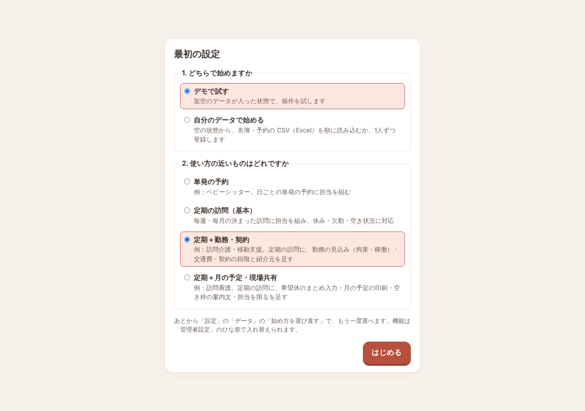

1. 「1. どちらで始めますか」：**自分のデータで始める** を選びます
   （アプリの動きだけ見たいときは「デモで試す」。架空のデータが入った状態で始まります）
2. 「2. 予約のかたちは、どちらが中心ですか」：**定期の訪問が中心** を選びます
   （毎週固定の契約が中心の訪問介護は、こちらです）
3. ［はじめる］を押します

画面の呼び方は「利用者さん」「スタッフ」になります。左のメニューは
**予定・空き状況・利用者さん・スタッフ・設定** の5つです（スマホは下のタブ）。

## 2-2 使う機能を入れる（管理者設定）

最初は画面を少なくするため、いくつかの機能が切ってあります。この説明書の手順では次の機能を使います。
**設定 › 管理者設定** で、それぞれのスイッチを「入」にしてください。

| 機能 | 使う場面 | 最初 |
|---|---|---|
| Excel の入出力 | 台帳 CSV を読み込む（3章） | 切 → **入にする** |
| 退職・担当替え | 退職者の担当を振り直す（7-3） | 切 → **入にする** |
| 利用者さんの休み | 入院・ショートステイの期間を入れる | 切 → 必要なら入 |
| メール | 連絡文をメールアプリで開く・スタッフのメールアドレス | 切 → 必要なら入 |
| 繰り返し・欠勤・キャンセル・空き状況・相性・郵便番号・住所の検索 | 毎週の予定・急な欠勤・空き枠・相性・地図に置く | 入（そのまま） |

スイッチを切っても、入れたデータは消えません。画面から隠れるだけです。

\newpage

# 3. 台帳 CSV を読み込む

介護ソフトの「利用者台帳」「職員台帳」の CSV を、そのまま読み込めます。

- 列名を見て、どちらの台帳かを自動で見分けます
- 文字コード（Shift_JIS・UTF-8 など）も自動で見分けます。Excel で開き直す必要はありません
- 請求・口座・生年月日などの列は読まず、アプリに残しません。読まなかった列は確認の画面に名前が出ます

## 3-1 利用者台帳を読み込む

1. 左のメニューの **利用者さん** を開き、右上の **［Excel・CSV］** を押します

   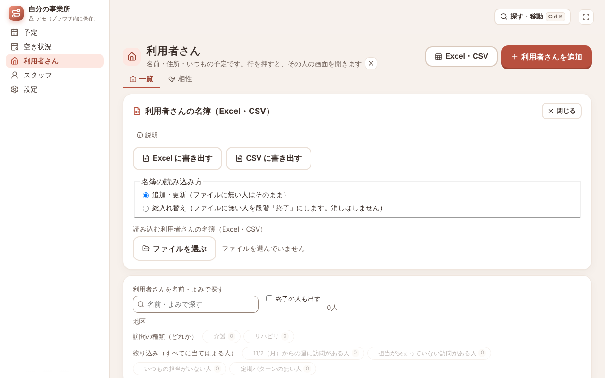

2. 「名簿の読み込み方」は **追加・更新（ファイルに無い人はそのまま）** のままにします
3. **［ファイルを選ぶ］** で `利用者台帳_サンプル.csv` を選びます
4. 確認の画面が出ます。読んだ形（「CSV（文字コード Shift_JIS）として読みました。顧客台帳の形として読みました。」）、
   読まなかった列、追加・更新される人数を確かめて **［名簿を読み込む］** を押します

   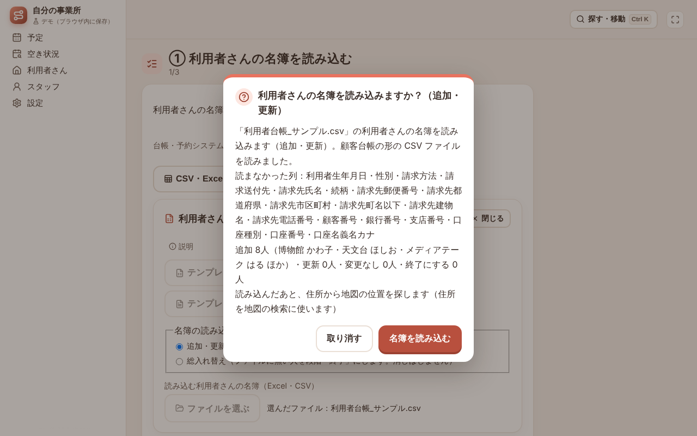

5. 一覧に利用者さんが入ります。続けて出る **［位置の無い7人を地図に置く］** を押すと、住所から地図の位置を探して置きます

   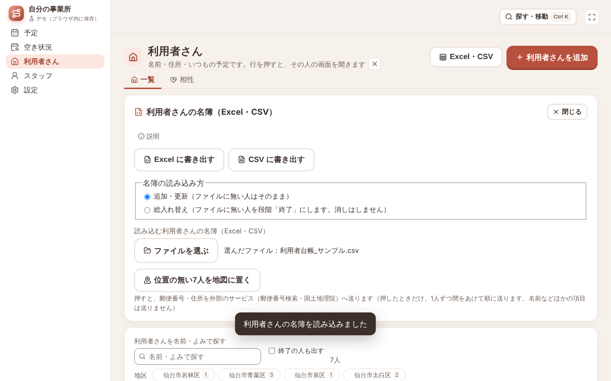

   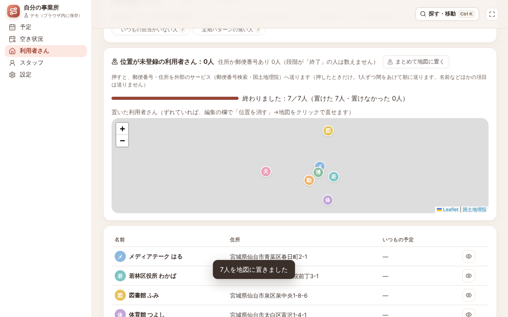

### 利用者台帳の列の読み方

| 台帳の列 | アプリでは |
|---|---|
| 利用者名 | 名前 |
| 利用者カナ | よみ（ひらがなにして入れます。検索に使います） |
| 郵便番号・都道府県・市区町村・町名以下・建物名 | 住所（つないで1行にします） |
| 利用者電話番号・利用者携帯電話番号 | メモの1行目（「電話 022-…　携帯 …」） |
| 備考 | メモ |
| 利用者状態 | 「利用中」なら利用中、それ以外（契約終了・空欄など）は **終了**（予定に入らず、自動で組む対象からも外れます） |
| 生年月日・性別・請求・口座・顧客番号など | 読みません（アプリに残しません） |

サンプルの「科学館 ひかる」さんは利用者状態が「契約終了」なので、終了の人として入ります
（一覧の「終了の人も出す」を押すと見えます）。そのため地図に置く対象は 7人です。

> **注意**：台帳の「入院中」なども「利用中」以外なので終了になります。入院の間だけ休む方は、台帳では「利用中」のまま読み込み、
> アプリの「利用者さんの休み」で期間を入れてください。

## 3-2 職員台帳を読み込む

1. 左のメニューの **スタッフ** を開き、右上の **［Excel・CSV］** を押します

   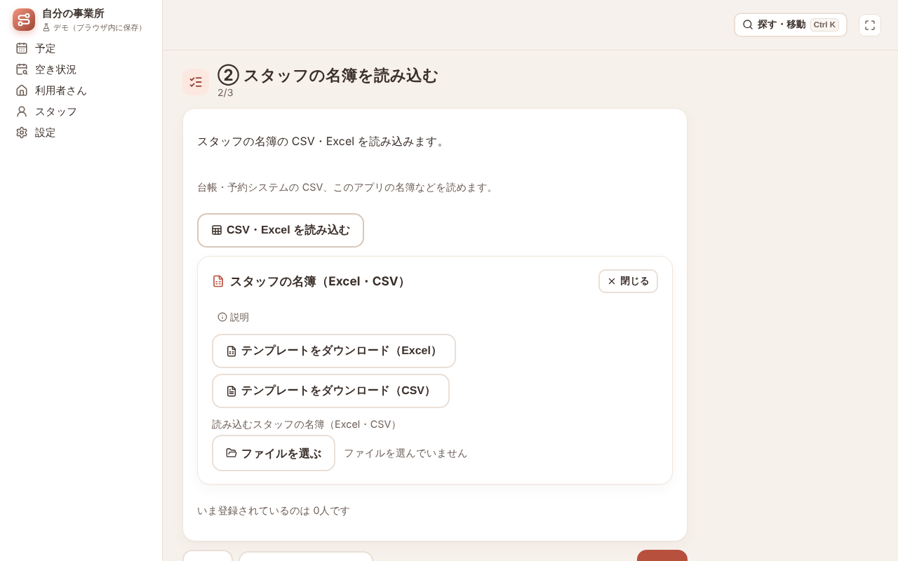

2. **［ファイルを選ぶ］** で `職員台帳_サンプル.csv` を選びます
3. 確認の画面（「職員台帳の形として読みました。」）を確かめて **［名簿を読み込む］** を押します

   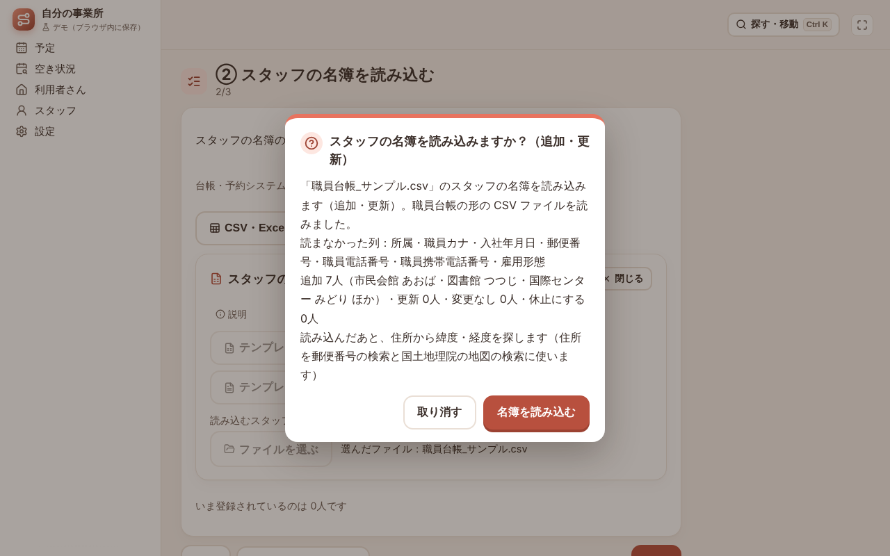

   読み込むと「最終勤務日の入ったスタッフがいます。「最終勤務日のあるスタッフ」の欄から担当を振り直してください」と出ます。

   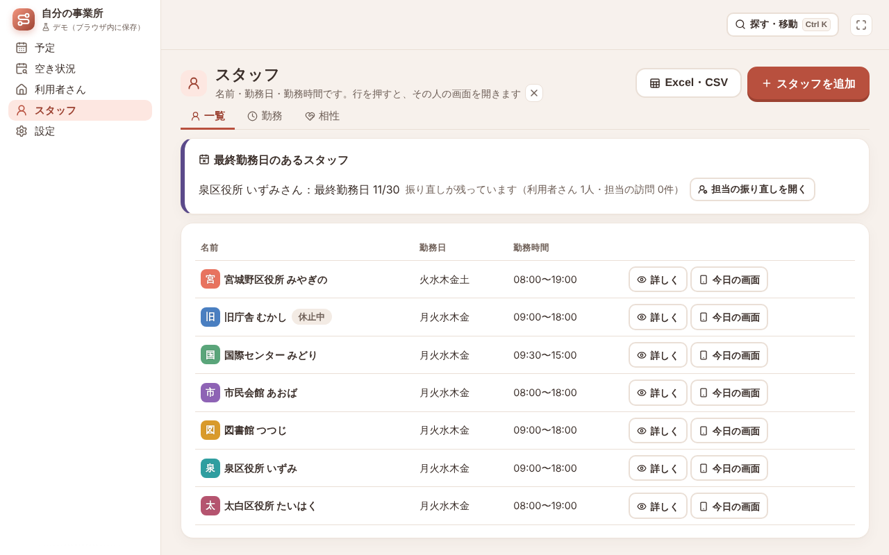

### 職員台帳の列の読み方

| 台帳の列 | アプリでは |
|---|---|
| 職員名 | 名前（同じ名前の人がいれば「職員名（社員番号）」で分けます） |
| 都道府県・市区町村・町名以下・建物名 | 自宅の住所（直行直帰の出発点） |
| 職員Eメールアドレス | メールアドレス（連絡文をメールで開くとき） |
| 退社年月日 | **最終勤務日**（翌日から勤務なし） |
| 在職状況 | 「退社済」か、退社年月日が今日より前なら **休止**（担当に入りません） |
| 資格・研修の列（介護福祉士・看護師・初任者研修・同行援護 など） | 取得日か「取得日不明」などが入っていれば、その資格を持つ。旧ホームヘルパー1・2級・実務者研修は「初任者研修」も持つとみなします |
| カナ・入社年月日・電話・雇用形態・所属など | 読みません |

サンプルでは、

- 「泉区役所 いずみ」さんは退社年月日 2026/11/30（在職中）→ 利用中で、最終勤務日 11/30 が入ります（7-3 で使います）
- 「旧庁舎 むかし」さんは退社済 → 休止で入ります

スタッフの自宅は1人ずつ地図に置きます。スタッフの画面の **基本情報 › 自宅** で **［住所を探す］**・**［地図に置く］** を押してください。

## 3-3 台帳を直して読み直すとき

- 同じ台帳を何度読み込んでもかまいません。**名前** で同じ人を見分け、変わったところだけ直します。新しい人は足します
- 「追加・更新」では、ファイルに無い人はそのままです。「総入れ替え」を選ぶと、ファイルに無い人を終了（利用者さん）・休止（スタッフ）にします。どちらも人を消すことはありません
- 訪問の予定・担当・相性・勤務時間は、読み直しても変わりません
- 読み直すと、台帳の値で上書きされるものがあります。アプリで直したら、台帳も同じように直してください
  - 利用者さん：名前・よみ・住所・メモ・利用中／終了
  - スタッフ：利用中／休止・最終勤務日・資格
- 読み込む前のデータは1つだけ控えてあります。取り違えたときは **設定 › データ › 直前の状態に戻す** で戻せます
- 改姓などで名前が変わると、別の人として足されます。先にアプリで名前を直してから読み込んでください

\newpage

# 4. 読み込んだあとに足す情報

台帳には、組むときに使う「性別」「勤務時間」「性別の希望」「相性」がありません。アプリで足します。

> 台帳から入ったスタッフは、最初は **月〜金・9:00〜18:00・車・性別は未確認** です。
> 性別が未確認のままだと、「女性のヘルパーを必ず」の利用者さんには組まれません。先に人ごとに直してください。

## 4-1 スタッフ：性別・勤務する曜日・勤務時間

スタッフの一覧で人を押し、スタッフの画面を開きます。

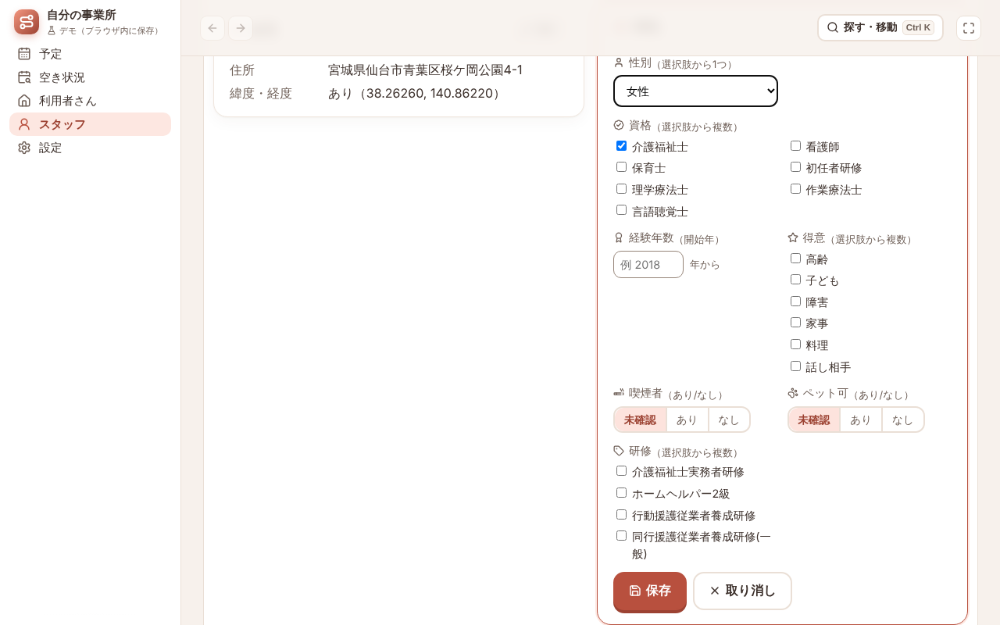

- **性別**：基本情報タブの「特性」（「詳しく ▾」の中）の **性別** で女性・男性を選びます
- **勤務する曜日・勤務開始・勤務終了**：勤務時間タブの「ふだんの勤務」で入れます
  - 子育て中で朝・夜に入れない人は、例えば **9:30〜15:00** にします。この時間の外には組まれません
  - 週休2日で曜日がばらばらの人は、勤務する曜日のチップで選びます
- **日ごとの例外**：スタッフ › 勤務 › 勤務時間（シフト）の表で、その日だけの時間帯（＋ 時間帯を追加）や休みを入れます。
  有給など前もって決まった休みもここで入れます

## 4-2 利用者さん：性別の希望

利用者さんの画面の **基本情報 › スタッフに求めること** で［直す］を押します。

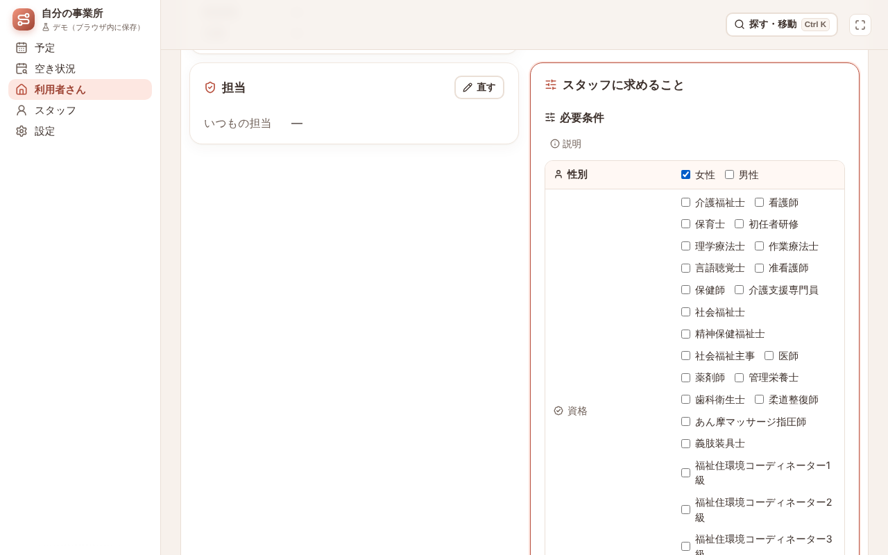

| ヒアリングでの言い方 | 画面で入れる所 | 組み方 |
|---|---|---|
| 女性のヘルパーを必ず | **必要条件** の「性別」で女性 | 満たさない人は担当にしません |
| できれば女性 | **希望** の「性別」で女性 | 満たさない人は点が下がります（ほかに人がいなければ入ります） |

資格・研修（看護師・同行援護従業者養成研修 など）が要る利用者さんも、同じく必要条件で資格を選びます。

## 4-3 相性（NG・できれば避ける）

利用者さん（またはスタッフ）の見出しの下の **相性** タブを開きます。行が利用者さん、列がスタッフの表です。マスを押して選びます。

| ヒアリングでの言い方 | 選ぶ印 |
|---|---|
| この人は合わない（NG） | **× 担当にしない** |
| できれば避けたい | **△ 選ばれにくい** |
| 指定なし | 未入力（ふつう） |
| 合う・指名がある | ○ やや選ばれやすい／◎ 選ばれやすい |

相性は入ってみないと分からないので、訪問のあとで分かったときに直してください。次に組むときから使われます。

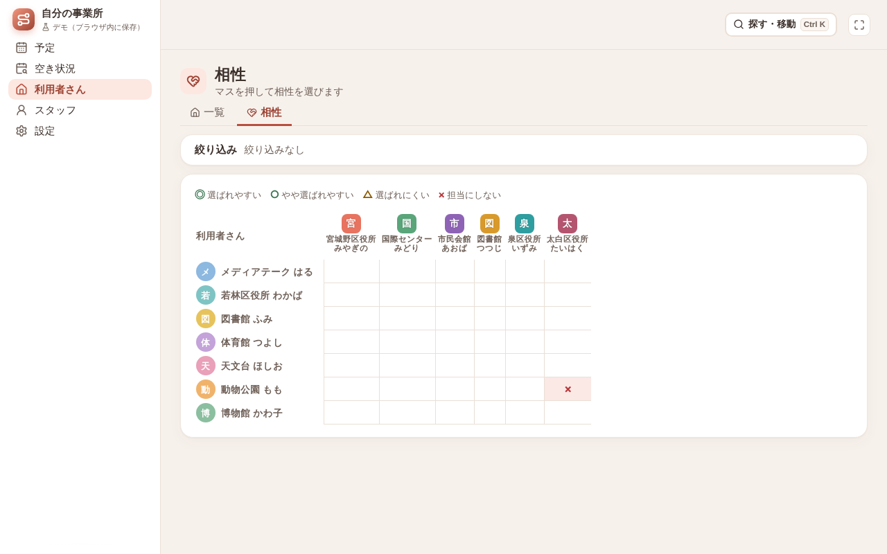

\newpage

# 5. 毎週の予定を入れる

契約で決まった毎週の曜日・時刻を入れると、その分の担当を自動で組みます。

1. **予定** を開き、主ボタン **［予定を入れる］** を押します
2. 右の欄で入れます
   - 利用者さん
   - **曜日**（複数選べます。例：月・水・金）
   - **くり返し**（毎週・隔週・3週ごと・4週ごと・毎月（第N））
   - **開始日**・**時刻**・**所要（分）**
3. **［入れる］** を押します。「予定を入れました（…・担当を自動で組みます）」と出て、今日〜翌月末の回に担当が付きます

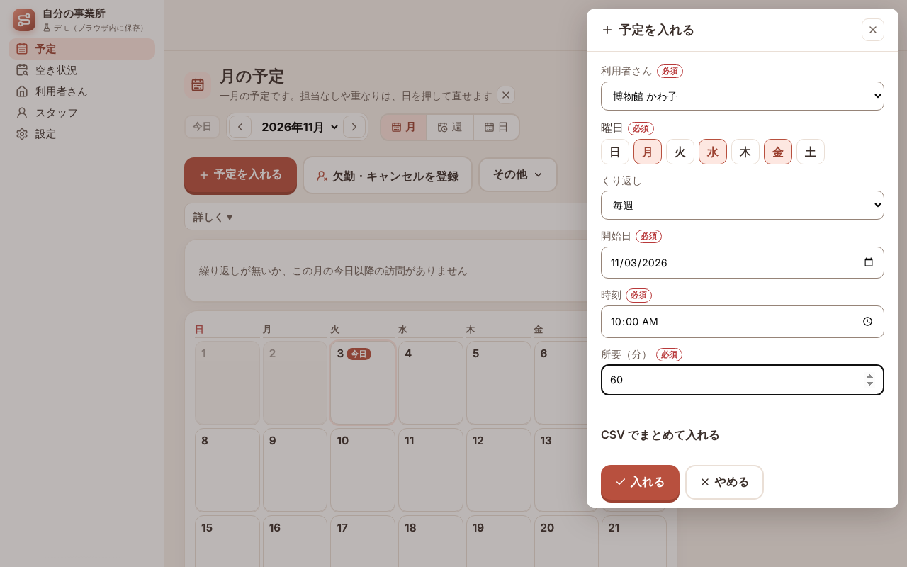

組むときに守ること・よくすること：

- 必ず守る：スタッフの勤務する曜日・勤務時間・休み、利用者さんの必要条件（性別・資格）、相性の「× 担当にしない」
- よくする：移動の近さ（自宅・前の訪問先からの距離）、希望、相性、いつもの担当、受け持ちのかたよりの少なさ

曜日ごとに時刻が違う方（例：月は10時・木は14時）は、利用者さんの画面の **繰り返し › 繰り返しを足す** から入れます。

## 予定の見方

- **月**：1日1マス。訪問の件数と、赤い札「要対応 N」が出ます。マスを押すとその日の訪問が出ます
- **週**：スタッフごと・利用者さんごとの時間軸、スタッフ×曜日の表。帯をドラッグして日時を動かせます
- **日**：担当ごとの列と地図。訪問を押すと担当の点数・移動の分数・Google マップの道順（ここへ道案内）が出ます

画面の上の **要対応** の帯に、担当なし・間に合わない・重なり・休みの人が数で出ます。
［見に行く ›］で1件ずつ移り、［要対応を組む］で残りをまとめて組み直します（ほかの訪問は動かしません）。

担当を手で替えた訪問はピンが付き、あとの自動では変わりません。

\newpage

# 6. デモ例：サンプルデータで1か月の予定を組む

3章・4章で入れたサンプルデータを使い、次の予定を入れた例です（2026年11月）。

## 6-1 スタッフ（4章で入れる値）

| スタッフ | 性別 | 勤務する曜日・時間 | 資格（台帳から） | メモ |
|---|---|---|---|---|
| 市民会館 あおば | 女性 | 月〜金 8:00〜18:00 | 介護福祉士 | |
| 図書館 つつじ | 女性 | 月〜金 9:00〜18:00 | 介護職員初任者研修・同行援護従業者養成研修(一般) | 犬が苦手 |
| 国際センター みどり | 女性 | 月〜金 **9:30〜15:00** | 看護師 | 子育て中で朝・夜は不可 |
| 太白区役所 たいはく | 男性 | 月〜金 8:00〜19:00 | 介護福祉士実務者研修・行動援護従業者養成研修 | |
| 宮城野区役所 みやぎの | 男性 | **火〜土** 8:00〜19:00 | ホームヘルパー2級（取得日不明） | 週休2日（日・月） |
| 泉区役所 いずみ | 女性 | 月〜金 9:00〜18:00 | 介護職員初任者研修 | **11/30 で退職** |
| 旧庁舎 むかし | ― | ― | ― | 退社済（休止） |

## 6-2 利用者さんと毎週の訪問

| 利用者さん（区） | 毎週の訪問 | 求めること・相性 |
|---|---|---|
| 博物館 かわ子（青葉区川内） | 月・水・金 10:00 60分 | 必要条件：女性 |
| 天文台 ほしお（青葉区錦ケ丘） | 火 13:00 180分（移動支援） | 必要条件：研修に「同行援護従業者養成研修(一般)」 |
| メディアテーク はる（青葉区春日町） | 土 10:00 240分（移動支援） | |
| 体育館 つよし（太白区富沢） | 月〜金 8:30 30分・18:00 30分 | |
| 動物公園 もも（太白区八木山） | 火・木 14:00 90分 | 相性：図書館 つつじ ×（犬がいる） |
| 若林区役所 わかば（若林区） | 水 11:00 60分 | 希望：女性 |
| 図書館 ふみ（泉区泉中央） | 月・木 15:00 60分 | |

## 6-3 組まれた結果の見どころ

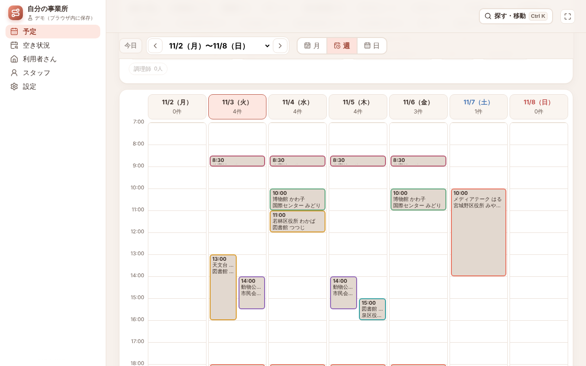

- 体育館 つよしさんの **朝8:30・夜18:00** には、9:30〜15:00 の国際センター みどりさんは入りません
- 博物館 かわ子さんには女性だけ、動物公園 ももさんには図書館 つつじさんが入りません
- 土曜のメディアテーク はるさんは、土曜に勤務する宮城野区役所 みやぎのさんが受け持ちます
- 泉区の図書館 ふみさんは、自宅の近い泉区役所 いずみさんが受け持ちやすくなります（12月からは 7-3 で振り直します）


\newpage

# 7. 場面別の使い方

## 7-1 スタッフが当日休む

朝、「熱が出たので休みます」と連絡があったとき。

1. 予定の画面の **［欠勤・キャンセルを登録］** を押します
2. 「何が起きたか」で **スタッフが休む** を選び、休む人と時間（終日・午前だけ・午後だけ・時間帯）を選びます
3. 「入らなくなる訪問 N件」と、担当が移る訪問の一覧（「10:00 博物館 かわ子さん：市民会館 あおばさん → 国際センター みどりさん」など）が出ます
4. **［この案で決める］** を押すと、欠勤の登録と振り直しが一度に入ります（元に戻せます）
5. 「変更を伝えて確定する」に、連絡が要る人ごとの連絡文が出ます。**［文をコピー］** して LINE などに貼り、送ったら「連絡した」に印を付けます

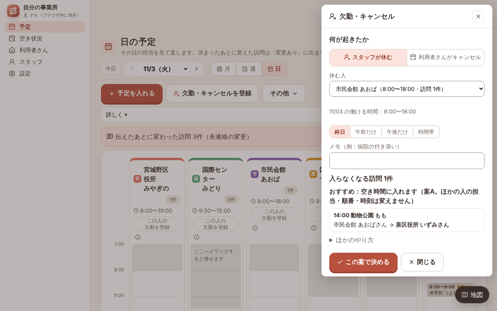

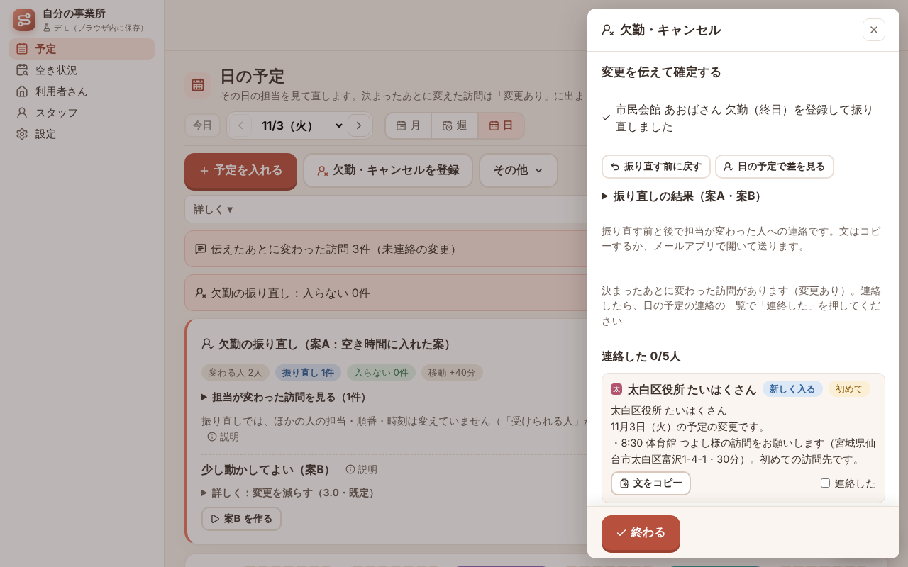

連絡文の例：

```
国際センター みどりさん
11月5日（水）の予定の変更です。
・10:00 博物館 かわ子様の訪問をお願いします（仙台市青葉区川内26・60分）。
```

初めて伺う利用者さんのときは、行に「初めて」の印と、その方の決まりごと（入り方・鍵・駐車場・注意）が付きます。

## 7-2 利用者さんが当日キャンセルする

1. **［欠勤・キャンセルを登録］** で **利用者さんがキャンセル** を選び、訪問を選びます
2. 取り消しの種類で **当日キャンセル** を選び、［当日キャンセルとして取り消す］を押します
3. その時間が担当の予定から外れて空きます。ほかの訪問の担当・順番・時刻は変えません
4. 当日キャンセルの回数は月の予定で数えます（請求はアプリではしません）

公式 LINE で届いた複数の連絡は、予定の「その他 ▾」の **連絡を貼り付けて入れる** に貼ると、
「11/5 図書館 つつじ 休み」「11/6 動物公園 もも キャンセル」のような行を読んでまとめて入れられます。

## 7-3 スタッフが退職する（泉区役所 いずみさん 11/30 退職の例）

1. 職員台帳の退社年月日を読み込むと、最終勤務日 11/30 が入ります（アプリで入れるときは、スタッフの画面の「最終勤務日（退職・担当替え）」）
2. スタッフの一覧の上の「最終勤務日のあるスタッフ」の欄で **［担当の振り直しを開く］** を押します
3. 12/1 以降の担当の訪問と、受け持っている利用者さんが並び、利用者さんごとに代わりの候補（入れる回の多い順）が出ます
4. 選んで **［まとめて適用］** を押すと、毎週の担当と12月の回の担当が置き換わります

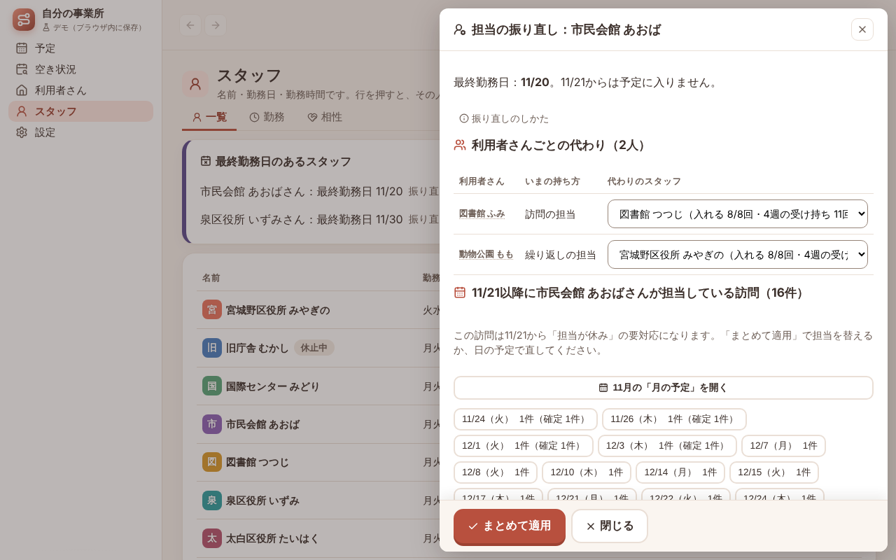

## 7-4 新しい相談（空き枠の確認）

相談員さんから「火曜か木曜の午前に、60分の身体介護を入れられますか」と聞かれたとき。

1. メニューの **空き状況** を開きます
2. 曜日（火・木）、時間帯（午前）、所要（60分）のチップを選びます
3. 答えのカードに「受けられます：火・木 10:00〜12:00 に N人」のように出ます。**［要約をコピー］** で返事に使えます
4. 「場所」に新しい利用者さんの住所を入れると、移動の時間も含めて試算します
5. 受ける方向なら「仮の利用者さんとして押さえる」で、段階「相談受付」の利用者さんとして入れておけます

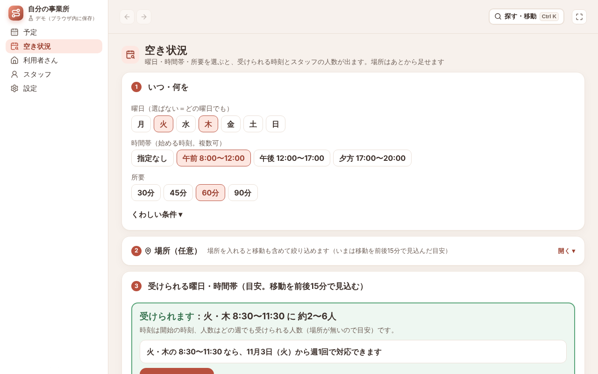

計算は、今の4週分の担当のすき間に入るかで見ます。ほかの人の予定は動かしません。

## 7-5 来月の確認

毎月20日を過ぎると、予定の画面の上に「12月の予定 N件はできています・担当なし 2件」のような1行が出ます。
［12月を見る ›］で来月の予定を開き、残った担当なしは［要対応を組む］で組みます。

\newpage

# 8. データの控え（バックアップ）

データはこのブラウザの中にだけあります。別のパソコン・別のブラウザでは見えません。ブラウザの閲覧データを消すと消えます。

- **設定 › データ › 控え（バックアップ）（JSON）› ファイルに書き出す** で、全データを1つのファイルにします。週に1回を目安に書き出してください
- 別のパソコンで続けるときは、そのファイルを「読み込む控え（JSON）」で読み込みます（今のデータは置き換わります）
- 名簿や控えを読み込む前のデータは1つだけ自動で控えます。**直前の状態に戻す** で戻せます
- 操作の取り消しは Ctrl+Z（50手まで）

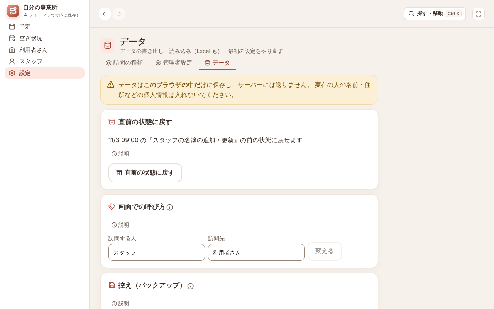

# 9. このアプリでできないこと

このデモ版は「だれを・どの順で」を組むことに絞っています。次のことはしません。

- 請求（国保連・移動支援の市町村別明細）、利用者負担の集金の管理、キャンセル料の請求
- 勤怠・打刻（入ります／終わりました）、実働・休憩・拘束の記録、実績記録票・サイン
- LINE・Google カレンダーとの連携、連絡文の自動送信（コピーかメールアプリを開くまで）
- ログイン・複数のパソコンでの同時編集・サーバーへの保存
- 相性の自動学習（相性は人が入れます）
- Google の実際の道のりでの移動時間（移動は直線距離からの概算です）

請求・勤怠・実績記録・LINE 連携は、本体の開発で検討しています。

# 10. よくある質問

**Q. 台帳の CSV を Excel で開いて保存し直したら、読めなくなりませんか。**
A. Shift_JIS・UTF-8 のどちらでも読めます。列名（1行目）を変えなければ読めます。

**Q. 読み込みで「読めませんでした」と出ました。**
A. 何行目のどの列かが台帳の列名で出ます。その行を直して読み込み直してください。今のデータは変わっていません。

**Q. 地図に置けなかった利用者さんがいます。**
A. 「置けなかった利用者さん」の一覧の［編集］から住所を直すか、地図をクリックして置いてください。市区町村の名前が無い住所は見つからないことがあります。

**Q. 自動で組んだ担当を変えたい。**
A. 日の予定・週の予定で訪問を押し、「担当を変える」か「受けられる人」から選びます。ずっとその人にするときは、利用者さんの画面の繰り返しの担当を直します。

**Q. 住所や郵便番号はどこかに送られますか。**
A. ［地図に置く］［住所を探す］を押したときだけ、郵便番号・住所を郵便番号検索と国土地理院へ送ります。名前などほかの項目は送りません。
