# この説明書について

訪問ルートAI は、「どのヘルパーが・どの利用者さんへ・どの順で」行くかを組むためのアプリです。
インターネットを見るソフト（Chrome・Edge）で開いて使います。インストールやログインはありません。

この説明書では、次のことを順に説明します。

- お使いの介護ソフトから書き出した **利用者台帳・職員台帳の CSV ファイル** を読み込む
- 毎週の予定を入れて、担当を組む
- 急な欠勤や、新しい相談に答える
- 勤務の見込み（拘束の時間）と交通費を見る

説明には、架空のデモデータを使います。

- 開くところ：<https://staff-assign-demo.katahimo.com/>
- おすすめの使い方：パソコンの Chrome か Edge。画面は横に広め（1280 以上）。スマホでも、予定を見ることと担当を替えることはできます
- 説明に使うファイル：`samples/利用者台帳_サンプル.csv`・`samples/職員台帳_サンプル.csv`
  （介護ソフトの台帳と同じ形です。人の名前は架空で、住所は仙台市の公共施設です）

> **大切なお願い（デモ版について）**
> 入れたデータは、お使いのパソコンの中だけに残ります。よそへは送りません。
> ただし、このデモ版はお試し用です。実在の利用者さん・職員の名前や住所を入れることは考えていません。
> お試しの間は、この説明書のサンプルの CSV ファイルか、名前・住所を置き換えたファイルをお使いください。

## 目次

1. 困りごとと、このアプリでできること
2. はじめる前に（最初の設定・登録の案内・最初から入っている機能）
3. 台帳の CSV ファイルを読み込む（利用者台帳・職員台帳）
4. 読み込んだあとに足すこと（性別・勤務時間・性別の希望・相性）
5. 毎週の予定を入れる（担当は自動で組まれます）
6. デモ例：サンプルデータで1か月の予定を組む
7. 場面ごとの使い方（当日の欠勤・当日キャンセル・退職・新しい相談・来月の確認）
8. 勤務・交通費・契約の段階（勤務の見込み・交通費・相談から契約まで）
9. データの控え（バックアップ）
10. このアプリでできないこと
11. よくある質問

\newpage

# 1. 困りごとと、このアプリでできること

お話を伺ったときの困りごとと、アプリでのやり方を並べました。くわしい手順は、右の欄の章にあります。

| 困りごと（今のやり方） | このアプリでは | 章 |
|---|---|---|
| シフトを毎月、手で組んでいる（カレンダーに色分け） | 毎週の訪問（曜日・時刻・時間）を一度入れると、担当を自動で組みます。翌月の終わりまで、同じ人が付きます | 5・6 |
| 振り分けの決め手（距離・性別の希望・相性）が、頭の中にしかない | 台帳を読み込むと、ヘルパーの自宅と利用者さんの住所を地図に置きます。近い人から組みます。性別の希望と相性も、入れておけば守ります | 3・4 |
| 子育て中で、朝・夜の訪問に入れないスタッフがいる | スタッフごとの勤務の時間と曜日の外には、組みません | 4 |
| どこに空きがあるか、誰を振れるかが、ひと目で分からない | 「空き状況」で曜日・時間帯・時間を選ぶと、受けられるかどうかと人数が出ます。その文を相談員さんへの返事に使えます | 7-4 |
| 当日の欠勤のたびに、組み直しと連絡に追われる | 休む人を選ぶと、代わりの案と連絡の文が出ます。文はコピーして LINE などに貼れます | 7-1 |
| 当日キャンセルがよくある | 「当日キャンセル」として取り消すと、その時間が空きます。月の回数も数えます | 7-2 |
| 退職者が出たとき、組み直しに時間がかかる | 職員台帳の退社年月日を、最後の勤務日として読みます。翌日からの担当と、代わりの候補が一覧になります | 7-3 |
| ヘルパーさんに、拘束の時間を示したい | 「勤務の見込み」で、人ごと・日ごとの出勤〜退勤（拘束）の時間を見られます | 8-1 |
| 交通費（1km 10円）を、毎月手で計算している | 「勤務の見込み」に、移動の距離と交通費の見込みが出ます。単価は変えられます | 8-2 |
| 相談を受けてから契約するまでを、まとめて見たい | 利用者さんごとに、相談受付 → 顔合わせ → 契約 → 利用中 の段階と、紹介元（相談員さん）を記録できます | 8-3 |
| 介護ソフトと二重に入力したくない | 介護ソフトの台帳の CSV ファイルを、列を直さずに読み込めます。請求・口座などの列は読みません | 3 |

次のことは、このデモ版ではできません（10章）。

- 移動支援の請求明細（市町村ごとの様式）・国保連の請求・集金の管理
- 勤怠（入ります／終わりました の打刻）、実際に働いた時間の記録
- 実績記録票・利用者さんのサイン
- LINE とのつながり（連絡の文は、コピーして人が送ります）

\newpage

# 2. はじめる前に

## 2-1 最初の設定（2つの質問）

初めて開くと、「最初の設定」の画面が出ます。

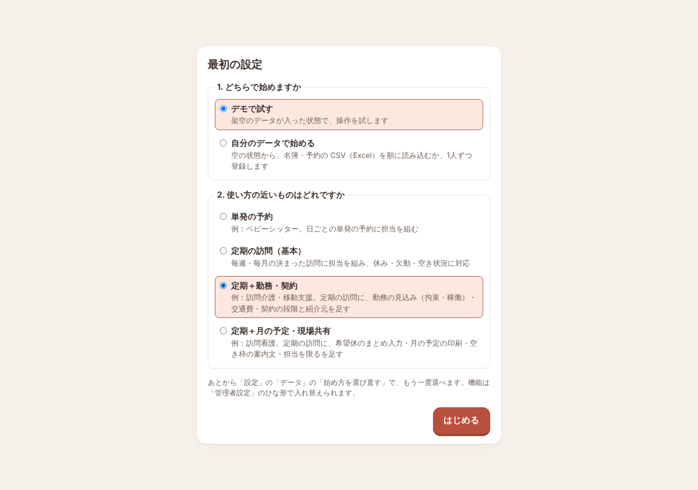

1. 「1. どちらで始めますか」で、**自分のデータで始める** を選びます
   （アプリの動きを見たいだけなら、**デモで試す** を選びます。架空のデータが入った状態で始まります）
2. 「2. 使い方の近いものはどれですか」で、**定期＋勤務・契約** を選びます
   （「例：訪問介護・移動支援」と書いてあるものです）
3. **［はじめる］** を押します

画面では、人の呼び方が「利用者さん」「スタッフ」になります。
左のメニューは **予定・空き状況・利用者さん・スタッフ・設定** の5つです（スマホでは下に並びます）。

## 2-2 登録の案内（自分のデータで始めたとき）

自分のデータで始めると、「登録の案内」が出ます。上に「1/3」のように、いまの段が出ます。

1. **① 利用者さんの名簿を読み込む**
   - **［CSV・Excel を読み込む］** を押すと、読み込みの欄が開きます
   - 利用者台帳の CSV ファイルを読み込みます。手順は「3-1 利用者台帳を読み込む」と同じです
   - 読み込むと、続けて住所から地図の位置を探します
   - 下に「いま登録されているのは N人です」と出ます。読み込んだら **［次へ］** を押します
2. **② スタッフの名簿を読み込む**
   - 同じように、職員台帳の CSV ファイルを読み込みます。手順は「3-2 職員台帳を読み込む」と同じです
   - スタッフの自宅の位置も、続けて探します
   - 読み込んだら **［次へ］** を押します
3. **③ 予定を登録する**
   - 予約の CSV ファイルがあれば、ここで読み込めます
   - 無ければ、**［予定の画面へ］** を押します。月の予定の画面が開きます（5章）

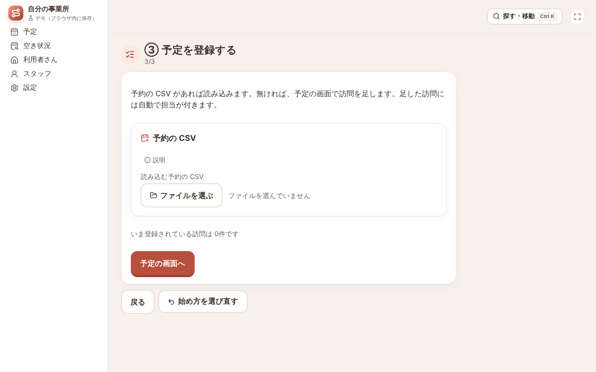

前の段に戻るときは **［戻る］** を押します。
始め方（デモか自分のデータか・使い方）を選び直すときは、下の **［始め方を選び直す］** を押します。

あとから読み込むときは、**利用者さん** や **スタッフ** の一覧の右上にある **［Excel・CSV］** からも読み込めます（3章）。

## 2-3 最初から入っている機能

「定期＋勤務・契約」を選ぶと、次の機能が入った状態で始まります。設定を変える必要はありません。

| 機能 | 使う場面 |
|---|---|
| 繰り返し・毎月の第N曜日 | 毎週・毎月の予定を入れる（5章） |
| 利用者さんの休み | 入院・ショートステイの間を入れる |
| 欠勤・キャンセル | 当日の欠勤・当日キャンセル（7-1・7-2） |
| 空き状況 | 新しい相談に答える（7-4） |
| 相性 | 合わない組み合わせを避ける（4-3） |
| 訪問先の決まりごと | 入り方・鍵・駐車場・注意を残す |
| 退職・担当替え | 退職する人の担当を振り直す（7-3） |
| 道順のリンク | 訪問先までの道順を Google マップで開く |
| 住所の検索 | 住所から地図の位置を探す（3章） |
| Excel の入出力 | 台帳の CSV ファイルを読み込む（3章） |
| **勤務の見込み** | 人ごとの出勤〜退勤（拘束）の時間を見る（8-1） |
| **交通費** | 移動の距離から交通費の見込みを出す（8-2） |
| **段階・紹介元** | 相談受付 → 契約 → 利用中 と、紹介元を残す（8-3） |

太字の3つが、「定期＋勤務・契約」で足される機能です。

ほかの機能（メール・希望休のまとめ入力・月の予定の印刷など）は、**設定 › 管理者設定** で入れられます。
管理者設定のスイッチは、1枚のカードに次のまとまりで並んでいます。

- 予定の入れ方
- 当日・問い合わせ
- 担当の決め方
- 勤務・契約
- 現場との共有
- 入力の補助
- 上級（組み方の調整）

スイッチを切っても、入れたデータは消えません。画面から隠れるだけです。

## 2-4 前のデータが残っているとき

前にこのアプリを開いたことがあるパソコンでは、前のデータと設定が残っています。そのときは「最初の設定」の画面が出ません。

**空のデータから始め直すとき**

1. 先に、今のデータの控えを残します（9章）。要らなければ、とばします
2. **設定 › データ** を開きます
3. 一番下の「最初からやり直す」で、**［始め方を選び直す］** を押します
4. 確かめる画面で **［2つの質問へ戻る］** を押します。今のデータは消えます
5. 「最初の設定」の画面が出ます。2-1 のとおりに答えます

**データはそのままで、機能だけそろえるとき**

1. **設定 › 管理者設定** を開きます
2. 「ひな形」の **［詳しく ▾］** を押します
3. 「定期＋勤務・契約」の **［適用］** を押します
4. 入る機能・切れる機能が出ます。よければ **［適用］** を押します

ひな形は次の5つです。

- 単発の予約
- 定期の訪問（基本）
- 定期＋勤務・契約
- 定期＋月の予定・現場共有
- すべての機能

\newpage

# 3. 台帳の CSV ファイルを読み込む

介護ソフトの「利用者台帳」「職員台帳」の CSV ファイルを、そのまま読み込めます。

- 1行目の列の名前を見て、どちらの台帳かを見分けます
- Excel で開き直したり、保存し直したりする必要はありません
- 請求・口座・生年月日などの列は読みません。アプリにも残りません。読まなかった列は、確かめる画面に名前が出ます
- 読み込むと、続けて住所から地図の位置を探します。1つずつ置く手間はありません

ここでは、登録の案内（2-2）から読み込む手順で説明します。
あとから読み込むときは、**利用者さん**（または **スタッフ**）の一覧の右上の **［Excel・CSV］** を押します。同じ欄が開きます。

## 3-1 利用者台帳を読み込む

1. 登録の案内の「① 利用者さんの名簿を読み込む」で、**［CSV・Excel を読み込む］** を押します

   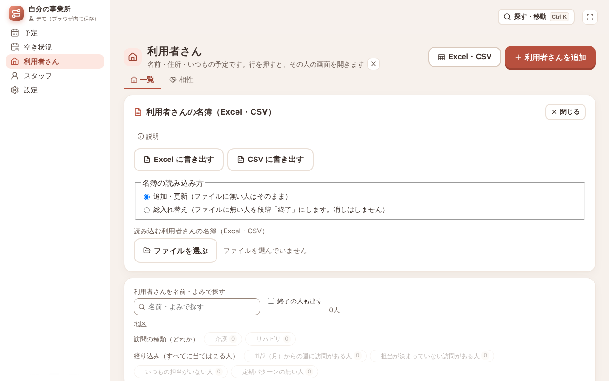

   まだ1人もいないときは、書き出しのボタンが **［テンプレートをダウンロード（Excel）］**・**［テンプレートをダウンロード（CSV）］** になります（3-4）。
   「名簿の読み込み方」の選択肢も出ません（追加・更新で読み込みます）。

2. **［ファイルを選ぶ］** を押して、`利用者台帳_サンプル.csv` を選びます
3. 確かめる画面が出ます。読み込む人数と、読まなかった列を見ます。
   最後に「読み込んだあと、住所から地図の位置を探します」と出ます。よければ **［名簿を読み込む］** を押します

   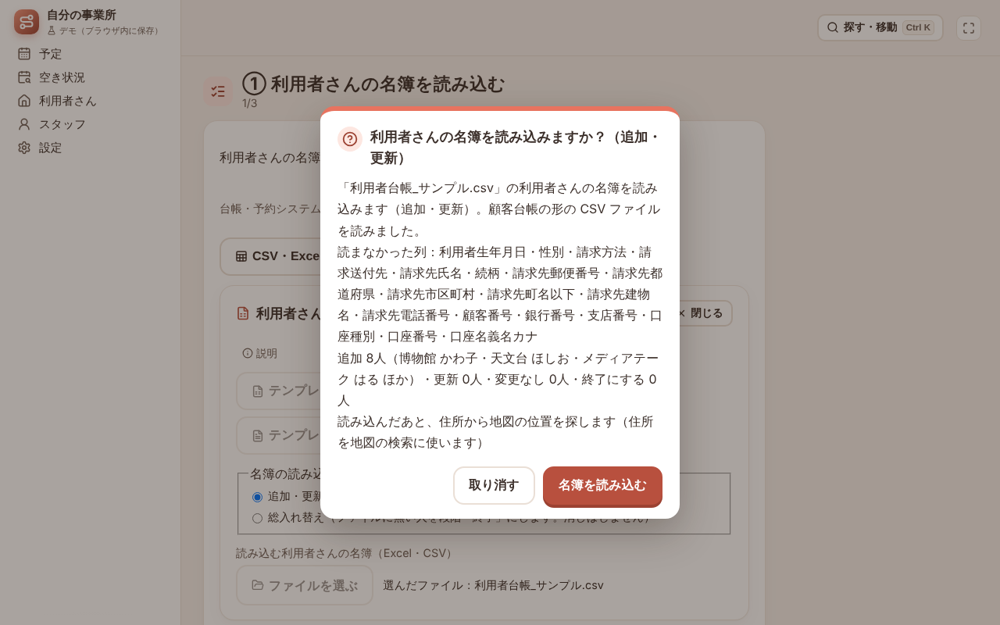

4. 利用者さんが入り、続けて住所から地図の位置を探します。
   「終わりました：7／7人（入れた 7人・見つからない 0人）」と出たら終わりです。入った場所が地図に出ます

   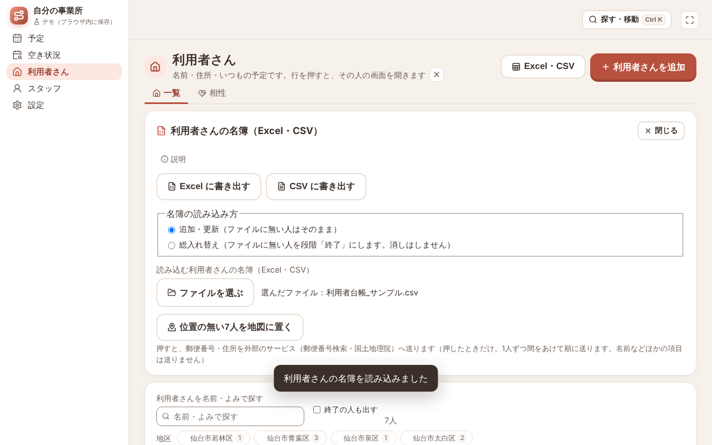

   途中で **［止める］** を押すと、探すのを止めます。続けるときは **［続きを探す（N人）］** を押します。

### 緯度・経度が見つからなかった人がいるとき

住所から位置が見つからなかった人は、「見つからなかった利用者さん」に名前が出ます。編集の欄で住所を直すか、地図をクリックして入れてください。
利用者さんの一覧にも、「位置なし」の印が付きます。

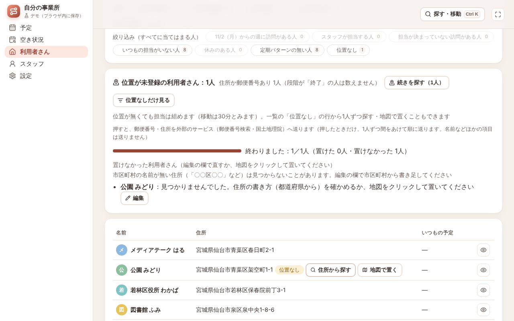

- 一覧の上の絞り込みの **位置なし** を押すと、位置の無い人だけが並びます（**［位置なしだけ見る］** でも同じです）
- 行の **［住所から探す］** で、その人だけをもう一度探します。住所を直したあとに使います
- 行の **［地図で置く］** で、その人の画面の住所の欄が開きます。地図を押して、その場所に置きます
- 市区町村の名前が無い住所（「〇〇区〇〇」など）は、見つからないことがあります。市区町村から書き足してください

位置が無いままでも、担当は組めます。そのときは、その人への移動を30分とみて組みます。

### 利用者台帳の列の読み方

| 台帳の列 | アプリでは |
|---|---|
| 利用者名 | 名前 |
| 利用者カナ | よみ（ひらがなにして入れます。さがすときに使います） |
| 郵便番号 | 郵便番号（住所から場所が見つからないときの手がかり） |
| 都道府県・市区町村・町名以下・建物名 | 住所（つないで1行にします） |
| 利用者電話番号・利用者携帯電話番号 | メモの1行目 |
| 備考 | メモ |
| 利用者状態 | 「利用中」なら利用中。それ以外（契約終了・空欄など）は **終了** |
| 生年月日・性別・請求・口座・顧客番号など | 読みません |

「終了」の人は、予定に入らず、自動で組む相手にもなりません。

サンプルの「科学館 ひかる」さんは、利用者状態が「契約終了」です。そのため終了の人として入ります。
一覧の「終了の人も出す」に印を付けると見えます。地図に置く人が 7人なのは、このためです。

> **ご注意**：台帳で「入院中」などになっている方も、「利用中」ではないので終了になります。
> 入院の間だけ休む方は、台帳を「利用中」のまま読み込みます。そのあと、アプリの「利用者さんの休み」で休む期間を入れてください。

## 3-2 職員台帳を読み込む

1. 登録の案内の「② スタッフの名簿を読み込む」で、**［CSV・Excel を読み込む］** を押します

   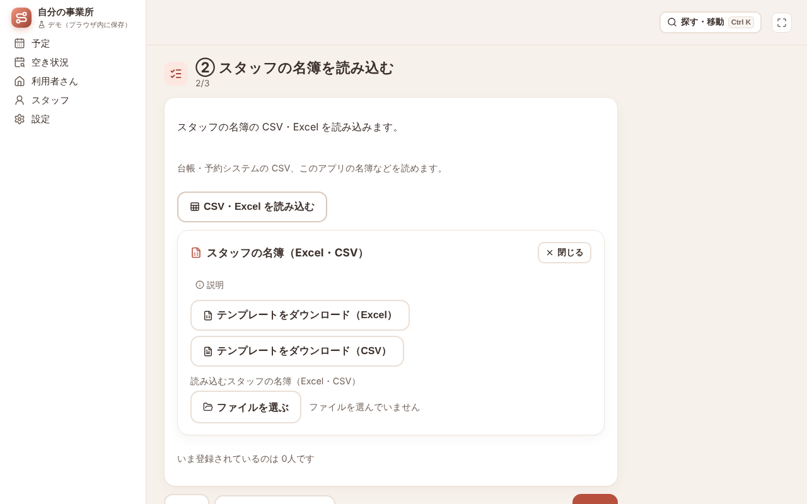

2. **［ファイルを選ぶ］** を押して、`職員台帳_サンプル.csv` を選びます
3. 確かめる画面を見て、**［名簿を読み込む］** を押します

   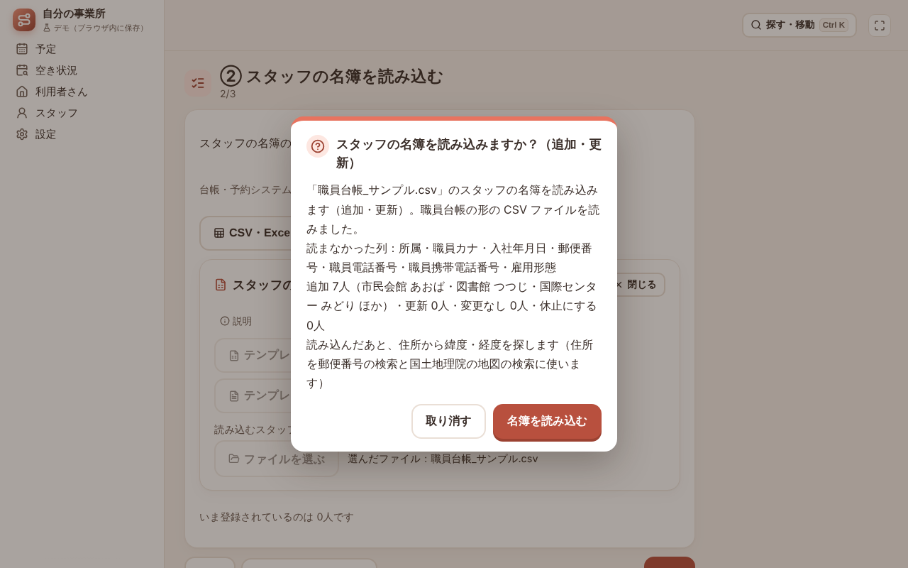

4. スタッフが入り、続けて自宅の住所から地図の位置を探します。休止の人は探しません

   退社年月日の入った人がいると、「最終勤務日のあるスタッフ」の欄から担当を振り直すよう、知らせが出ます（7-3）。

   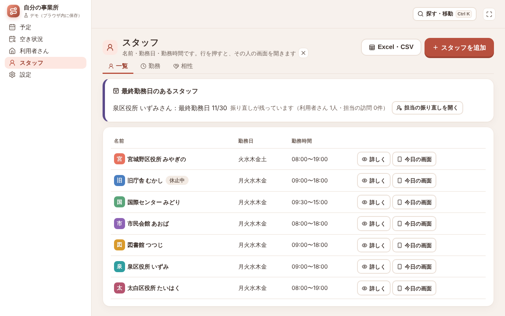

### 職員台帳の列の読み方

| 台帳の列 | アプリでは |
|---|---|
| 職員名 | 名前（同じ名前の人がいれば「職員名（社員番号）」で分けます） |
| 都道府県・市区町村・町名以下・建物名 | 自宅の住所（直行直帰の出発点） |
| 職員Eメールアドレス | メールアドレス |
| 退社年月日 | **最終勤務日**（次の日から勤務しません） |
| 在職状況 | 「退社済」か、退社年月日が今日より前なら **休止**（担当に入りません） |
| 資格・研修の列（介護福祉士・看護師・初任者研修・同行援護 など） | 取得日か「取得日不明」などが入っていれば、その資格を持つとします。旧ホームヘルパー1級・2級と実務者研修は、「初任者研修」も持つとします |
| カナ・入社年月日・電話・雇用形態・所属など | 読みません |

サンプルでは、

- 「泉区役所 いずみ」さんは、退社年月日が 2026/11/30（在職中）です。利用中で入り、最終勤務日に 11/30 が入ります（7-3 で使います）
- 「旧庁舎 むかし」さんは、退社済です。休止で入ります

自宅の位置が見つからなかった人は、スタッフの一覧に「位置なし」の印が付きます。利用者さんと同じように、行の **［住所から探す］** か **［地図で置く］** で置きます（3-1）。

## 3-3 台帳を直して、読み直すとき

- 同じ台帳を何度読み込んでもかまいません。**名前** で同じ人を見分けて、変わったところだけ直します。新しい人は足します
- 「追加・更新」では、ファイルに無い人はそのままです
- 「総入れ替え」を選ぶと、ファイルに無い人を終了（利用者さん）・休止（スタッフ）にします。どちらも、人を消すことはありません
- 訪問の予定・担当・相性・勤務時間は、読み直しても変わりません
- 読み直すと、台帳の内容で書きかわるものがあります。アプリで直したときは、台帳も同じように直してください
  - 利用者さん：名前・よみ・郵便番号・住所・メモ・利用中か終了か
  - スタッフ：利用中か休止か・最終勤務日・資格・自宅の住所・メールアドレス（住所とメールアドレスは、台帳が空なら今のままにします）
- 読み込む前のデータを、1つだけ控えてあります。まちがえたときは、**設定 › データ** の **［直前の状態に戻す］** で戻せます
- 結婚などで名前が変わると、別の人として足されます。先にアプリで名前を直してから、読み込んでください

## 3-4 台帳が読めないとき（アプリの名簿の形で書く）

お手元の台帳がうまく読めないときは、アプリの名簿の形に書いて読み込めます。

1. 名簿の欄で、**［テンプレートをダウンロード（Excel）］**（CSV がよければ **（CSV）** のほう）を押します。
   もう人が入っているときは、**［Excel に書き出す］**（**［CSV に書き出す］**）を押します
2. できたファイルを開きます。1行目の列名はそのままにして、2行目から1行に1人ずつ書きます
   （利用者さんの名前の列は「表示名」、スタッフの名前の列は「名前」です）
3. 保存して、同じ欄の **［ファイルを選ぶ］** で読み込みます

名前だけ書いても読み込めます。空の列は、決まった値で入ります。

Excel のテンプレートには「書き方」「記入例」のシートが付いています。何を書くかと、書き方の例が見られます（読み込みでは見ません）。

- スタッフ：勤務は月〜金・9:00〜18:00、移動は車、利用中
- 利用者さん：利用中（色は順に付きます）

書き出したファイルの名前は、「staff-assign-demo-」で始まります。

\newpage

# 4. 読み込んだあとに足すこと

台帳には、組むときに使う「性別」「勤務時間」「性別の希望」「相性」がありません。アプリで足します。

> 台帳から入ったスタッフは、はじめ **月〜金・9:00〜18:00・車・性別は未確認** です。
> 性別が未確認のままだと、「女性のヘルパーを必ず」の利用者さんの担当になりません。先に1人ずつ直してください。

## 4-1 スタッフ：性別・勤務する曜日・勤務時間

スタッフの一覧で人を押すと、その人の画面が開きます。

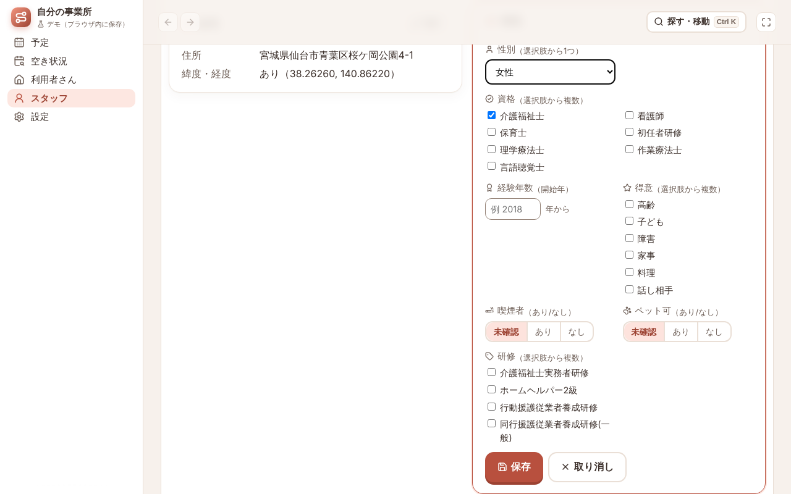

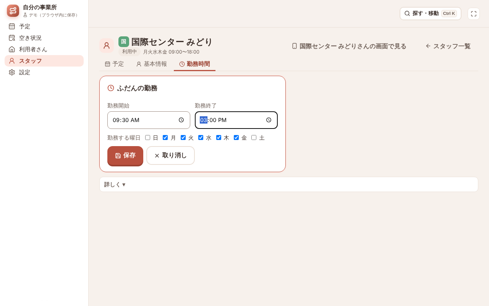

- **性別**：基本情報タブの「特性」（「詳しく ▾」の中）にあります。女性か男性を選びます
- **勤務する曜日・勤務開始・勤務終了**：勤務時間タブの「ふだんの勤務」で入れます
  - 子育て中で朝・夜に入れない人は、たとえば **9:30〜15:00** にします。この時間の外には組みません
  - 週休2日で曜日がばらばらの人は、勤務する曜日を1つずつ選びます
- **その日だけの変更**：**スタッフ › 勤務** の「勤務時間（シフト）」の表で入れます。その日だけの時間（＋ 時間帯を追加）や、休みを入れます。
  有給など、前から決まっている休みもここで入れます

## 4-2 利用者さん：性別の希望

利用者さんの画面の **基本情報 › スタッフに求めること**（「詳しく ▾」の中）で、**［直す］** を押します。

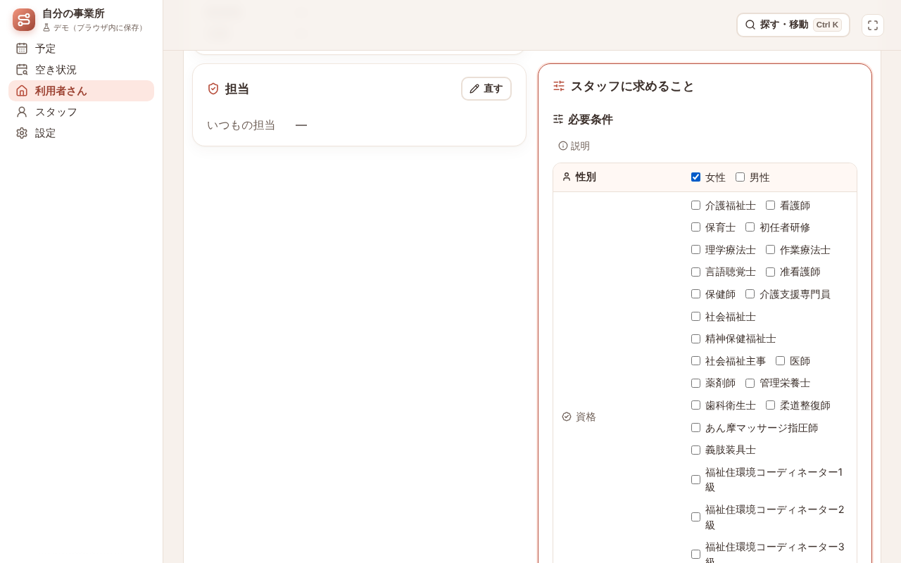

| お話のときの言い方 | 画面で入れるところ | 組み方 |
|---|---|---|
| 女性のヘルパーを必ず | **必要条件** の「性別」で女性 | 女性でない人は担当にしません |
| できれば女性 | **希望** の「性別」で女性 | 女性の人を先に考えます。ほかに人がいなければ男性も入ります |

資格・研修（看護師・同行援護従業者養成研修 など）が要る利用者さんも、同じく必要条件で資格を選びます。

## 4-3 相性（合わない・できれば避けたい）

利用者さん（かスタッフ）の画面の上にある **相性** のタブを開きます。
行が利用者さん、列がスタッフの表です。マスを押して、印を選びます。

| お話のときの言い方 | 選ぶ印 |
|---|---|
| この人は合わない | **× 担当にしない** |
| できれば避けたい | **△ 選ばれにくい** |
| とくに無し | 入れない（ふつう） |
| 合う・指名がある | ○ やや選ばれやすい／◎ 選ばれやすい |

相性は、行ってみないと分からないことが多いです。分かったときに直してください。次に組むときから使われます。

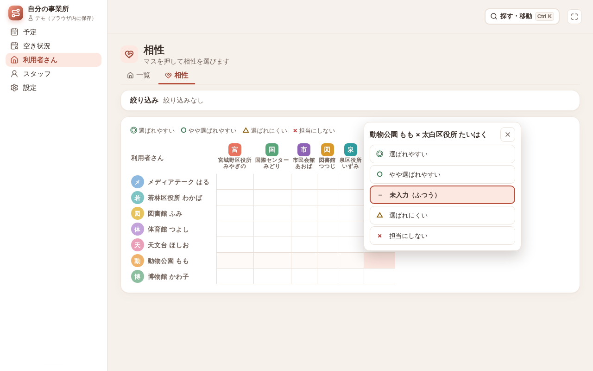

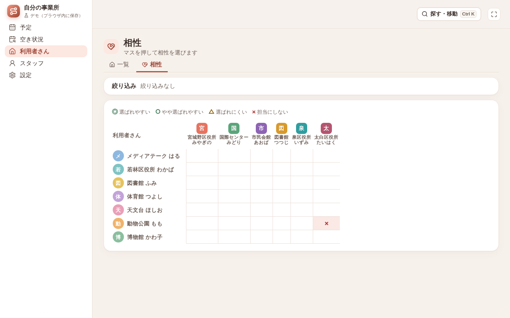

\newpage

# 5. 毎週の予定を入れる

契約で決まった毎週の曜日・時刻を入れると、その分の担当を自動で組みます。

1. **予定** を開き、月か週の予定で **［定期の予定を入れる］** を押します
2. 右に出る欄で、次のものを入れます
   - 利用者さん
   - **曜日**（いくつでも選べます。例：月・水・金）
   - **くり返し**（毎週・隔週・3週ごと・4週ごと・毎月（第N））
   - **開始日**・**時刻**・**所要（分）**
3. **［入れる］** を押します。今日から翌月の終わりまでの回に、担当が付きます

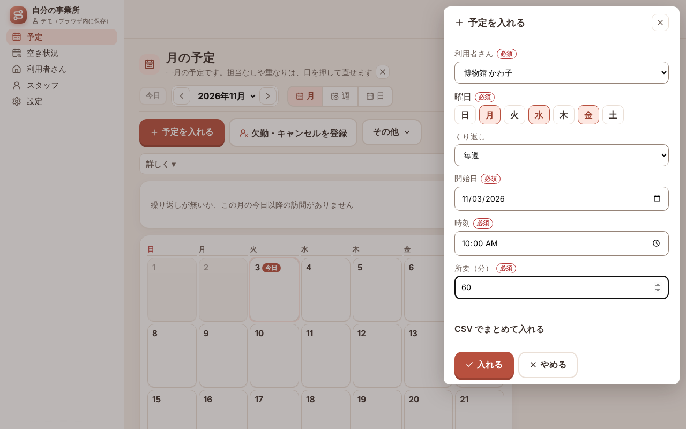

組むときに、必ず守ること：

- スタッフの勤務する曜日・勤務時間・休み
- 利用者さんの必要条件（性別・資格）
- 相性の「× 担当にしない」

組むときに、できるだけ良くすること：

- 移動が近いこと（自宅や、前の訪問先から）。地図の位置が無い人への移動は、30分とみます
- 希望・相性・いつもの担当
- 受け持ちが、人によってかたよらないこと

曜日ごとに時刻がちがう方（例：月は10時、木は14時）は、利用者さんの画面の **繰り返し › 繰り返しを足す** から入れます。

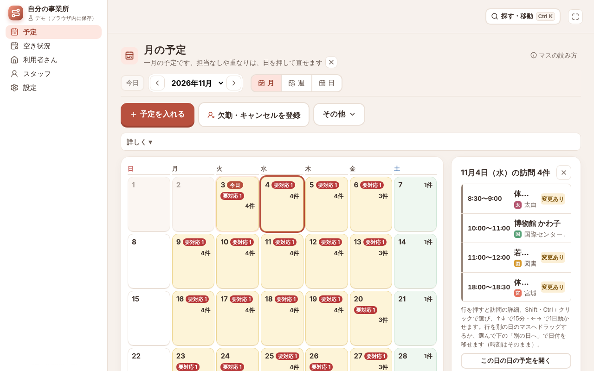

## 予定の見かた

- **月**：1日が1マスです。訪問の件数と、赤い「要対応 N」の札が出ます。マスを押すと、その日の訪問が出ます
- **週**：スタッフごと・利用者さんごとの時間の流れと、スタッフ×曜日の表が出ます
- **日**：担当ごとの列と、地図が出ます。訪問を押すと、移動の時間と、Google マップの道順（ここへ道案内）が出ます。
  その日だけの訪問を足すときは、日の予定の **［訪問を1件足す］** を押します

画面の上の **要対応** の帯に、担当なし・間に合わない・重なり・休みの人が、数で出ます。

- **［見に行く ›］** で、1件ずつ見ていけます
- **［要対応を組む］** で、残りをまとめて組み直します。ほかの訪問は動かしません

手で担当を替えた訪問にはピンが付きます。そのあとの自動の組みでは、変わりません。

今日から1か月先までの組んだ日は、スタッフに伝えたものとして扱います。
そのあとで担当や時刻が変わった訪問には、黄色い **「変更あり」** の印が付きます。
日の予定の **連絡の一覧** に、連絡が要る人が並びます。連絡したら「連絡した」を押してください。

まちがえて操作したときは、画面の **［元に戻す］** で、ひとつ前に戻せます。

\newpage

# 6. デモ例：サンプルデータで1か月の予定を組む

3章・4章で入れたサンプルデータを使って、次の予定を入れた例です（2026年11月）。

## 6-1 スタッフ（4章で入れる内容）

| スタッフ | 性別 | 勤務する曜日・時間 | 資格（台帳から） | メモ |
|---|---|---|---|---|
| 市民会館 あおば | 女性 | 月〜金 8:00〜18:00 | 介護福祉士 | |
| 図書館 つつじ | 女性 | 月〜金 9:00〜18:00 | 介護職員初任者研修・同行援護従業者養成研修(一般) | 犬が苦手 |
| 国際センター みどり | 女性 | 月〜金 **9:30〜15:00** | 看護師 | 子育て中で朝・夜は入れない |
| 太白区役所 たいはく | 男性 | 月〜金 8:00〜19:00 | 介護福祉士実務者研修・行動援護従業者養成研修 | |
| 宮城野区役所 みやぎの | 男性 | **火〜土** 8:00〜19:00 | ホームヘルパー2級（取得日不明） | 週休2日（日・月） |
| 泉区役所 いずみ | 女性 | 月〜金 9:00〜18:00 | 介護職員初任者研修 | **11/30 で退職** |
| 旧庁舎 むかし | ― | ― | ― | 退社済（休止） |

## 6-2 利用者さんと毎週の訪問

| 利用者さん（区） | 毎週の訪問 | 求めること・相性 |
|---|---|---|
| 博物館 かわ子（青葉区川内） | 月・水・金 10:00 60分 | 必要条件：女性 |
| 天文台 ほしお（青葉区錦ケ丘） | 火 13:00 180分（移動支援） | 必要条件：研修に「同行援護従業者養成研修(一般)」 |
| メディアテーク はる（青葉区春日町） | 土 10:00 240分（移動支援） | |
| 体育館 つよし（太白区富沢） | 月〜金 8:30 30分・18:00 30分 | |
| 動物公園 もも（太白区八木山） | 火・木 14:00 90分 | 相性：図書館 つつじ ×（犬がいる） |
| 若林区役所 わかば（若林区） | 水 11:00 60分 | 希望：女性 |
| 図書館 ふみ（泉区泉中央） | 月・木 15:00 60分 | |

## 6-3 組まれた結果

訪問を入れるたびに「N件の担当を組みました」と出ます。11/3〜12/31 のすべての回に担当が付きました（担当なし 0件）。
はじめの週は、次のとおりです。

| 日 | 時刻 | 利用者さん | 担当 |
|---|---|---|---|
| 11/3（火） | 8:30 | 体育館 つよし | 太白区役所 たいはく |
| 11/3（火） | 13:00〜16:00 | 天文台 ほしお | 図書館 つつじ |
| 11/3（火） | 14:00〜15:30 | 動物公園 もも | 市民会館 あおば |
| 11/3（火） | 18:00 | 体育館 つよし | 宮城野区役所 みやぎの |
| 11/4（水） | 10:00〜11:00 | 博物館 かわ子 | 国際センター みどり |
| 11/4（水） | 11:00〜12:00 | 若林区役所 わかば | 図書館 つつじ |
| 11/5（木） | 15:00〜16:00 | 図書館 ふみ | 泉区役所 いずみ |
| 11/7（土） | 10:00〜14:00 | メディアテーク はる | 宮城野区役所 みやぎの |

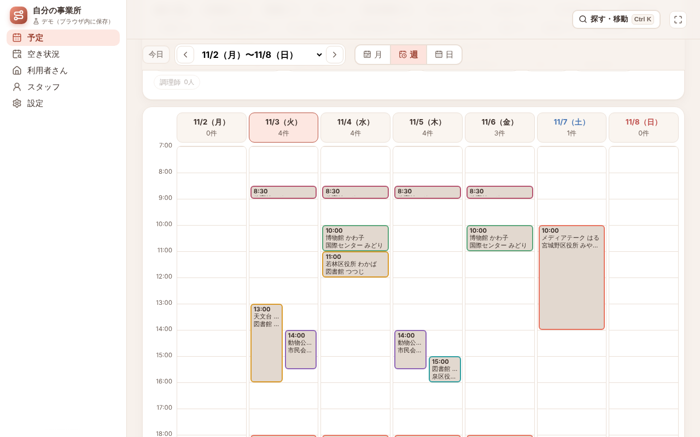

ここを見てください：

- **朝・夜に入れない人**：体育館 つよしさんの朝 8:30・夜 18:00 には、9:30〜15:00 勤務の国際センター みどりさんは入りません。朝は 8:00 から勤務の太白区役所 たいはくさん、夜は 19:00 まで勤務の宮城野区役所 みやぎのさんです
- **性別の希望**：博物館 かわ子さん（必要条件：女性）には、女性の国際センター みどりさん。若林区役所 わかばさん（希望：女性）には、図書館 つつじさん
- **資格**：天文台 ほしおさん（同行援護）には、同行援護の研修を持つ図書館 つつじさんだけが入ります
- **相性**：動物公園 ももさんには、× の図書館 つつじさんは入りません
- **勤務する曜日**：土曜のメディアテーク はるさんは、土曜に勤務する宮城野区役所 みやぎのさん
- **距離**：泉区の図書館 ふみさんは、泉区に住む泉区役所 いずみさん（12月からは 7-3 で振り直します）

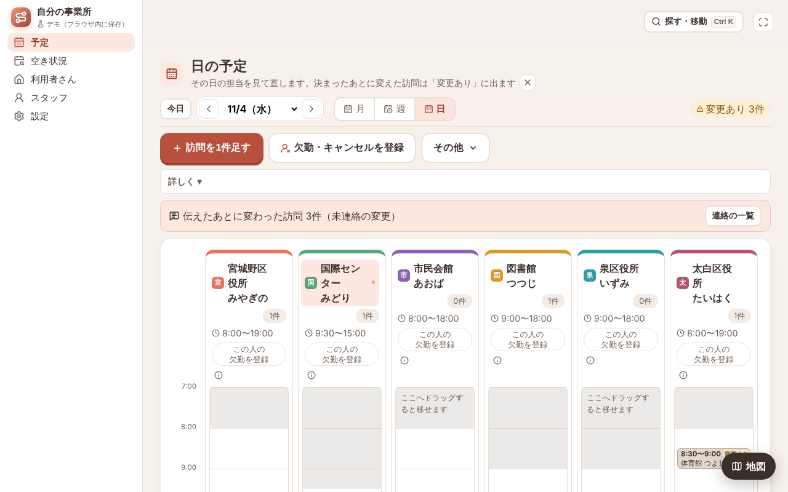

\newpage

# 7. 場面ごとの使い方

## 7-1 スタッフが当日休む（市民会館 あおばさんが 11/3 に休む例）

朝、「熱が出たので休みます」と連絡があったときです。

1. 予定の画面で **［欠勤・キャンセルを登録］** を押します
2. 「休み・キャンセルを選ぶ」で **スタッフが休む** を選びます
3. 休む人と、休む時間（終日・午前だけ・午後だけ・時間帯）を選びます
4. 「入らなくなる訪問 1件」と、おすすめの案が出ます。
   例：「14:00 動物公園 もも　市民会館 あおばさん → 泉区役所 いずみさん」（ほかの人の担当・順番・時刻は変えません）
5. **［この案で決める］** を押します。欠勤の登録と振り直しが、一度に入ります（［振り直す前に戻す］で戻せます）
6. 「変更を伝えて確定する」に、連絡が要る人ごとの文が出ます。**［文をコピー］** を押して、LINE などに貼ります
7. 送ったら「連絡した」に印を付けます。終わったら **［終わる］** を押します

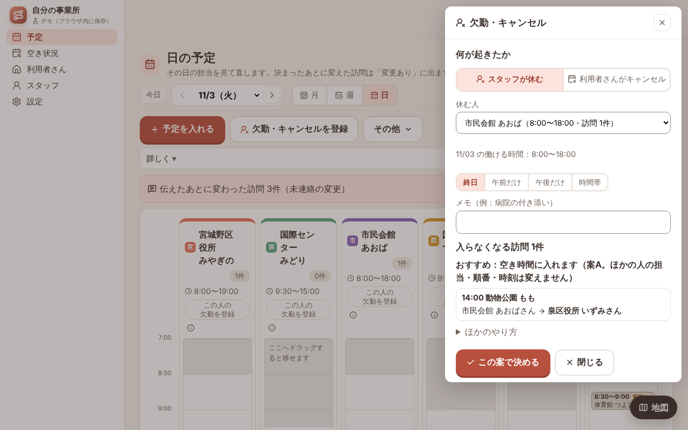

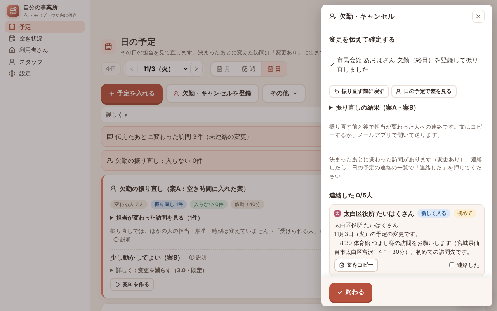

スタッフあての文の例：

```
泉区役所 いずみさん
11月3日（火）の予定の変更です。
・14:00 動物公園 もも様の訪問をお願いします（宮城県仙台市太白区八木山本町1-43・90分）。初めての訪問先です。
```

利用者さんあての文の例（担当の姓と時刻だけを書きます。前の担当や、休む理由は書きません）：

```
動物公園 もも様
いつもお世話になっております。自分の事業所です。
11月3日（火）の訪問について、変更をお知らせいたします。
・14:00の訪問は、担当が泉区役所に代わります。
ご迷惑をおかけして申し訳ございません。どうぞよろしくお願いいたします。
```

「自分の事業所」のところには、事業所の名前が入ります。
初めて伺う利用者さんのときは、「初めて」の印と、その方の決まりごと（入り方・鍵・駐車場・注意）が付きます。

## 7-2 利用者さんが当日キャンセルする

1. **［欠勤・キャンセルを登録］** を押し、**利用者さんがキャンセル** を選びます
2. キャンセルする訪問を選びます
3. 取り消しの種類で **当日キャンセル** を選びます
4. **［当日キャンセルとして取り消す］** を押します

その時間は、担当の予定から外れて空きます。ほかの訪問の担当・順番・時刻は変えません。
当日キャンセルの回数は、月の予定で数えます（請求はアプリではしません）。

LINE でいくつも連絡が届いたときは、予定の「その他 ▾」の **連絡を貼り付けて入れる** に、届いた文を貼ります。
「11/5 図書館 つつじ 休み」「11/6 動物公園 もも キャンセル」のような行を読んで、まとめて入れられます。

## 7-3 スタッフが退職する（泉区役所 いずみさんが 11/30 で退職する例）

1. 職員台帳の退社年月日を読み込むと、最終勤務日に 11/30 が入ります
   （アプリで入れるときは、スタッフの画面の「最終勤務日（退職・担当替え）」で入れます）。
   12/1 からは予定に入らないので、12月の回ははじめから別の人で組まれます
2. スタッフの一覧の上の「最終勤務日のあるスタッフ」の欄に、「振り直しが残っています」と出ます。**［担当の振り直しを開く］** を押します
3. 「利用者さんごとの代わり」に、いずみさんがいつも担当している利用者さん（図書館 ふみさん）と、代わりの候補が出ます。
   候補は、入れる回が多い順・受け持ちが少ない順に並びます
4. 代わりの人を選んで、**［まとめて適用］** を押します
5. 「担当を置き換えますか？」で **［担当を置き換える］** を押します。12/1 からの担当が置き換わります。11/30 までは、そのままです

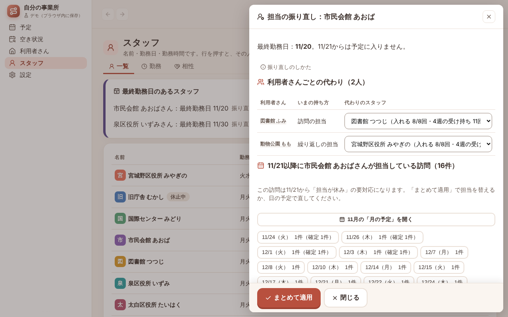

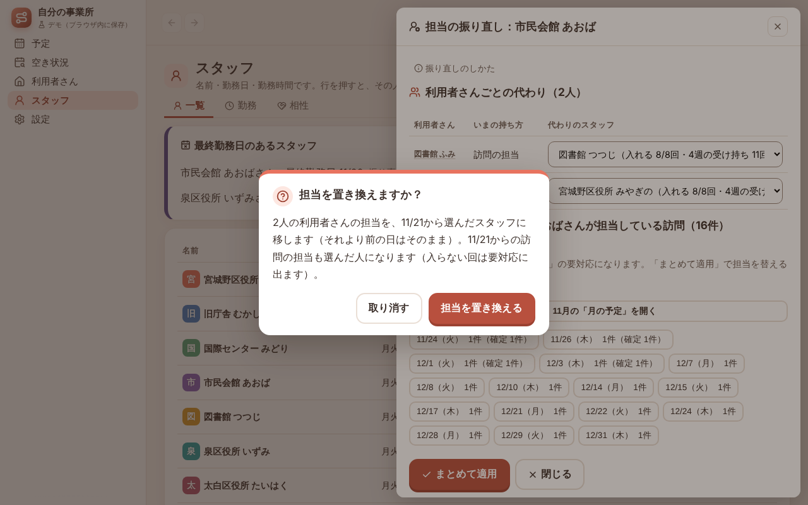

## 7-4 新しい相談（空きの確認）

相談員さんから「火曜か木曜の午前に、60分の身体介護を入れられますか」と聞かれたときです。

1. メニューの **空き状況** を開きます
2. 曜日（火・木）、時間帯（午前）、所要（60分）を選びます
3. 答えのカードに、「受けられます：火・木 8:30〜11:30 に 約1〜6人」のように出ます
4. **［要約をコピー］** を押すと、答えの文をコピーできます。相談員さんへの返事に使えます
5. 「場所」に新しい利用者さんの住所を入れると、移動の時間も入れて計算します
6. 受けるときは、**［仮の利用者さんとして押さえる］** を押します。「仮」の印の利用者さんとして入ります。段階は「相談受付」です（8-3）

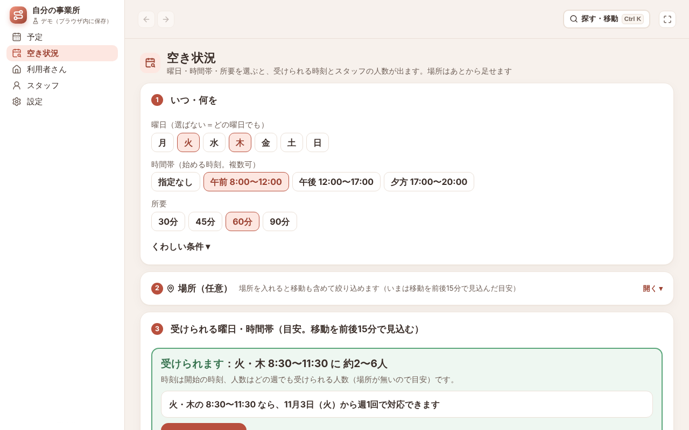

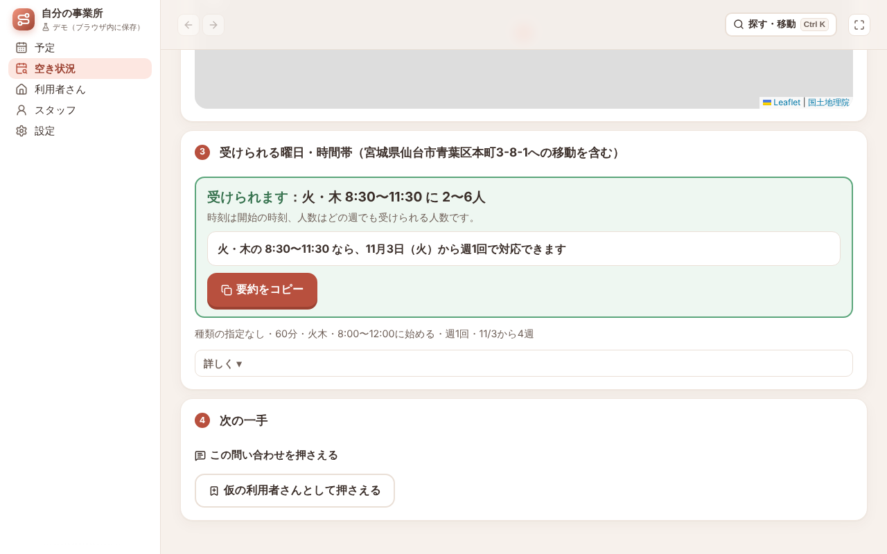

今の4週分の担当のすき間に入るかどうかで見ます。ほかの人の予定は動かしません。

## 7-5 来月の確認

毎月20日を過ぎると、予定の画面の上に「12月の予定 N件はできています・担当なし 2件」のような1行が出ます。

1. **［12月を見る ›］** を押して、来月の予定を開きます
2. 担当なしが残っていれば、**［要対応を組む］** を押して組みます

\newpage

# 8. 勤務・交通費・契約の段階

「定期＋勤務・契約」で足される3つの機能の使い方です。

## 8-1 勤務の見込み（拘束の時間）を見る

ヘルパーさんごとに、月の出勤〜退勤（拘束）の時間を見られます。今の予定から出した見込みです。実際に働いた時間ではありません。

**開き方**

1. 左のメニューの **スタッフ** を開きます
2. 上のタブの **勤務** を押します。「勤務時間（シフト）」の画面が開きます
3. 右上の **［勤務の見込み］** を押します

月の予定の「その他 ▾」の **勤務の見込み** からも開けます。

**見かた**

- 上の ‹ › で月を替えます。**［今月］** で今月に戻ります
- 「月の合計」の表に、スタッフごとに次のものが出ます
  - 日数・訪問の件数
  - 出勤〜退勤（拘束）の時間の合計と、一番長い日
  - 訪問の時間・移動の時間・空き時間（待ち）
  - 自宅との行き帰りの時間・距離・交通費
- 表の名前を押すと、下の表に、その人の日ごとの時間が出ます。日付を押すと、その日の予定が開きます
- **［表をコピー］** を押すと、表をコピーできます。Excel に貼り付けられます

**出勤〜退勤（拘束）の数え方**

- その日の最初の訪問の始まりから、最後の訪問の終わりまでです
- 自宅との行き帰りは入れません（直行直帰のため）
- 移動の時間は、地図の上のまっすぐな距離からの見積もりです

**長すぎる日に気づくには**

「出勤〜退勤（拘束）の上限」に時間を入れておきます（はじめは 10時間）。
上限を超える日があると、表の「上限超え」に日数が出ます。日の予定の上にも、知らせの帯が出ます。
上限は知らせを出すだけで、組み方は変わりません。0 にすると、知らせを出しません。

## 8-2 交通費の見込みを見る

勤務の見込みの画面に、移動の距離から出した交通費が出ます。

- 「交通費の単価」は、はじめ **10 円/km** です
- 単価を変えるときは、数字を入れて Enter を押すか、欄の外を押します
- 0 にすると、交通費を出しません
- 距離には、自宅との行き帰りも入ります
- 距離は、地図の上のまっすぐな距離からの見積もりです。実際の道のりより短めに出ます
- 交通費は、日ごとに「距離 × 単価」を四捨五入して、月で足しています

実際の精算は、これまでどおり事業所の決まりで行ってください。この表は、目安や見直しに使います。

## 8-3 相談から契約までの段階と、紹介元を残す

利用者さんごとに、今どの段階かと、どこからの紹介かを残せます。

段階は次の5つです。

相談受付 → 顔合わせ → 契約 → 利用中 → 終了

予定に入るのは、「利用中」の方と、「仮押さえ」をしている方だけです。

**段階と紹介元を入れる**

1. 利用者さんの画面を開きます
2. 基本情報の **段階と紹介元**（「詳しく ▾」の中）で、**［直す］** を押します
3. 「段階」を選びます
4. 「紹介元」に、相談員さんの事業所などを入れます。連絡先・メールアドレス・メモも入れられます
   （メモの例：返事待ち・顔合わせの日程）
5. **［保存］** を押します

利用中より前の段階（相談受付・顔合わせ・契約）では、「枠を仮押さえする」に印を付けられます。
印を付けると、契約の前でも予定に入れて、担当を組めます。

**空き状況から入れたとき**

7-4 で［仮の利用者さんとして押さえる］を押すと、段階「相談受付」・仮押さえ で入ります。
利用者さんの画面に「仮押さえの利用者さんです」の枠が出ます。

- 決まったら **［本登録にする］** を押します。段階が「利用中」になります
- お断りになったら **［仮押さえを取り消す］** を押します

利用者さんの一覧では、段階の印で、相談中の方と利用中の方を見分けられます。

> 台帳の CSV ファイルから読み込むと、段階は「利用中」か「終了」のどちらかになります（3-1）。
> 相談中の方は、アプリで段階を直してください。

\newpage

# 9. データの控え（バックアップ）

データは、このパソコンのこのソフト（Chrome・Edge）の中にだけあります。

- 別のパソコンや、別のソフトでは見えません
- ソフトの「閲覧データを消す」を行うと、消えてしまいます

そのため、控えのファイルを残してください。

- **設定 › データ** の「控え（バックアップ）」で、**［ファイルに書き出す］** を押します。全部のデータが1つのファイルになります。週に1回くらいを目安にしてください
- 書き出したファイルを「控えのファイル」と呼びます。名前は「staff-assign-demo-」で始まります
- 別のパソコンで続けるときは、その控えのファイルを「読み込む控えのファイル」の **［ファイルを選ぶ］** で読み込みます（今のデータは入れかわります）
- 名簿や控えを読み込む前のデータは、1つだけ自動で控えます。**［直前の状態に戻す］** で戻せます
- まちがえて操作したときは、**［元に戻す］** で、ひとつ前に戻せます（50回分まで）

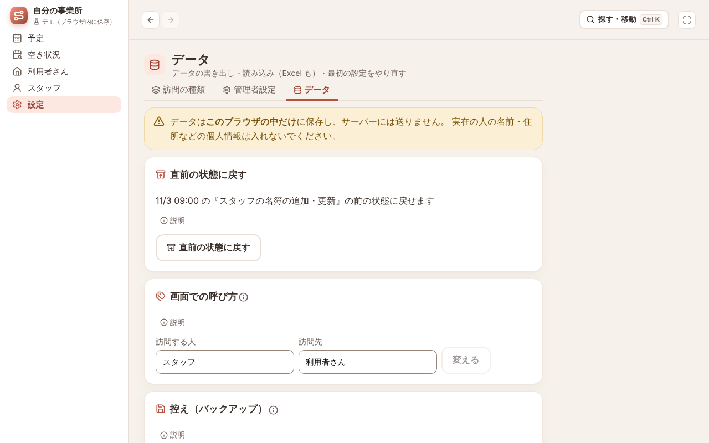

# 10. このアプリでできないこと

このデモ版は、「だれが・どの順で行くか」を組むことに絞っています。次のことはしません。

- 請求（国保連・移動支援の市町村ごとの明細）、利用者負担の集金の管理、キャンセル料の請求
- 勤怠・打刻（入ります／終わりました）、実際に働いた時間・休憩の記録。勤務の見込み（8-1）は予定からの見込みで、記録ではありません
- 交通費の精算（8-2 は見込みです）
- 実績記録票・利用者さんのサイン
- LINE・Google カレンダーとのつながり、連絡の文を自動で送ること（コピーするところまでです）
- ログイン・何台ものパソコンでの同時の入力・インターネット上への保存
- 相性を自動で覚えること（相性は人が入れます）
- 実際の道のりでの移動時間（移動は、まっすぐな距離からの見積もりです）

請求・勤怠・実績の記録・LINE とのつながりは、本番の開発で考えています。

# 11. よくある質問

**Q. 台帳の CSV ファイルを Excel で開いて保存し直したら、読めなくなりませんか。**
A. 読めます。1行目の列の名前を変えなければ、読み込めます。

**Q. 読み込みで「読めませんでした」と出ました。**
A. 何行目のどの列かが、台帳の列の名前で出ます。その行を直して、もう一度読み込んでください。今のデータは変わっていません。

**Q. 緯度・経度が見つからなかった利用者さんがいます。**
A. 一覧の「位置なし」の行で、［地図で置く］を押して地図の上に置いてください。住所を直したときは、［住所から探す］でもう一度探せます。市区町村の名前が無い住所は、見つからないことがあります（3-1）。

**Q. 地図の位置が無いと、担当は組めませんか。**
A. 組めます。位置の無い人への移動は30分とみて組みます。担当の理由には「利用者さんの位置が未登録（移動は30分とみる）」のように出ます。
その間は、移動の時間・道順・交通費の見込み（8-2）が実際と違います。近さで選べるよう、できるだけ地図に置いてください。

**Q. 自動で組んだ担当を替えたい。**
A. 日の予定か週の予定で、訪問を押します。「担当を変える」か「受けられる人」から選びます。ずっとその人にするときは、利用者さんの画面の繰り返しで、担当を直します。

**Q. 交通費の単価を変えたら、前の月の金額も変わりますか。**
A. 変わります。勤務の見込みは、その時の予定と単価から、毎回計算し直します。残しておきたい月は、［表をコピー］で Excel に貼って残してください。

**Q. 住所や郵便番号は、どこかに送られますか。**
A. 名簿を読み込んだあとと、［地図に置く］［住所を探す］［住所から探す］［続きを探す］などを押したときだけ、住所から地図の場所を探すために、郵便番号と住所を地図の検索に使います。名簿のときは、読み込む前の確かめる画面に「読み込んだあと、住所から地図の位置を探します」と出ます。名前など、ほかのことは送りません。
