# この説明書について

訪問ルートAI は、「どのスタッフが・どの利用者さんへ・いつ」行くかを組むためのアプリです。
ブラウザで開いて使います。インストールやログインはありません。

この説明書では、看護師・リハビリのスタッフ・事務の方に向けて、
利用者さんとスタッフの名簿を入れ、決まった訪問を入れ、毎月の予定と急な変更に対応するまでを順に説明します。

- 公開先：<https://staff-assign-demo.katahimo.com/>
- おすすめの環境：パソコンの Chrome か Edge（横に広い画面）。スマホでも予定を見ることはできます
- 説明に使うデータ：`samples/訪問看護_利用者_サンプル.csv`・`samples/訪問看護_スタッフ_サンプル.csv`
  （人の名前は架空です。住所は仙台市の公共施設、電話番号は使われていない番号です）
- 画面の例は、2026年11月4日（水）に、このサンプルを読み込んで 5章の例の訪問を入れたときのものです。日付や件数は、開いた日とデータで変わります

> **大切なお願い（デモ版について）**
> 入れたデータは、お使いのブラウザの中だけに保存します。サーバーへは送りません。
> ただ、このデモ版はお試しのためのもので、実在の利用者さん・スタッフの名前や住所を入れる前提では作っていません。
> お試しの間は、この説明書のサンプル CSV か、名前・住所を置き換えた CSV をお使いください。

## 目次

1. 困りごとと、このアプリでできること
2. はじめる前に（最初の設定）
3. 利用者さんとスタッフを入れる
4. 名簿のあとに足すこと（職種・訪問の種類・勤務・相性・担当の決まり・訪問先の決まりごと）
5. 決まった訪問を入れる（毎週・第N曜日・曜日ごとの時刻）
6. 毎月の流れ（来月の確認・希望休・月の予定の印刷）
7. 休みと急な変更（利用者さんの休み・振り替え・スタッフの急な休み・当日キャンセル）
8. 新しい依頼への返事（空き状況・空き枠の案内文）
9. 退職・担当替え
10. データの控え
11. このアプリでできないこと
12. よくある質問

\newpage

# 1. 困りごとと、このアプリでできること

お話を伺った困りごとと、このアプリでの対応を並べました。くわしい手順は右の欄の章にあります。

| 困りごと（今のやり方） | このアプリでは | 章 |
|---|---|---|
| 利用者さんは約70名。曜日・時刻が決まっている方も、翌月分を毎月手で入れ直している | 利用者さんごとに「繰り返し」を一度入れると、今日から翌月末までの回が予定に出て、担当も付きます。月が変わっても入れ直しは要りません | 5・6 |
| 月1回、第3日曜・第4日曜などの決まりが、翌月に引き継がれない | 繰り返しで「毎月（第N）」を選び、第何週かを選びます。毎月その日に訪問が出ます | 5 |
| 回によって訪問時刻が違う（ある曜日は15時、別の曜日は9時半） | 繰り返しの「曜日ごとに時刻を変える」で、曜日ごとに開始時刻を入れます | 5 |
| 看護師・PT・OT がそれぞれ担当している | スタッフに資格（看護師・理学療法士・作業療法士など）を入れ、訪問の「種類」で担当できる人を分けます | 4・5 |
| 相性・ベテランの指定・担当を2名に限る・アレルギーへの配慮がある | 相性（× 担当にしない など）、希望（経験年数）、「担当できる人を限る」、訪問先の「注意」の欄で入れておけます。組むときに守ります | 4 |
| 空き枠が見えず、ケアマネジャーさんの「何曜日の何時が空いていますか」に答えられない。10月は新しい依頼が増える | 「空き状況」で曜日・時間帯・所要を選ぶと、受けられる曜日・時刻と人数が出ます。「空き枠の案内文」をコピーして返事に使えます | 8 |
| ワクチン接種や急な休みの振り替えを入れ忘れる。休みの利用者さんに予定が残る | 利用者さんの「休み」に期間を入れると、その間の訪問は「休みのため無し」になります。振り替えは、その回の日時を変えます | 7 |
| スタッフの急な休みのたびに組み直しと連絡に追われる | 「欠勤・キャンセルを登録」で、振り直しの案と、人ごとの連絡文が出ます | 7 |
| 予定・休みを請求ソフト・トークアプリ・紙のカレンダーの3か所に書いている | 予定と休みはこのアプリにまとめます。紙のカレンダーは「月の予定の印刷」で代わりにできます。トークアプリへは連絡文をコピーして貼ります（請求ソフトへの入力は今までどおりです） | 6・7 |
| 鍵の置き場所（キーボックス）・インターホンの押し方・駐車位置をトークアプリで伝えている | 利用者さんごとに「訪問先の決まりごと」（入り方・鍵・駐車場・注意）を書くと、予定の訪問と一緒に出ます | 4 |
| 常勤（月10日休みのシフト）・非常勤の希望休をまとめたい | 月の予定で、スタッフを選んで日のマスを押すと希望休が入ります | 6 |

次のことは、このデモ版ではできません（11章）。

- 訪問記録・計画書・報告書の作成、記録の要約
- レセプト・医療保険の請求の送信、口座振替
- 訪問先への出入りを位置で自動に記録すること

\newpage

# 2. はじめる前に

## 2-1 最初の設定（2つの質問）

初めて開くと「最初の設定」の画面が出ます。

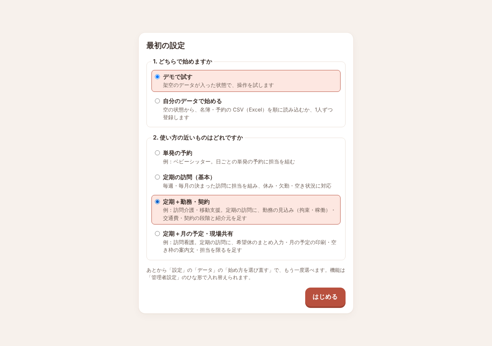

1. 「1. どちらで始めますか」で **自分のデータで始める** を選びます
   （まず動きだけ見たいときは **デモで試す** を選びます。架空のデータが入った状態で始まります）
2. 「2. 使い方の近いものはどれですか」で **定期＋月の予定・現場共有** を選びます
   （「例：訪問看護」と書いてあるものです）
3. **［はじめる］** を押します

「自分のデータで始める」を選ぶと、次に「登録の案内」の画面が開きます（3章）。

画面の呼び方は「利用者さん」「スタッフ」です。左のメニューは
**予定・空き状況・利用者さん・スタッフ・設定** の5つです（スマホでは画面の下に並びます）。

## 2-2 最初から入っている機能

「定期＋月の予定・現場共有」を選ぶと、次の機能が入った状態で始まります。設定を変える必要はありません。

| 機能 | 使う場面 | 章 |
|---|---|---|
| 繰り返し（定期パターン） | 決まった訪問を一度だけ入れる | 5 |
| 毎月の第N曜日・曜日ごとの時刻 | 月1回・第3日曜などの訪問、曜日で時刻が違う訪問 | 5 |
| 利用者さんの休み | 入院・ショートステイなどの期間 | 7 |
| 欠勤・キャンセル | スタッフの急な休み、利用者さんのキャンセル | 7 |
| 空き状況 | 新しい依頼に答える | 8 |
| 相性 | 合う・合わないを組み方に入れる | 4 |
| 担当を限る | 「この方は2人だけで担当する」 | 4 |
| 退職・担当替え | 最後の勤務日と担当の振り直し | 9 |
| 訪問先の決まりごと | 入り方・鍵・駐車場・注意を伝える | 4 |
| 道順のリンク | 訪問先までの道順を Google マップで開く | 5 |
| 郵便番号・住所の検索 | 郵便番号・住所から緯度・経度を探す | 3 |
| 希望休のまとめ入力 | スタッフの希望休を月の予定で入れる | 6 |
| 月の予定の印刷 | 紙のカレンダーの代わり | 6 |
| 空き枠の案内文 | ケアマネジャーさんなどへの返事の文 | 8 |

メールと Excel・CSV の読み込み・書き出しは、どの使い方でもいつも使えます（管理者設定で切れません）。

機能は **設定 › 管理者設定** の「機能の入・切」で1つずつ入・切できます。スイッチを切っても、入れたデータは消えません。画面から隠れるだけです。
管理者設定には、スイッチのほかに次の2つの欄があります。

- **移動時間の見積もり方**：直線距離で見積もるか、車道にそった道のりから見積もるかを選びます（3-1 の③と同じ欄です）
- **メールの予約送信（Google）**：日の予定のメールを事業所の Google のアカウントに預け、訪問の前日の決めた時刻に送ります。使うときは、欄の手順に沿って用意したウェブアプリの URL と合言葉を入れます

## 2-3 前のデータが残っているとき

前にこのアプリを開いたことのあるブラウザでは、前のデータと設定が残っていて、「最初の設定」の画面は出ません。

- **最初からやり直すとき**：**設定 › データ** を開き、一番下の **［最初の設定をやり直す］** を押します。
  確認の画面で **［最初の設定へ戻る］** を押すと、2-1 の2つの質問が出ます。
  今のデータは消えます。残したいときは、先に控えを書き出します（10章）
- **データはそのままで、機能だけそろえるとき**：**設定 › 管理者設定** の「ひな形」で「詳しく ▾」（5つから選んで適用）を開き、
  「定期＋月の予定・現場共有」の **［適用］** を押します。確認の画面でもう一度 **［適用］** を押します

\newpage

# 3. 利用者さんとスタッフを入れる

## 3-1 登録の案内

「自分のデータで始める」を選ぶと、「登録の案内」が開きます。3つの段を順に進みます。上に「1/3」のように今の段が出ます。

1. **① 利用者さんの名簿を読み込む**
   - 名簿の欄がはじめから出ています。**［ファイルを選ぶ］** で名簿のファイルを読み込みます（3-2）
   - 読み込むと、続けて住所から緯度・経度を探します。下に「いま登録されているのは N人です」と出ます。終わったら **［次へ］** を押します
2. **② スタッフの名簿を読み込む**
   - 同じように、スタッフの名簿を読み込みます。スタッフの自宅の緯度・経度も、続けて探します
   - 休みを Google カレンダーに入れているときは、下の **［休みのカレンダーを取り込む］** で、書き出した zip ファイルから休みを取り込めます（7-6）
   - 終わったら **［次へ］** を押します
3. **③ 予定を登録する**
   - 上の「移動時間の見積もり方」で、移動の時間をどう見積もるかを選びます
     - **緯度・経度の直線距離で見積もる**（はじめはこちら）：直線距離に道なり係数を掛け、車の速さで割って見積もります
     - **車道にそった道のりから見積もる**：**［道のりを取得する］** を押すと、道路の所要を取ってきて見積もります。地点の緯度・経度だけを OSRM の公開サーバーに送ります
     - あとから **設定 › 管理者設定** の「移動時間の見積もり方」でも変えられます
   - 予約の CSV ファイルがあれば、ここで読み込めます。無ければ **［予定の画面へ］** を押します。月の予定の画面が開きます（5章）

前の段に戻るときは **［戻る］** を押します。
最初の設定（デモか自分のデータか・使い方）をやり直すときは、下の **［最初の設定をやり直す］** を押します。
案内の途中で人の画面を開いたとき（緯度・経度を直すときなど）は、右上の **［登録の案内へ戻る］** で案内に戻れます。

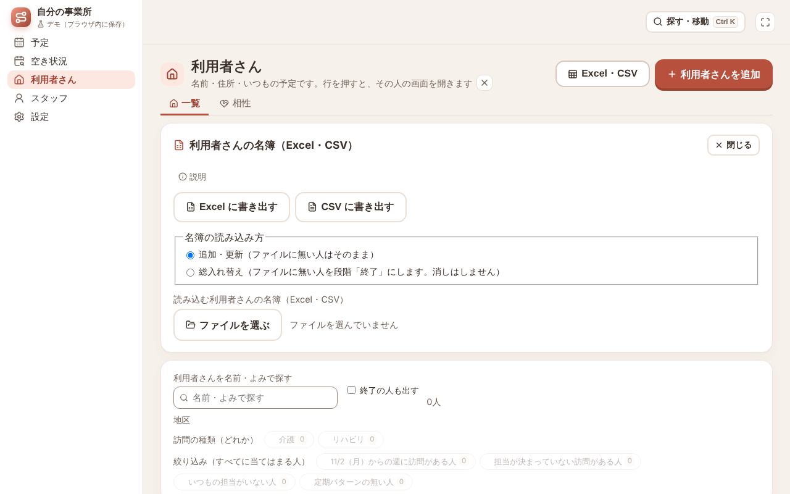

あとから名簿を読み込むときは、左のメニューの **利用者さん**（または **スタッフ**）を開き、右上の **［Excel・CSV］** を押します。同じ欄が開きます。

## 3-2 名簿の CSV を読み込む

> **お知らせ（今の読み方は仮のものです）**
> 事業所でお使いの名簿の CSV の形は、まだいただいていません。そのため今は、次のように読んでいます。
> いただいた名簿の形に合わせて、今後直します。

- 1行目に **氏名**（または「利用者名」「職員名」「名前」など）の列がある CSV なら、1行目の列名を見て読みます
- 読む列：名前・カナ・郵便番号・住所・電話・メールアドレス・性別・退職日
- うまく読めない列や、読まない列は、読み込む前の確認の画面に名前が出ます

手順は次のとおりです。

1. もう人が入っているときは、「名簿の読み込み方」で **追加・更新（ファイルに無い人はそのまま）** を選びます（既定は総入れ替え）。
   まだ1人もいないときは、この選択肢は出ません
2. **［ファイルを選ぶ］** で CSV ファイルを選びます（サンプルなら `訪問看護_利用者_サンプル.csv`）
3. 「利用者さんの名簿を読み込みますか？」の画面が出ます。「列名から読んだ名簿の形の CSV ファイルを読みました。」の文と、読まなかった列（サンプルなら「性別」）、足される人数を確かめます。
   最後に「読み込んだあと、住所から緯度・経度を探します（住所を郵便番号の検索と国土地理院の地図の検索に使います）」と出ます
4. **［名簿を読み込む］** を押します
5. 名簿が入り、続けて住所から緯度・経度を探します。「終わりました：8／8人（入れた 8人・見つからない 0人）」のように出たら終わりです

スタッフの名簿も同じ手順です（サンプルなら `訪問看護_スタッフ_サンプル.csv`）。画面の名前は「スタッフの名簿を読み込みますか？」です。
スタッフの自宅の緯度・経度も、続けて探します（休止の人は探しません。サンプルでは 7人のうち 6人を探します）。

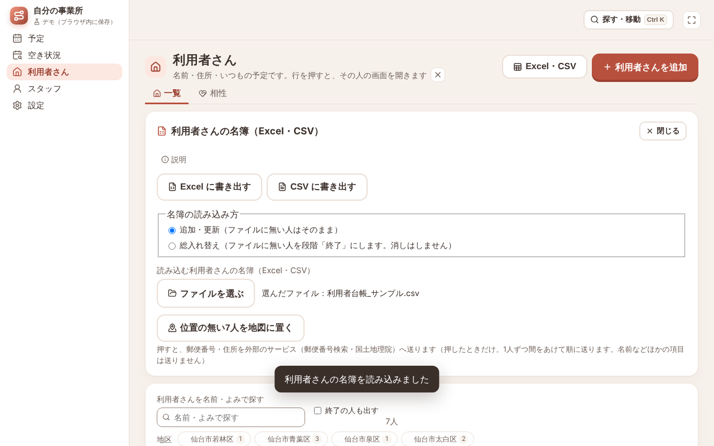

途中で **［止める］** を押したときは、**［続きを探す（N人）］** で続けます。

**緯度・経度が見つからなかった人がいるとき**

緯度・経度が見つからなかった人は、一覧に「緯度・経度なし」の印が付きます。

- 一覧の上の絞り込みの **緯度・経度なし** を押すと、緯度・経度の無い人だけが並びます
- 行の **［住所から探す］** で、その人だけをもう一度探します。住所を直したあとに使います
- 行の **［緯度・経度を編集］** で、その人の画面の住所の欄が開きます。地図を押して入れます

緯度・経度が無いままでも、担当は組めます。そのときは、その人への移動を30分とみて組みます。

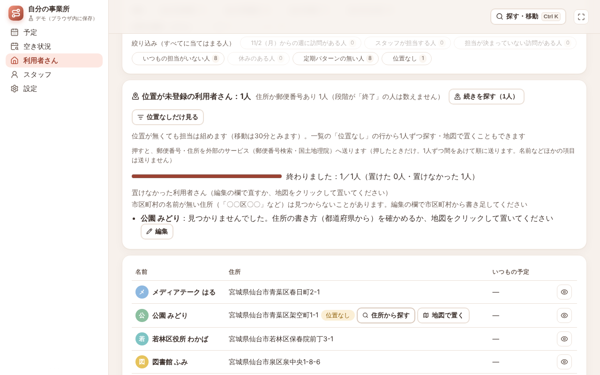

**遠くの利用者さん（移動時間・遠方）**

新幹線で行く方など遠くの利用者さんは、距離から見積もると移動が長くなりすぎて、担当が付きません。

1. 利用者さんの画面の **基本情報** のタブで、「住所」の **［直す］** を押します
2. **移動時間（片道・分。新幹線・飛行機など距離で見積もれないとき）** に、片道の分数を入れます（例：東京へ新幹線なら 120〜180）。その人への行き帰りは、この分数とみます
3. その日、ほかの訪問に回せないときは、**遠方（出張）：この日はほかの訪問を入れない** に印を付けます
4. **［保存］** を押します

遠方（出張）の人の訪問がある日は、担当のスタッフにほかの訪問を入れません。訪問の詳細には「遠方（出張）・移動 片道180分・家を出る目安 7:00」のように出ます。

### 列の読み方

| CSV の列 | 利用者さん | スタッフ |
|---|---|---|
| 氏名 | 名前 | 名前 |
| フリガナ | よみ（ひらがなにして入れます。探すときに使います） | 読みません |
| 性別 | 読みません | 性別（「女」「男」なら、女性・男性として入ります） |
| 郵便番号 | 郵便番号 | 読みません |
| 住所 | 住所 | 自宅の住所 |
| 電話番号 | メモの1行目（「電話 022-…」） | 読みません |
| メールアドレス | ― | メールアドレス（連絡文をメールで開くときに使います） |
| 退職日 | ― | 最終勤務日（9章）。今日より前の日なら「休止」になります |
| 職種など、ほかの列 | 読みません | 読みません |

サンプルのスタッフ CSV では、

- 「宮城野区役所 なつみ」さんは退職日が 2026/11/30 なので、最終勤務日 11/30 が入ります。
  スタッフの一覧の上の「最終勤務日のあるスタッフ」の欄に出ます。予定を入れる前は「振り直すものはありません」と出ます
- 「旧庁舎 いさむ」さんは退職日が 2026/9/30 で過ぎているので、休止で入ります

「職種」の列は読まないので、看護師・理学療法士などは、読み込んだあとに入れます（4-1）。

### 読み直すとき

- 同じ名簿を何度読み込んでもかまいません。**名前** で同じ人を見分け、変わった所だけ直します。新しい人は足します
- 「総入れ替え」を選ぶと、ファイルに無い人を「終了」（利用者さん）・「休止」（スタッフ）にします。人を消すことはありません
- 訪問の予定・担当・相性・勤務時間は、読み直しても変わりません
- 読み込む前のデータは1つだけ控えてあります。まちがえたときは **設定 › データ** の「直前の状態に戻す」で戻せます

## 3-3 アプリの名簿の形（Excel）に書いて読み込む

お手元の名簿がうまく読めないときは、アプリの名簿の形に書き写して読み込む方法もあります。

1. 名簿の欄で **［テンプレートをダウンロード（Excel）］** を押します（CSV がよければ **（CSV）** のほう）。
   もう人が入っているときは、ボタンが **［Excel に書き出す］**（**［CSV に書き出す］**）になります
2. できたファイルを開き、1行目の列名はそのままにして、2行目から1行に1人ずつ書きます
   （利用者さんの名前の列は「表示名」、スタッフの名前の列は「名前」です）
3. 保存して、同じ欄の **［ファイルを選ぶ］** で読み込みます

名前だけ書いても読み込めます。空の列は、決まった値で入ります。

Excel のテンプレートには「書き方」「記入例」のシートが付いています。何を書くかと、書き方の例が見られます（読み込みでは見ません）。

- スタッフ：勤務は月〜金・9:00〜18:00、移動は車、利用中
- 利用者さん：利用中（色は順に付きます）

書き出したファイルの名前は、「staff-assign-demo-」で始まります。

## 3-4 あとから1人足すとき

新しい方が増えたときは、一覧の右上の **［利用者さんを追加］**（**［スタッフを追加］**）を押し、名前と住所を入れて保存します。

\newpage

# 4. 名簿のあとに足すこと

名簿には、組むときに使う「職種」「勤務の曜日・時間」「相性」などがありません。アプリで足します。

> 名簿から入ったスタッフは、最初は **月〜金・9:00〜18:00** の勤務になっています。人ごとに直してください。

## 4-1 スタッフの職種（資格）

スタッフの一覧で人を押し、スタッフの画面を開きます。

1. **基本情報** のタブを開き、「詳しく ▾」を開きます
2. 「特性」の **［直す］** を押します
3. **資格** で、看護師・理学療法士・作業療法士・言語聴覚士などに印を付けます
4. **［保存］** を押します

性別も、同じ「特性」の **性別** で直せます。

資格の選択肢は、最初は 介護福祉士・看護師・保育士・初任者研修・理学療法士・作業療法士・言語聴覚士 の7つです。**准看護師はありません。**
准看護師など、ほかの資格を足すときは次のとおりにします。

1. **設定 › 管理者設定** の「上級（組み方の調整）」で、**エキスパート機能（条件の重み・案を比べる）** と **条件の重みとプリセット** を入にします
2. **設定 › 特性の項目** を開き、「スタッフの項目」の「資格」の行の「選択肢を追加」に **准看護師** と入れて **［追加］** を押します
3. 足し終わったら、2つの機能は切ってかまいません。足した選択肢は残り、スタッフの「特性」で選べます

サンプルの「泉区役所 ともこ」さん（准看護師）は、この手順のあとで資格を入れます。

### 訪問の種類（看護とリハビリ）

訪問には「種類」があります。**設定 › 訪問の種類** で見られます。最初は次の2つです。

| 種類 | 標準の所要 | 担当に必要な条件（資格） |
|---|---|---|
| 介護 | 60分 | 介護福祉士・初任者研修・看護師のどれか |
| リハビリ | 40分 | 理学療法士・作業療法士・言語聴覚士のどれか |

訪問看護では、「介護」の種類を「看護」に直して使うのがおすすめです。

1. **設定 › 訪問の種類** で、「介護」の行の鉛筆のボタンを押します
2. **名前** を「看護」にします
3. 「担当に必要な条件（いつも必須）」の **資格** で、介護福祉士・初任者研修の印を外し、**准看護師** に印を付けます（看護師はそのまま）
4. **［保存］** を押します。一覧の条件が「資格に看護師・准看護師のどれかを含む」になります

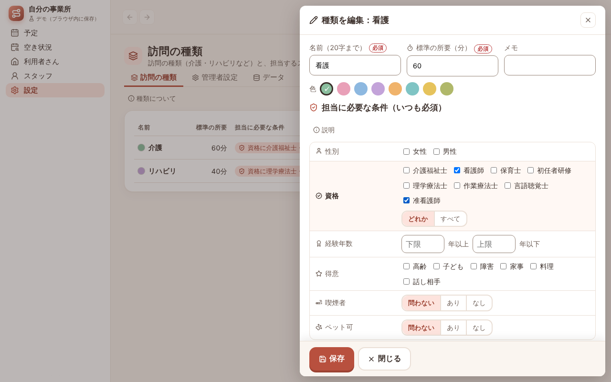

訪問に種類を付けると、条件に合わない人はその訪問の担当になりません（付け方は 5-2）。
この説明書では、ここから先は「看護」に直したものとして書きます。

## 4-2 スタッフの勤務の曜日・時間

スタッフの画面の **勤務時間** のタブを開き、「ふだんの勤務」の **［直す］** を押します。

- **勤務する曜日**：曜日のボタンを押して選びます
- **勤務開始・勤務終了**：この時間の外には組まれません
- 決まった休みの曜日がない常勤の方（月10日休みなど）は、勤務する曜日をふだん働く曜日にしておき、
  休む日は「希望休」として月の予定で入れます（6-2）
- その日だけ時間が違うときは、同じ **勤務時間** のタブの「詳しく ▾」を開き、「日ごとに変えた勤務（これから）」の **［勤務時間（シフト）で直す］** から、その日の時間帯や休みを入れます。
  スタッフの一覧の上の **勤務** のタブからも、同じ「勤務時間（シフト）」の表を開けます

## 4-3 相性・ベテランの指定

利用者さんの画面の **基本情報** のタブで「詳しく ▾」を開くと、「担当」「スタッフに求めること」「相性」があります。

| お話での言い方 | 入れる所 | 組み方 |
|---|---|---|
| この方とこのスタッフは合わない | 「相性」の **［相性の表で直す］** で、そのマスを **× 担当にしない** | その人は担当になりません |
| できれば避けたい | 同じ表で **△ 選ばれにくい** | 選ばれにくくなります |
| このスタッフが合う | 同じ表で **○ やや選ばれやすい** か **◎ 選ばれやすい** | 選ばれやすくなります |
| ベテランを付けたい | 「スタッフに求めること」の **希望** で「経験年数」に年数を入れます（「N年以上」） | 満たす人が選ばれやすくなります |
| 必ず女性のスタッフ | 「スタッフに求めること」の **必要条件** で「性別」を女性に | 満たさない人は担当になりません |

相性の表は、行が利用者さん、列がスタッフです。マスを押すと欄が出るので、印を選びます。
スタッフの「経験年数」は、スタッフの画面の「特性」の **経験年数（開始年）** に、始めた年（西暦）を入れます。

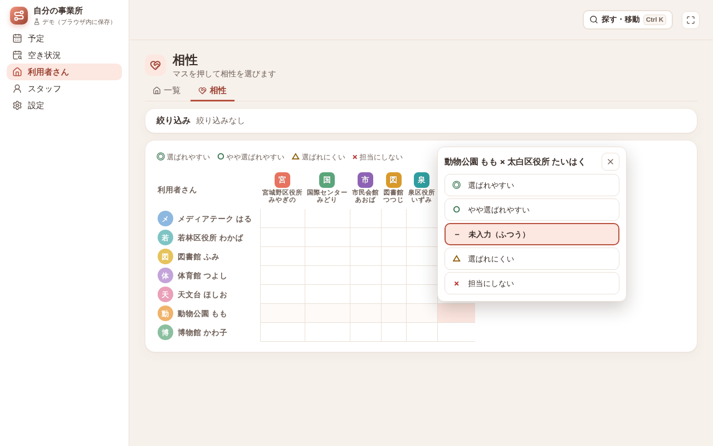

## 4-4 担当を特定の2名に限る

「この方は、この2人だけで担当する」という決まりがあるときです。

1. 利用者さんの画面の **基本情報** のタブで「詳しく ▾」を開き、「担当」の **［直す］** を押します
2. **担当できる人を限る** に印を付けます
3. 「担当できるスタッフ（押して選ぶ・外す）」で、2人を押して選びます
4. **［保存］** を押します

選んだ人のほかは、担当になりません。選んだ人が全員休止になると、だれでも担当できる状態に戻ります。
「いつもの担当」は、ここではなく繰り返しの担当で決めます（5-2）。

## 4-5 アレルギーなどへの配慮

- スタッフにアレルギーがあり、その利用者さんのお宅に行けないとき（ペットなど）は、相性を **× 担当にしない** にします（4-3）
- 訪問するスタッフみんなに知ってほしいこと（利用者さんのアレルギーなど）は、次の「訪問先の決まりごと」の **注意** に書きます

## 4-6 訪問先の決まりごと（鍵・インターホン・駐車位置）

今トークアプリで伝えている、訪問先ごとの決まりごとを書いておく所です。

1. 利用者さんの画面の **基本情報** のタブで「詳しく ▾」を開き、「訪問先の決まりごと」の **［直す］** を押します
2. 4つの欄に書きます（各200文字まで）
   - **入り方**（例：インターホンを押してから玄関へ）
   - **鍵**（例：ポストの中のキーボックス）
   - **駐車場**（例：坂の下の空き地に1台）
   - **注意**（例：玄関の段差が高い）
3. **［保存］** を押します

書いた決まりごとは、スタッフの画面の訪問と、日の予定の訪問に出ます。
初めて伺う訪問先には「初めて」の印が付きます。

> 暗証番号など、外に出てはいけない情報は書かないでください。

\newpage

# 5. 決まった訪問を入れる

曜日・時刻の決まった訪問は、「繰り返し」として一度だけ入れます。
入れると、今日から翌月末までの回が予定に出て、担当が自動で付きます。月が変わっても、入れ直しは要りません。

## 5-1 予定の画面から入れる（毎週・隔週・毎月の第N）

1. 左のメニューの **予定** を開き、月か週の予定で **［定期の予定を追加］** を押します
2. 右の欄で、次を入れます
   - **利用者さん**
   - **曜日**（いくつでも選べます。例：月・木）。はじめは今日の曜日が選ばれています。要らないときは押して外します
   - **くり返し**（毎週・隔週・3週ごと・4週ごと・毎月（第N））。毎月（第N）を選ぶと、「第何週」を選ぶ欄が出ます
   - **開始日**（はじめは今日）・**時刻**・**所要（分）**
3. **［追加］** を押します。今日から翌月の終わりまでの回に担当が付き、「17件の担当を組みました」のように出ます

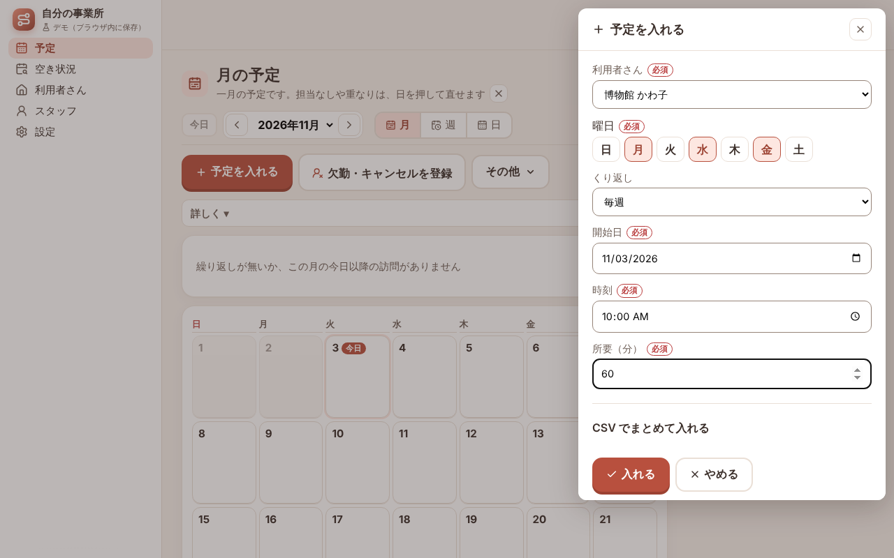

例：

| お話での言い方 | 入れ方 |
|---|---|
| 毎週月曜と木曜の10時に60分 | 曜日：月・木、くり返し：毎週、時刻：10:00、所要：60 |
| 月1回、第3日曜の14時 | 曜日：日、くり返し：毎月（第N）、第何週：第3 |
| 第3・第4日曜 | 曜日：日、くり返し：毎月（第N）、第何週：第3・第4 |

第5を選ぶと、その曜日が5回ある月だけ訪問ができます。

> **［定期の予定を追加］で入れた訪問には、種類が付きません。** 種類が無いと、資格にかかわらず、だれでも担当になれます。
> 看護師だけ・リハビリの職種だけにしたい訪問は、次の 5-2 で種類を選んで入れてください。

## 5-2 利用者さんの画面から入れる（曜日ごとの時刻・種類・いつもの担当）

曜日によって時刻が違う方や、看護とリハビリを分けたい方は、利用者さんの画面から入れます。

1. 利用者さんの画面の **予定** のタブを開き、「繰り返し」の **［繰り返しを追加］** を押します
2. 次を入れます
   - **種類**（看護の訪問なら「看護」、リハビリなら「リハビリ」。種類を選ぶと、所要がその種類の標準の所要になります）
   - **繰り返し**・**曜日**・**開始**・**所要（分）**・**開始日**（終わりが決まっていれば **終了日**）
   - **担当（いつもの担当）**：決まった人がいれば選びます。選ばないときは「担当なし（AI で組む）」のままにします
3. 曜日で時刻が違うときは、**曜日ごとに時刻を変える（例：月曜は 9:30、木曜は 15:00）** に印を付け、曜日ごとの開始を入れます。
   空の曜日は、上の共通の時刻になります
4. **［保存］** を押します。「17件の担当を組みました」のように出ます。いつもの担当を選んだときは「繰り返しを追加しました（担当：市民会館 ゆり）」のように出ます

### 例：サンプルの利用者さんに入れた繰り返し

この説明書の画面の例は、4-1 のとおり資格と種類を入れたあとで、次の繰り返しを入れたものです。

| 利用者さん | 種類 | 繰り返し | 時刻・所要 | いつもの担当 |
|---|---|---|---|---|
| 博物館 しずか | 看護 | 毎週 月・木 | 10:00・60分 | 市民会館 ゆり |
| 天文台 すばる | リハビリ | 毎週 火・金 | 14:00・40分 | ― |
| メディアテーク ひかり | 看護 | 毎週 月・水・金 | 9:30・30分 | ― |
| 体育館 まさる | リハビリ | 毎週 水 | 11:00・40分 | ― |
| 動物公園 さくら | 看護 | 毎月 第3・第4 日 | 14:00・60分 | ― |
| 若林区役所 はるみ | 看護 | 毎週 火・木（曜日ごとの時刻：火 15:00） | 9:30・60分 | ― |
| 図書館 よしこ | 看護 | 毎週 月・水 | 13:00・60分 | ― |
| 科学館 たける | 看護 | 毎週 金 | 10:30・60分 | 宮城野区役所 なつみ |

スタッフの資格は、市民会館 ゆり・図書館 あやめ・宮城野区役所 なつみ が看護師、泉区役所 ともこ が准看護師、国際センター かえで が理学療法士、太白区役所 けんじ が作業療法士です。
動物公園 さくらさんの日曜の回は、日曜に勤務するスタッフがいないので「担当なしのまま 4件（勤務日外 4）」になります（5-5）。

### 続けて足すと「変更あり」が付く

繰り返しを1件ずつ続けて足すと、前に足した分の日は「スタッフに伝えたもの」として扱われます（5-4）。
そのため、あとから足した訪問には「変更あり」の印が付き、月の予定の日のマスに「要対応」「変更あり」の札が出ます。

予定を全部入れて、スタッフに伝えたあとで、日の予定の **［連絡の一覧］** で日ごとに **［連絡した］** を押します。「変更あり」が消えます。

## 5-3 繰り返しを直す・終わらせる

利用者さんの画面の **予定** のタブの「繰り返し」で、直したい行の **［直す］** を押します。
「いつから変えますか」に日付を入れて **［保存］** を押すと、その日からの回が新しい内容になります。それより前の回は変わりません。

## 5-4 予定の見方

- **月**：1日1マスです。訪問の件数と、赤い「要対応 N」・黄色い「変更あり N」の札が出ます。マスを押すと、その日の訪問が出ます
- **週**：「時間軸：スタッフ」「時間軸：利用者さん」「スタッフ×曜日」「利用者さん×曜日」から見方を選べます
- **日**：スタッフごとの列と地図です。訪問を押すと、担当と **［担当を変える］**、**ここへ道案内**（Google マップで道順を開く）が出ます。
  その日だけの訪問を足すときは、**［訪問を1件追加］** を押します
- 日の時間軸には、訪問のあいだの **移動**（「移動 15分」。自宅との行き帰りは「自宅から」「自宅まで」。次の訪問のすぐ前）と、**待ち**（点線の枠で「待ち 20分」）も出ます（間が狭いときは線だけ）。緯度・経度が無い所は「（見込み）」、間に合わない所は三角の印です
- 操作をまちがえたときは、操作の行の矢印のボタン **［元に戻す］** で1つずつ戻せます（隣の **［やり直す］** でやり直せます）

画面の上の **要対応** の帯に、担当なし・間に合わない・重なり・休みの人の訪問の数が出ます（例：「要対応 担当なし 4件・休みの人 1件（担当なしの理由：勤務日外 4）」）。
**［要対応を組む］** を押すと、その分だけ組み直します（ほかの訪問は動かしません）。

担当を手で替えた訪問はピンが付き、あとで自動で組んでも変わりません。

今日から1か月先までの組んだ日は、スタッフに伝えたものとして扱います。
そのあとで担当や時刻が変わった訪問・足した訪問には、黄色い **「変更あり」** の印が付きます。
日の予定の上に「伝えたあとに変わった訪問 N件（未連絡の変更）」と出ます。**［連絡の一覧］** を押すと、連絡が要る人と連絡の文が並びます。連絡したら **［連絡した］** を押してください。「変更あり」が消えます。

## 5-5 担当なしが残ったとき（組めない理由）

担当なしの訪問には、組めない理由が出ます。

- 要対応の帯：「（担当なしの理由：勤務日外 4）」のように、理由ごとの件数
- 組んだあとの知らせ：「担当なしのまま 4件（勤務日外 4）」と **［理由を見る］**
- 日の予定：担当なしの訪問の下に「組めない理由：勤務日外 3人・必須の条件 3人」

**［理由を見る］** か、日の予定で担当なしの訪問を押して **［詳細・変更］** を押すと、訪問の詳細が開きます。上の「組めない理由」の枠に、直し方と、直す画面へのボタンが出ます。
サンプルの動物公園 さくらさん（日曜）なら、「日曜はどのスタッフの勤務日でもありません。」の文と、**［スタッフの勤務する曜日を直す］**・**［その日だけの勤務を足す］** が出ます。

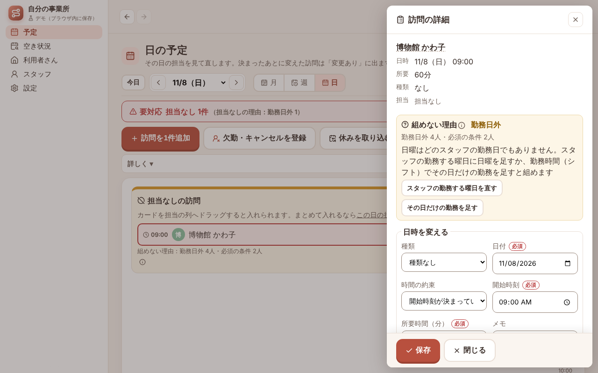

おもな理由と直し方です。

| 理由 | どういうとき | 直し方（枠のボタン） |
|------|--------------|----------------------|
| 勤務日外 | その曜日に勤務するスタッフがいない（土日など） | スタッフの勤務する曜日を足すか、勤務時間（シフト）でその日だけの勤務を足す |
| 勤務時間外 | 勤務の時間に訪問が収まらない（例：勤務 9:00〜18:00、訪問 17:00〜20:00） | 勤務の終わりを 20:00 以降にする（枠に時刻が出ます） |
| 欠勤・最終勤務日の後 | 入れる人が休み・辞めたあと | 勤務時間（シフト）・スタッフの画面で直すか、ほかの人の勤務を足す |
| 担当できる人の限定 | 利用者さんの「担当できる人」で絞った人が入れない | 利用者さんの画面の担当できる人を足す |
| 必須の条件・相性× | 種類の資格・性別などの必須の条件に合う人がいない、相性が × | 種類の条件・利用者さんの条件・スタッフの資格・相性の表を見直す |
| 重なり・1日の上限 | 入れる人は、その時間に別の訪問が入っている | 時間をずらす・人を足す・ほかの訪問を動かす |
| 移動が間に合わない・遠方（出張）の日 | 遠くて、勤務の始めに家を出ても間に合わない | ［移動時間・遠方を設定］で利用者さんの「移動時間（片道・分）」と「遠方（出張）」を入れる（例：東京へ新幹線で行くなら 片道 120〜180分、遠方（出張）に印） |
| 位置なし | 緯度・経度が無く、移動を30分とみると間に合わない | 緯度・経度を入れる |
| 入れられる人あり | 入れられる人はいるが、ほかの訪問との兼ね合いで外れた | 「担当を替える」で選ぶか、もう一度［要対応を組む］ |

\newpage

# 6. 毎月の流れ

## 6-1 来月の予定を確かめる

繰り返しを入れてあれば、来月の訪問はもうできています。手で入れ直す必要はありません。

毎月20日を過ぎると、月の予定の上に「12月の予定 61件はできています」（担当なしがあれば「・担当なし 2件」）のような1行が出ます。

1. **［12月を見る］** を押して、来月の予定を開きます
2. 担当なしが残っていれば、**［要対応を組む］** を押します

## 6-2 希望休をまとめて入れる

常勤の方の月10日休みや、非常勤の方の希望休を、月の予定で入れます。

1. **予定** の **月** を開きます
2. **その他** を押し、**表示を選ぶ（スタッフ・利用者さん・混み具合）** を押します
3. **表示** でスタッフを1人選びます
4. **［休みを追加］** を押します。「（名前）さんの休みを追加：勤務日のマスを押すと、その日を終日の希望休にします。」の帯が出ます
5. 休む日のマスを押します。その日が終日の「希望休」になります。もう一度押すと外れます。帯に「この月の希望休：N日」と出ます
6. 終わったら **［休みの入力を終わる］** を押します

- 勤務の無い日・今日より前の日・ほかの欠勤がある日は押せません
- 希望休にした日に、その人の訪問が入っていると「11/9 を希望休にしました。市民会館 ゆりさんにこの日の訪問が 1件あります。ほかの人に自動で組み直します」と出ます。
  その人の訪問は、ほかの人に自動で組み直します。組み直した訪問は「変更あり」になるので、日の予定の［連絡の一覧］で伝えます（5-4）

## 6-3 月の予定を印刷する（紙のカレンダーの代わり）

1. **予定** の **月** を開き、**その他** の **印刷** を押します
2. 印刷の画面で、月と **スタッフ**（全員か1人）を選びます
3. **［印刷する］** を押します。A4横で印刷します（ブラウザの印刷の設定で「横」を選んでください）。**［月の予定に戻る］** で月の予定に戻ります

印刷には、日ごとに時刻・利用者さん・担当が並びます。日の「確」は確定（伝えた）日、「未」はまだ確定していない日です。休みの印は次のとおりです。

| 印 | 意味 |
|---|---|
| 希 | スタッフの希望休 |
| 欠 | スタッフの欠勤 |
| 利用者さん休 | 利用者さんの休み |

事務所に貼るカレンダーや、スタッフに渡す1人分の予定表に使えます。

\newpage

# 7. 休みと急な変更

## 7-1 利用者さんの休み（入院・ショートステイなど）

1. 利用者さんの画面の **休み** のタブを開き、**［休みを追加］** を押します
2. **開始日**・**終了日**・**理由（任意）**（例：入院）を入れます
3. **［保存］** を押します

休みの間の訪問は、消さずに「休みのため無し」になり、担当も付きません。休みの利用者さんに予定が残ることはありません。
退院の日が変わったら、休みの行の **［直す］** で終了日を直します。休みを消すと、元の予定に戻ります。

> 休みを入れても、訪問を別の日に振り替えることはしません。振り替えるときは、次の 7-2 のとおりにします。

## 7-2 1回だけ別の日にする（ワクチン接種などの振り替え）

1. 予定の画面（月・週・日）か、利用者さんの画面の予定で、振り替える訪問を押します（日の予定では、押したあと **［詳細・変更］** を押します）
2. 「日時を変える」で、**日付** と開始時刻を新しい日に直します
3. 「変える範囲（繰り返しの回です）」で **この回だけ** を選んで **［保存］** を押します

ほかの回は変わりません。新しい日の担当が合わないときは、同じ欄の「担当を替える」で選びます。

## 7-3 スタッフが急に休む（市民会館 ゆりさんが 11/12 に休む例）

朝、「熱が出たので休みます」と連絡があったときです。

1. 日の予定で 11/12 を開き、**［欠勤・キャンセルを登録］** を押します
2. 「休み・キャンセルを選ぶ」で **スタッフが休む** を選びます
3. 「休む人」で **市民会館 ゆり** を選び、時間（**終日**・**午前だけ**・**午後だけ**・**時間帯**）を選びます
4. 「入らなくなる訪問 1件」と、おすすめの振り直しが出ます。
   例：「おすすめ：空き時間に入れます（案A。ほかの人の担当・順番・時刻は変えません）」「10:00 博物館 しずか　市民会館 ゆりさん → 図書館 あやめさん」
   ほかの案は **ほかのやり方** を開くと見られます（［案B も作る］・［欠勤だけ登録（振り直さない）］）
5. **［この案で決める］** を押します。欠勤の登録と振り直しが一度に入ります
6. 「変更を伝えて確定する」に切り替わり、連絡が要る人ごとの文が出ます（担当が外れる人・新しく入る人・利用者さん）。
   **［文をコピー］** を押してトークアプリに貼るか、**［メール］** でメールアプリを開いて送ります（メールはメールアドレスを入れたスタッフだけ）
   - **［振り直す前に戻す］**：欠勤の登録と振り直しを取り消します
   - **［日の予定で差を見る］**：振り直す前と後の差を、日の予定で見ます
   - **振り直しの結果（案A・案B）**：開くと、決めた振り直し（案A）の中身が出ます。ほかの人の予定を少し動かしてよいときは、**［案B を作る］** で別の案を作れます
7. 送ったら、人ごとの **連絡した** に印を付けます。上に「連絡した 1/3人」のように数が出ます。終わったら **［終わる］** を押します

決まったあとに変わった訪問なので、日の予定では「変更あり」になります。連絡したら、日の予定の［連絡の一覧］でも［連絡した］を押してください。

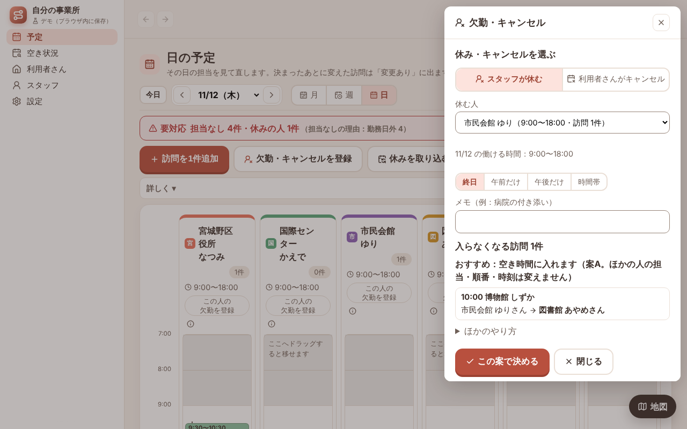

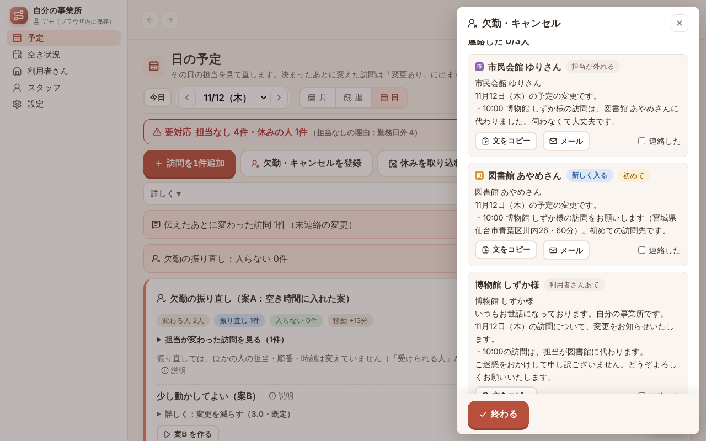

連絡の文には、日付・時刻・利用者さんのお名前・住所・所要が入ります。新しく入る人あての文の例です。

> 図書館 あやめさん
> 11月12日（木）の予定の変更です。
> ・10:00 博物館 しずか様の訪問をお願いします（宮城県仙台市青葉区川内26・60分）。初めての訪問先です。

担当が外れる人には「・10:00 博物館 しずか様の訪問は、図書館 あやめさんに代わりました。伺わなくて大丈夫です。」の文が出ます。
初めて伺う訪問先のときは「初めて」の印が付き、その方の決まりごと（入り方・鍵・駐車場・注意）を書いてあれば、それも付きます。

## 7-4 利用者さんがキャンセルする

1. **［欠勤・キャンセルを登録］** で **利用者さんがキャンセル** を選び、「訪問」でキャンセルする訪問を選びます
2. 「取り消しの種類」を選びます
   - **当日キャンセル（その日になって利用者さんの都合で取りやめ）**
   - **ふつうの取り消し（前もって決まった休み・予定の変更など）**
3. **［当日キャンセルとして取り消す］**（ふつうの取り消しなら **［取り消す］**）を押します
4. 「変更を伝えて確定する」に、担当だった人あての文（「・14:00 天文台 すばる様の訪問は、中止です（キャンセル）。伺わなくて大丈夫です。」）が出ます（キャンセルした利用者さんあては作りません）。
   7-3 と同じように送って、**連絡した** に印を付け、**［終わる］** を押します

その時間は担当の予定から外れます。ほかの訪問の担当・順番・時刻は変わりません。
当日キャンセルの回数は、月の予定と、利用者さんごとの月の集計に出ます（請求はアプリではしません）。

## 7-5 トークアプリの連絡を貼り付けて入れる

休みやキャンセルの連絡がいくつも届いたときは、予定の画面の **その他** の **連絡を貼り付けて入れる** に文を貼ります。

1. 「連絡の文」に、届いた文を貼ります。1行に 日付・名前・言葉 です（例：「11/12 図書館 あやめ 休み」「11/13 科学館 たける キャンセル」）
2. 「読めた 2行・読めない 0行」と、入れる中身（「11/12（木）図書館 あやめ 終日の欠勤」「11/13（金）科学館 たける 訪問の取り消し」）が出ます。確かめます
3. **［N件を入れる］** を押します

スタッフは 休み・欠勤・希望休（午前・午後・10時から・15時まで も読めます）、利用者さんは 中止・キャンセル・休み を読みます。入院などは「〜12/10」のように終わりの日を書きます。
貼り付けで入れたときは、担当は振り直しません。日の予定で直します。

## 7-6 休みを取り込む（Google カレンダー）

スタッフの休みを Google カレンダーに入れているときは、予定の画面の **［休みを取り込む］** で、まとめて欠勤にできます。

1. Google カレンダーから書き出したファイル（スタッフごとのカレンダーをまとめた .zip。.ics 1つでも可）を用意します
2. **［休みを取り込む］** を押し、「カレンダーのファイル」の **［ファイルを選ぶ］** で選びます
3. カレンダーの名前をスタッフの名前に当て、件名に「休み」などのある予定を、今日から93日分、欠勤にします

当たったスタッフのこの期間の欠勤は、手で入れたものも含めて、カレンダーの内容に入れ替わります。

\newpage

# 8. 新しい依頼への返事（空き状況）

ケアマネジャーさんから「火曜か木曜の午前に、60分の訪問を入れられますか」と聞かれたときです。

1. 左のメニューの **空き状況** を開きます
2. 「1 いつ・何を」で、**曜日**（火・木）、**時間帯**（午前 8:00〜12:00）、**所要**（60分）を押して選びます
3. 「3 受けられる曜日・時間帯」の答えのカードに、「受けられます：火・木 9:30〜11:30 に 約3〜5人」のような答えが出ます。
   その下に「火・木の 9:30〜11:30 なら、11月4日（水）から週1回で対応できます」と出ます。**［要約をコピー］** で、返事の文に使えます
4. 新しい利用者さんの住所が分かっていれば、「2 場所（任意）」の **［開く ▾］** を押して住所を入れ、**［住所から緯度・経度を入れる］** を押します。移動の時間も含めて答えます（「約」が取れます）

今の4週分の担当のすき間に入るかどうかで見ます。ほかの人の予定は動かしません。
看護師だけ・リハビリの職種だけで見たいときは、「1 いつ・何を」の **くわしい条件 ▾** で種類を選びます。

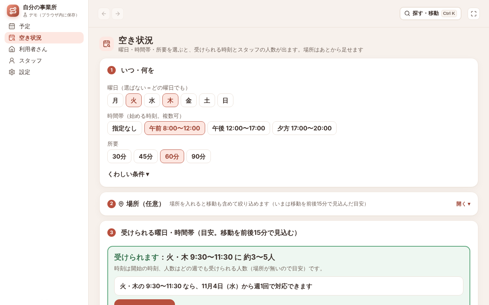

## 8-1 空き枠の案内文を作る

空いている枠を、ケアマネジャーさんや紹介元にまとめて知らせる文を作ります。10月のように依頼が増える時期の返事に使えます。

1. 空き状況の下の **空き枠の案内文** の **［開く ▾］** を押します
2. 案内する期間（**今週**・**来週**・**先4週**）を選びます
3. **種類**（指定なし・看護・リハビリ）を選びます。所要は、指定なしなら「1 いつ・何を」の所要、種類を選べばその種類の標準の所要です
4. できた文を **［案内文をコピー］** でコピーし、メールやトークアプリに貼ります

今週・来週は、日ごとに受けられる開始の時間を載せます。「先4週」は、毎週続けて受けられる曜日・開始の時間を載せます。
案内文は、「1 いつ・何を」で選んだ曜日・時間帯では絞りません（スタッフの条件・場所は上の「1 いつ・何を」「2 場所」のままです）。

先4週の文の例です。

> 自分の事業所です。11/4〜12/1の毎週、続けて60分の訪問をお受けできる開始の時間をご案内します。
> ・月 9:30〜16:30
> ・火 9:30〜16:30
> （中略）
> 開始の時間の目安です（移動の時間などで変わることがあります）。新しい利用者さんのご相談は、お気軽にお問い合わせください。

## 8-2 受ける方向のとき（仮に押さえる）

1. 「4 次の一手」の **［仮の利用者さんとして押さえる］** を押します
2. 右に出る欄で **表示名** を入れます。「次の定期パターン（毎週）で、11/4（水）から押さえます。」と、押さえる曜日と時刻（例：火 9:30 60分）が出ます。
   選んだ曜日・時間帯のうち、週1回・1つの曜日で押さえます
3. **［押さえる］** を押します。「仮」の印の利用者さんとして入り、繰り返しが足されます

予定に入るので、ほかの依頼とぶつかりません。
その利用者さんの画面の **基本情報** のタブ（「詳しく ▾」の中の「段階」）に、「仮押さえの利用者さんです」の枠が出ます。
決まったら **［本登録にする］**、断られたら **［仮押さえを取り消す］** を押します。

\newpage

# 9. 退職・担当替え（宮城野区役所 なつみさんが 11/30 で退職する例）

サンプルのスタッフ CSV では、宮城野区役所 なつみさんの最終勤務日に 11/30 が入っています（3-2）。
5-2 の例では、科学館 たけるさんの金曜の回の「いつもの担当」がなつみさんです。

1. 最終勤務日は、スタッフの画面の **基本情報** のタブの「詳しく ▾」の中の **最終勤務日（退職・担当替え）** で **［直す］** を押して入れます
   （名簿の「退職日」の列から入ることもあります。3-2）
2. その翌日（12/1）からは、その人は予定に入りません
3. スタッフの一覧の上の「最終勤務日のあるスタッフ」の欄に、「振り直しが残っています（利用者さん 1人・担当の訪問 1件）」のように出ます。**［担当の振り直しを開く］** を押します
4. 「担当の振り直し：宮城野区役所 なつみ」の欄が開きます。「利用者さんごとの代わり（1人）」に、なつみさんが担当している利用者さん（科学館 たけるさん。いまの持ち方は「繰り返しの担当」）と、代わりの候補が出ます
5. 候補は「図書館 あやめ（入れる 1/1回・4週の受け持ち 19回）」のように、入れる回が多い順・受け持ちが少ない順に並びます。
   看護の資格が無い人や相性が × の人は「入れる回なし」になります。代わりの人を選びます（だれにもしないときは「（だれにもしない）」）
6. 下の「12/1以降に宮城野区役所 なつみさんが担当している訪問（1件）」に、日ごとの件数が出ます。押すと、その日の予定を開けます
7. **［まとめて適用］** を押し、「担当を置き換えますか？」で **［担当を置き換える］** を押します。
   12/1 からの、いつもの担当・訪問の担当が選んだ人に置き換わります。入らない回は要対応に出ます
8. 振り直しが終わると、「最終勤務日のあるスタッフ」の欄は「振り直すものはありません」になります

最終勤務日までの訪問は、そのままです。
「いまの持ち方」には、ほかに「担当できる人」（利用者さんの担当できる人に入っている）と「訪問の担当」（いつもの担当ではないが、翌日からの回の担当になっている）があります。

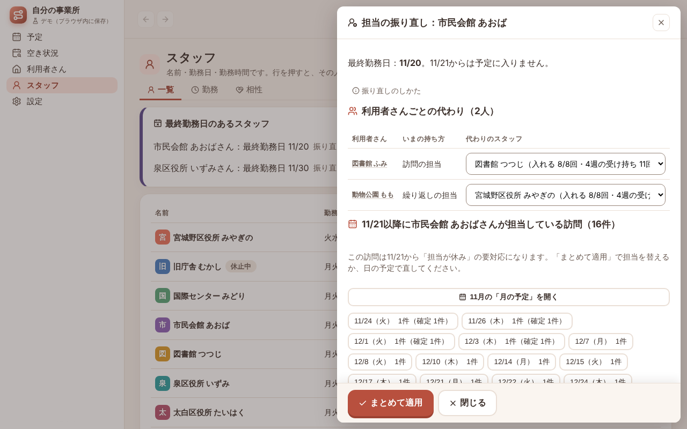

\newpage

# 10. データの控え

データはこのブラウザの中にだけあります。別のパソコン・別のブラウザでは見えません。ブラウザの閲覧データを消すと、消えてしまいます。

- **設定 › データ** の「控え（バックアップ）」の **［ファイルに書き出す］** で、全部のデータを1つのファイルにします。週に1回を目安に書き出してください。
  「最後に書き出した日」も、ここに出ます
- 確定した日があり、2週間以上書き出していないと、開いたときに「控え（バックアップ）を2週間以上書き出していません。データの画面で書き出せます」と出ます
- 書き出したファイルを「控えのファイル」と呼びます。名前は「staff-assign-demo-」で始まります
- 別のパソコンで続けるときは、その控えのファイルを同じ欄の「読み込む控えのファイル」の **［ファイルを選ぶ］** で読み込みます（今のデータは置き換わります）
- 名簿や控えを読み込む前のデータは、1つだけ控えてあります。**［直前の状態に戻す］** で戻せます
- 操作をまちがえたときは、予定の画面の操作の行にある矢印のボタン **［元に戻す］** で1つずつ戻せます（50回分まで。隣の［やり直す］でやり直せます）

# 11. このアプリでできないこと

このデモ版は「だれが・いつ・どの利用者さんへ行くか」を組むことに絞っています。次のことはしません。

- 訪問記録・訪問看護計画書・報告書の作成、記録の要約
- レセプト・医療保険・介護保険の請求の送信、口座振替、利用料の集金
- 今お使いの請求ソフトや、連絡用のトークアプリとのつながり。Google カレンダーは、書き出したファイルから休みを取り込むだけです（7-6）
- 連絡の文を自動で送ること（文をコピーするか、メールアプリで開いて、人が送ります。管理者設定の「メールの予約送信」をつないだときの、日の予定のメールは除きます）
- 訪問先への出入りを、スマホの位置で自動に記録すること
- ログイン、何台ものパソコンでの同時の書き込み、サーバーへの保存
- 渋滞・信号待ちを入れた移動時間。移動時間は、直線距離か、車道にそった道路の所要（管理者設定の「移動時間の見積もり方」）からの見積もりです

請求ソフトへの入力は、今までどおり必要です。

# 12. よくある質問

**Q. 名簿の CSV を読み込んだら「読めませんでした」と出ました。**
A. 何行目のどの列かが出ます。その行を直して、もう一度読み込んでください。今のデータは変わっていません。
1行目に「氏名」などの名前の列が無いと読めません。3-3 のアプリの名簿の形に書き写す方法もあります。

**Q. CSV を表計算ソフトで開いて保存し直しても読めますか。**
A. 読めます。1行目の列名を変えなければ読めます。

**Q. 緯度・経度が見つからなかった利用者さんがいます。**
A. 一覧の「緯度・経度なし」の行で［緯度・経度を編集］を押し、地図を押して入れてください。住所を直したときは、［住所から探す］でもう一度探せます。市区町村の名前が無い住所は見つからないことがあります。

**Q. 緯度・経度が無いと、担当は組めませんか。**
A. 組めます。緯度・経度の無い人への移動は30分とみて組みます。担当の理由には「利用者さんの緯度・経度が未登録（移動は30分とみる）」のように出ます。近さで選べるよう、できるだけ緯度・経度を入れてください。

**Q. 担当なしのまま残る訪問があります。**
A. 要対応の帯の［見に行く］か、組んだあとの知らせの［理由を見る］で開き、「組めない理由」の枠を見てください。理由（勤務日外・勤務時間外・必須の条件・移動が間に合わない など）と直し方、直す画面へのボタンが出ます。遠くの利用者さんは、［移動時間・遠方を設定］から移動時間（片道・分）と遠方（出張）を入れると組めます。

**Q. 准看護師の方が看護の訪問に入りません。**
A. 資格の選択肢に准看護師を足し（4-1）、スタッフの「特性」で准看護師に印を付けます。訪問の種類「看護」の条件にも准看護師を入れてください（4-1「訪問の種類」）。

**Q. 自動で付いた担当を替えたい。**
A. 日の予定で訪問を押し、［担当を変える］を押して選びます。担当なしの訪問は、「担当なしの訪問」の「受けられる人」からも入れられます。ずっとその人にするときは、利用者さんの画面の **予定** のタブの「繰り返し」で［直す］を押し、「担当（いつもの担当）」を替えます。

**Q. 翌月の分は、いつ入れればよいですか。**
A. 入れる必要はありません。繰り返しがあれば、来月の訪問はできています。毎月20日を過ぎたら、6-1 のとおり来月の担当なしだけ確かめてください。

**Q. 住所や郵便番号は、どこかに送られますか。**
A. 名簿を読み込んだあとと、［住所から緯度・経度を入れる］［住所を探す］［住所から探す］［続きを探す］などを押したときだけ、郵便番号・住所を、郵便番号の検索と国土地理院へ送ります。ボタンの近くには「緯度・経度は国土地理院、住所は郵便番号検索のサイトで調べます（押したときだけ。郵便番号・住所のみ送信）」と出ます。名簿のときは、読み込む前の確認の画面に「読み込んだあと、住所から緯度・経度を探します（住所を郵便番号の検索と国土地理院の地図の検索に使います）」と出ます。名前などほかのことは送りません。
移動時間の見積もり方で「車道にそった道のりから見積もる」を選んで［道のりを取得する］を押したときは、地点の緯度・経度だけを OSRM の公開サーバーに送ります。
